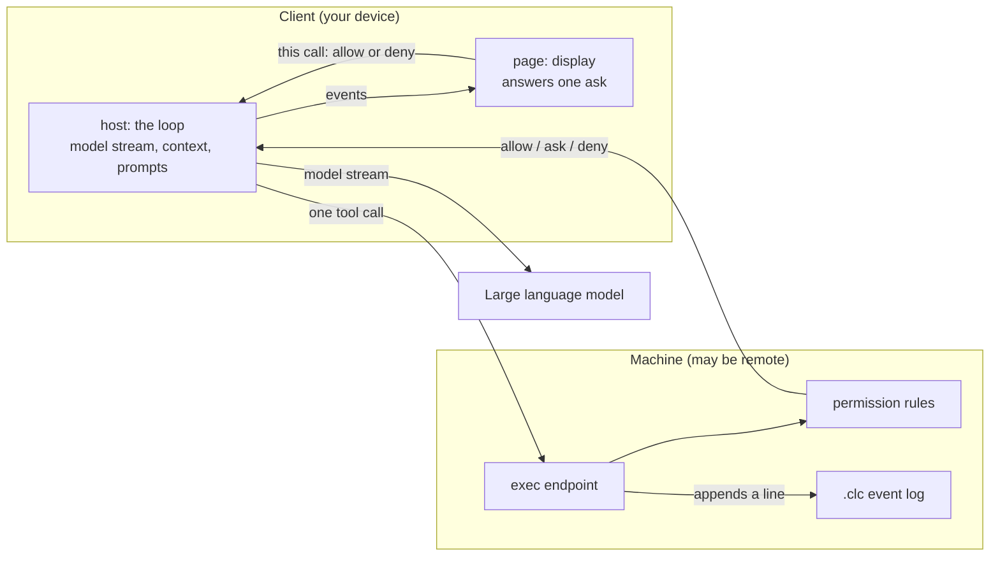

<p align="center">
  
</p>

<p align="center">
  <a href="https://github.com/Ethereal1024/Clutch/blob/master/LICENSE"></a>
  <a href="https://github.com/Ethereal1024/Clutch/releases/latest"></a>
  <a href="https://github.com/Ethereal1024/Clutch/actions/workflows/release.yml"></a>
  <a href="https://github.com/Ethereal1024/Clutch/blob/master/pyproject.toml"></a>
</p>

<p align="center">
  <a href="README.md">English</a> | <a href="README.zh.md">简体中文</a>
</p>

# Clutch

Clutch is a coding agent that runs locally. Given a task description, it calls a
large language model to read and modify files and to run commands in a specified
working directory. The task ends when the model finishes it or a termination
condition is met.

Clutch is available as a desktop application and as an Android application, and it
can work on a remote host over SSH. Models are reached through an
OpenAI-compatible interface, so any service that provides that interface can be
used. The API key is supplied by the user.

## Features

- **Task execution**: the model calls tools over multiple turns. A task ends when the
  model stops calling tools; a maximum turn count and repeated-call detection stop
  unproductive loops.
- **File and command tools**: read, search, write, and edit files, and run commands.
  Commands run inside the working directory and are subject to timeouts and output
  length limits.
- **Web retrieval**: web search and page text extraction. The default search backend
  needs no API key; Tavily or a self-hosted SearXNG instance can be configured
  instead.
- **Project memory**: `grep_memory` and `read_memory` search the project's earlier
  records beyond the current context window, so decisions and constraints survive
  compaction.
- **Skills**: skills are loaded on demand; a skill that is not loaded occupies one
  line of description in the prompt.
- **Project files**: one project is one `.clc` file that holds every record of that
  project; reopening the file restores the conversation.
- **Permission prompts**: deleting files, running privileged commands, or writing
  outside the working directory requires approval.
- **Remote workspaces**: connect to a remote host over SSH and read, write, and run
  commands there.
- **Components**: file, retrieval, skill, and remote-workspace capabilities are
  provided as independent components that can be installed as needed.

## Supported platforms

| Build | Requirements |
| --- | --- |
| Desktop | Linux x86_64 (deb package), macOS Apple Silicon (dmg image), Windows x86_64 (exe installer). The installers bundle their runtime and need neither Python nor Node.js. |
| Android | Android 7.0 or later, arm64-v8a or x86_64. |
| From source | Python 3.8 or later, Node.js, uv. |

## Installation

### Desktop

Download the installer for the target platform from
[GitHub Releases](https://github.com/Ethereal1024/Clutch/releases/latest).

Linux:

```bash
sudo dpkg -i clutch-ui_<version>_amd64.deb
```

macOS (Apple Silicon): download `Clutch-<version>-arm64.dmg`, open it, and drag
`Clutch.app` into `/Applications`. The package is not code-signed, so Gatekeeper
blocks the first launch. The "is damaged and can't be opened" message results from
the quarantine flag together with the missing signature; the file itself is intact.
Clear the quarantine flag to open the application:

```bash
xattr -cr /Applications/Clutch.app
```

If the application still does not open, re-sign it:

```bash
codesign --force --deep --sign - /Applications/Clutch.app
```

Windows: run `Clutch.Setup.<version>.exe`. The package is not code-signed, so
SmartScreen warns on the first run; choose "More info" and then "Run anyway".

### Android

Download `clutch-android-<version>.apk` from Releases and install it manually. The
system must allow installation from this source first.

### From source

```bash
git clone https://github.com/Ethereal1024/Clutch.git
cd Clutch
pip install uv
uv sync                  # the machine side's dependencies
cd ui && npm install     # the client's dependencies
npm start                # start the client; it runs the loop, the machine executes
```

## Configuration

Set the model, the endpoint, and the API key in the application settings, or provide
them through environment variables:

| Variable | Description |
| --- | --- |
| `CLUTCH_API_KEY` | API key for the model service |
| `CLUTCH_BASE_URL` | Endpoint of the model service |
| `CLUTCH_MODEL` | Model name |

The default interface is Chat Completions. If the service also provides a Responses
interface, switch to it in the settings.

The default web search backend needs no API key. Optional backends are enabled by
these environment variables:

| Variable | Description |
| --- | --- |
| `CLUTCH_TAVILY_API_KEY` | Use the Tavily search backend |
| `CLUTCH_SEARXNG_URL` | Use a self-hosted SearXNG instance |

## Usage

1. Start the application and choose Open project or New project on the welcome page
   to open or create a project file. Project files use the `.clc` extension.
2. The working directory of a project is the directory that contains its file.
   Reopening the file resumes from the complete record of that project.
3. Submit a task description in the input box. Tool calls and their results appear in
   the interface as they happen.
4. When a permission request appears, allow or deny it. A denied operation does not
   run, and the model receives the corresponding error message.
5. Install, update, or remove components on the Plugins page in the settings, and set
   the component download mirror on the same page.
6. Check for and install application updates on the About page in the settings.

## Architecture

Clutch is split in two. The **client** runs the loop: the model stream, the conversation
context, compaction, prompts, and tool orchestration. The **machine** only executes: it
runs commands, reads and writes files, decides permissions, and appends the event log. No
code on the machine calls a model, and no code on the client runs a command.

The client is itself two halves. The **host** — the Electron main process on the desktop,
the libnode process inside the app on Android — runs the loop. The **page** is the WebView,
and Android freezes it — timers included — the moment it is not visible. That is why the
loop cannot live there. The page shows events and answers one permission prompt at a time;
it never decides what is allowed.



With a remote workspace, only the exec endpoint and the `.clc` live on the remote host, and
the client reaches them over an SSH tunnel. Model requests leave the client, so the remote
host needs no API key.

Design decisions:

- **The loop keeps no state of its own.** Every step can be derived from the last lines of
  the `.clc`: kill the process, lock the screen, or reopen the window, and the run continues
  from the log instead of from memory.
- Project records are appended to the `.clc` file as events. The model receives only
  the content after the newest compaction; earlier records stay in the file and can
  be searched on demand.
- **There is one implementation of judgement**: the machine evaluates the permission rules
  (`agent/core/permission.py`), and the page only answers the one ask in front of the user.
- Tool results and error messages are returned to the loop, which uses them to choose its
  next step. A tool's component declares its name, arguments, execution method, and how the
  interface shows it, so installing one teaches both halves without touching code.
- Permissions are decided by a rule table: routine operations inside the working
  directory are allowed by default, while file deletion, privilege escalation, and
  writes outside the working directory require approval.

## Components

File operations, web retrieval, the skill library, and remote workspaces are provided
as independent components and are not bundled with the main program. The component's own
declaration decides where it is held: this client, or the machine the session's commands run
on. Local use and remote-workspace use can therefore require separate installations. The
Plugins page in the settings lists the available components, their installation state, and
their sources.

The available components come from the market index the release publishes. Each row
names a component's release manifest and pins that manifest's digest. The manifest in
turn pins the artifact for each platform, and the target machine downloads the component
files itself and checks them against those digests. The application reads that index
once; if it cannot be read, the page says why and offers a retry rather than drawing a
remembered copy. Removing a component removes its tools from the tool list and leaves
the remaining functionality unaffected. With no component installed, Clutch still
provides conversation, command execution, and project record search.

To download components through a mirror, fill in Source mirror on the Plugins page, or
set the `CLUTCH_SOURCE_MIRROR` environment variable. The mirror only changes the
download address; component integrity is still checked against the digest in each
component's release manifest.

## Security

- Commands run inside the working directory and are subject to timeouts and output
  length limits.
- File paths are confined to the working directory; access outside it requires
  approval.
- Web fetching rejects loopback and local-network addresses, and re-checks addresses
  after redirects.
- API keys are stored in local application settings or environment variables and are
  never written to the repository.

## Contributing

Submit defect reports and feature requests in
[GitHub Issues](https://github.com/Ethereal1024/Clutch/issues). Before submitting code
changes, confirm that the relevant tests pass.

## License

Clutch is released under the MIT License. See [LICENSE](LICENSE).
