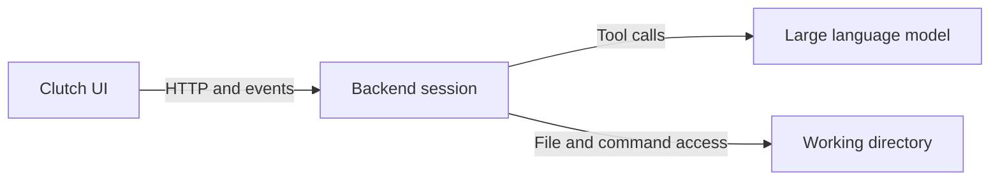
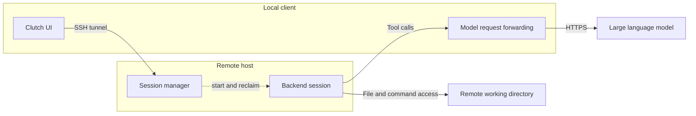

<p align="center">
  
</p>

<p align="center">
  <a href="https://github.com/Ethereal1024/Clutch/blob/master/LICENSE"></a>
  <a href="https://github.com/Ethereal1024/Clutch/releases/latest"></a>
  <a href="https://github.com/Ethereal1024/Clutch/actions/workflows/release.yml"></a>
  <a href="https://github.com/Ethereal1024/Clutch/blob/master/pyproject.toml"></a>
</p>

<p align="center">
  <a href="README.md">English</a> | <a href="README.zh.md">简体中文</a>
</p>

# Clutch

Clutch is a coding agent that runs locally. Given a task description, it calls a
large language model to read and modify files and to run commands in a specified
working directory. The task ends when the model finishes it or a termination
condition is met.

Clutch is available as a desktop application and as an Android application, and it
can work on a remote host over SSH. Models are reached through an
OpenAI-compatible interface, so any service that provides that interface can be
used. The API key is supplied by the user.

## Features

- **Task execution**: the model calls tools over multiple turns. A task ends when the
  model stops calling tools; a maximum turn count and repeated-call detection stop
  unproductive loops.
- **File and command tools**: read, search, write, and edit files, and run commands.
  Commands run inside the working directory and are subject to timeouts and output
  length limits.
- **Web retrieval**: web search and page text extraction. Clutch includes a search
  backend that needs no API key; Tavily or a self-hosted SearXNG instance can be
  configured instead.
- **Project memory**: save, load, and search project facts across sessions.
- **Skills**: skills are loaded on demand; a skill that is not loaded occupies one
  line of description in the prompt.
- **Session files**: one session is one file; reopening the file restores the full
  conversation.
- **Permission prompts**: deleting files or writing outside the working directory
  requires approval.
- **Remote workspaces**: connect to a remote host over SSH and read, write, and run
  commands there.
- **Components**: file, memory, retrieval, skill, and remote-workspace capabilities
  are provided as independent components that can be installed as needed.

## Supported platforms

| Build | Requirements |
| --- | --- |
| Desktop | Linux x86_64 (deb package), macOS Apple Silicon (dmg image), Windows x86_64 (exe installer). The installers bundle their runtime and need neither Python nor Node.js. |
| Android | Android 7.0 or later, arm64-v8a or x86_64. |
| From source | Python 3.10 or later, Node.js, uv. |

## Installation

### Desktop

Download the installer for the target platform from
[GitHub Releases](https://github.com/Ethereal1024/Clutch/releases/latest).

Linux:

```bash
sudo dpkg -i clutch-ui_<version>_amd64.deb
```

macOS (Apple Silicon): download `Clutch-<version>-arm64.dmg`, open it, and drag
`Clutch.app` into `/Applications`. The package is not code-signed, so Gatekeeper
blocks the first launch. The "is damaged and can't be opened" message results from
the quarantine flag together with the missing signature; the file itself is intact.
Clear the quarantine flag to open the application:

```bash
xattr -cr /Applications/Clutch.app
```

If the application still does not open, re-sign it:

```bash
codesign --force --deep --sign - /Applications/Clutch.app
```

Windows: run `Clutch.Setup.<version>.exe`. The package is not code-signed, so
SmartScreen warns on the first run; choose "More info" and then "Run anyway".

### Android

Download `clutch-android-<version>.apk` from Releases and install it manually. The
system must allow installation from this source first.

### From source

```bash
git clone https://github.com/Ethereal1024/Clutch.git
cd Clutch
pip install uv
uv sync                  # backend dependencies
cd ui && npm install     # frontend dependencies
npm start                # start the application; backend sessions start on demand
```

## Configuration

Set the model, the endpoint, and the API key in the application settings, or provide
them through environment variables:

| Variable | Description |
| --- | --- |
| `CLUTCH_API_KEY` | API key for the model service |
| `CLUTCH_BASE_URL` | Endpoint of the model service |
| `CLUTCH_MODEL` | Model name |

The default interface is Chat Completions. If the service also provides a Responses
interface, switch to it in the settings.

The default web search backend needs no configuration. Optional backends are enabled
by these environment variables:

| Variable | Description |
| --- | --- |
| `CLUTCH_TAVILY_API_KEY` | Use the Tavily search backend |
| `CLUTCH_SEARXNG_URL` | Use a self-hosted SearXNG instance |

## Usage

1. Start the application and create or open a session file on the welcome page.
   Session files use the `.clc` extension.
2. The working directory of a session is the directory that contains its file.
   Reopening the file restores the full conversation of that session.
3. Submit a task description in the input box. Tool calls and their results appear in
   the interface as they happen.
4. When a permission request appears, allow or deny it. A denied operation does not
   run, and the model receives the corresponding error message.
5. Install, update, or remove components on the Plugins page in the settings.

## Architecture

Clutch has two layers: an interface and a backend. The interface handles interaction
and event display; the backend handles model calls, tool execution, and session state.
The two communicate over HTTP endpoints and server-sent events. Each window
corresponds to one backend session, and closing the window ends that session.



With a remote workspace, the backend runs on the remote host, and the interface
reaches it over an SSH tunnel. Model requests are forwarded by the local client, so
the remote host needs no API key.



Design decisions:

- Session state derives from an event log: conversation history and the interface are
  generated from the same event sequence.
- Tool results and error messages are returned to the model, which uses them to adjust
  its next steps.
- Tool names, arguments, execution methods, and their display in the interface are
  declared by components; the client contains no tool implementation of its own.
- Permissions are decided by a rule table: routine operations inside the working
  directory are allowed by default, while file deletion and writes outside the
  working directory require approval.

## Components

File operations, project memory, web retrieval, the skill library, and remote
workspaces are provided as independent components and are not bundled with the main
program. Components are installed on the machine that runs the backend, so local use
and remote-workspace use require separate installations. The Plugins page in the
settings lists the available components, their installation state, and their sources.

Component sources default to the source list built into the application, and each
source points to the release of that component. Users can add custom sources, or
register a component stored in a local directory. Removing a component removes
its tools from the tool list and leaves the remaining functionality unaffected. With
no component installed, Clutch provides conversation only.

To download components through a mirror, set the `CLUTCH_SOURCE_MIRROR` environment
variable. The mirror only carries files; component integrity is still verified against
the digests in each component's own release.

## Security

- Commands run inside the working directory and are subject to timeouts and output
  length limits.
- File paths are confined to the working directory; access outside it requires
  approval.
- Web fetching validates the target address and rejects private addresses and
  redirects to them.
- API keys are stored in local application settings or environment variables and are
  never written to the repository.

## Contributing

Submit defect reports and feature requests in
[GitHub Issues](https://github.com/Ethereal1024/Clutch/issues). Before submitting code
changes, confirm that the relevant tests pass.

## License

Clutch is released under the MIT License. See [LICENSE](LICENSE).
