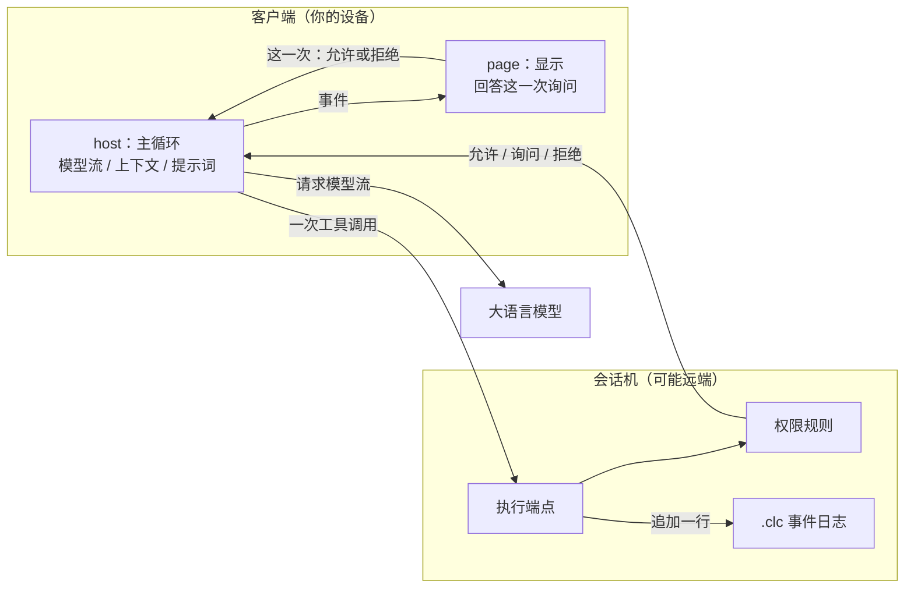

<p align="center">
  
</p>

<p align="center">
  <a href="https://github.com/Ethereal1024/Clutch/blob/master/LICENSE"></a>
  <a href="https://github.com/Ethereal1024/Clutch/releases/latest"></a>
  <a href="https://github.com/Ethereal1024/Clutch/actions/workflows/release.yml"></a>
  <a href="https://github.com/Ethereal1024/Clutch/blob/master/pyproject.toml"></a>
</p>

<p align="center">
  <a href="README.md">English</a> | <a href="README.zh.md">简体中文</a>
</p>

# Clutch

Clutch 是一个本地运行的编程智能体（coding agent）。用户提交任务描述后，Clutch 调用
大语言模型，在指定的工作目录中读取与修改文件、执行命令，直至模型结束任务或满足终止
条件。

Clutch 提供桌面应用与 Android 应用，并支持通过 SSH 在远端主机上工作。模型通过兼容
OpenAI 的接口接入，可使用任何提供该接口的服务，API 密钥由用户自行提供。

## 功能

- **任务执行**：模型在多轮循环中调用工具；模型不再调用工具时任务结束，最大轮数与重复
  调用检测用于终止无效循环。
- **文件与命令工具**：读取、检索、写入与编辑文件，执行命令。命令在工作目录内运行，受
  超时与输出长度限制。
- **网络检索**：网页搜索与正文抓取。默认搜索后端无需密钥，也可配置 Tavily 或自建
  SearXNG。
- **项目记忆**：模型可用 `grep_memory` 与 `read_memory` 检索当前上下文窗口之外的早期
  记录，项目中的决定与约束不因对话压缩而丢失。
- **技能**：技能按需加载，未加载的技能只占用提示中的一行描述。
- **项目文件**：一个项目对应一个 `.clc` 文件，保存该项目的全部记录，重新打开即恢复
  对话。
- **权限确认**：删除文件、提权命令与写入工作目录之外等操作需要人工确认。
- **远程工作区**：通过 SSH 连接远端主机，在远端读写文件与执行命令。
- **组件化扩展**：文件、检索、技能与远程工作区以独立组件提供，可按需安装。

## 支持的平台

| 版本 | 支持环境 |
| --- | --- |
| 桌面应用 | Linux x86_64（deb 安装包）、macOS Apple Silicon（dmg 磁盘映像）、Windows x86_64（exe 安装程序）。安装包自带运行时，不需要 Python 与 Node.js。 |
| Android 应用 | Android 7.0 及以上，arm64-v8a 或 x86_64。 |
| 从源码运行 | Python 3.8 及以上、Node.js、uv。 |

## 安装

### 桌面应用

从 [GitHub Releases](https://github.com/Ethereal1024/Clutch/releases/latest) 下载对应
平台的安装包。

Linux：

```bash
sudo dpkg -i clutch-ui_<版本>_amd64.deb
```

macOS（Apple Silicon）：下载 `Clutch-<版本>-arm64.dmg`，打开后将 `Clutch.app` 拖入
`/Applications`。安装包未做代码签名，首次启动会被 Gatekeeper 阻止。“已损坏，无法打开”
的提示由隔离标记与缺少签名共同导致，文件本身并未损坏。清除隔离标记后即可打开：

```bash
xattr -cr /Applications/Clutch.app
```

若清除标记后仍无法打开，对应用重新签名：

```bash
codesign --force --deep --sign - /Applications/Clutch.app
```

Windows：运行 `Clutch.Setup.<版本>.exe`。安装包未做代码签名，SmartScreen 首次运行时会
提示“Windows 已保护你的电脑”，依次选择“更多信息”与“仍要运行”。

### Android 应用

从 Releases 下载 `clutch-android-<版本>.apk`（Android 安装包）并手动安装。安装前需要在
系统中允许该来源安装应用。

### 从源码运行

```bash
git clone https://github.com/Ethereal1024/Clutch.git
cd Clutch
pip install uv
uv sync                  # 会话机侧的依赖
cd ui && npm install     # 客户端的依赖
npm start                # 启动客户端：循环在这边跑，会话机只负责执行
```

## 配置

模型、接口地址与 API 密钥在应用的设置中配置，也可通过环境变量提供：

| 环境变量 | 说明 |
| --- | --- |
| `CLUTCH_API_KEY` | 模型服务的密钥 |
| `CLUTCH_BASE_URL` | 模型服务接口地址 |
| `CLUTCH_MODEL` | 模型名称 |

默认使用 Chat Completions 接口；若服务同时提供 Responses 接口，可在设置中切换。

联网检索的默认搜索后端无需密钥，可选后端由以下环境变量启用：

| 环境变量 | 说明 |
| --- | --- |
| `CLUTCH_TAVILY_API_KEY` | 使用 Tavily 搜索后端 |
| `CLUTCH_SEARXNG_URL` | 使用自建 SearXNG 实例 |

## 使用

1. 启动应用，在欢迎页选择 Open project 或 New project，打开或新建一个项目文件，扩展名
   为 `.clc`。
2. 项目的工作目录是该项目文件所在的目录；重新打开文件即从该项目的完整记录继续。
3. 在输入框中提交任务描述。模型调用工具的过程与结果实时显示在界面中。
4. 出现权限确认请求时，选择允许或拒绝。被拒绝的操作不执行，模型会收到对应的错误信息。
5. 在设置的 Plugins 页面安装、更新或卸载组件，并可在同一页面设置组件下载镜像。
6. 在设置的 About 页面检查并安装应用更新。

## 架构

Clutch 分成两半。**客户端**跑主循环：模型流、对话上下文、压缩、提示词、工具编排；
**会话机**只执行：跑命令、读写文件、判定权限、往事件日志里追加行。会话机上没有一行代码在
调模型，客户端上也没有一行在执行命令。

客户端自己又分两半：**host**（桌面是 Electron 主进程，手机是 app 里那个 libnode 进程）跑
主循环；**page** 是 WebView，它一不可见就被冻结（Android 会把 WebView 和它的定时器一起挂
起），所以循环不能住在那里。page 只显示事件、只回答眼前那一条权限询问，判定不在它手里。



使用远程工作区时，远端只有执行端点与 `.clc`，客户端经 SSH 隧道连它。模型请求从客户端发
出，所以远端机器不需要密钥。

设计要点：

- **循环没有自己的内存态**：每一步都能从 `.clc` 的最后几行推出来。杀进程、锁屏、重开窗
  口，都是接着日志跑，而不是接着内存跑。
- 项目记录以事件为单位追加写入 `.clc`。模型只接收最近一次对话压缩之后的内容，更早的
  记录保留在文件中，可按需检索。
- **判定只有一个实现**：权限规则在会话机上判（`agent/core/permission.py`），page 只回答
  眼前那一条询问。
- 工具的执行结果与错误信息回到循环，由循环决定下一步做什么。工具的名称、参数、执行方式与
  界面显示由它所属的组件声明，所以装一个组件等于同时教会两半，不必改代码。
- 权限由规则表判定：工作目录内的常规操作默认允许，删除文件、提权命令与超出工作目录的
  写入需要确认。

## 组件

文件操作、网络检索、技能库与远程工作区以独立组件的形式提供，不随主程序打包。组件放在
哪里——本客户端，还是会话执行命令的那台机器——由组件自己的声明决定，因此在本地使用与在
远程工作区使用时可能需要分别安装。设置的 Plugins 页面列出可用组件、安装状态与来源。

可用组件来自发布方提供的市场索引。索引逐条指向各组件的发布清单，并固定该清单的摘要；
清单再固定各平台组件的摘要。组件文件由目标机器自行下载，并按清单中的摘要校验。应用
只读取这份索引一次；读不到时页面会说明原因并提供重试，而不是改画一份记住的副本。卸载
组件后，对应工具从工具列表中移除，其余功能不受影响；未安装任何组件时，Clutch 仍提供
对话、运行命令与检索项目记录的能力。

如需通过镜像下载组件，在 Plugins 页面填写 Source mirror，或设置环境变量
`CLUTCH_SOURCE_MIRROR`。镜像只改变下载地址，组件的完整性仍按各组件发布清单中的摘要
校验。

## 安全

- 命令在工作目录内执行，受超时与输出长度限制。
- 文件路径受工作目录约束，越界访问需要人工确认。
- 网页抓取拒绝本机与内网地址，重定向后的地址同样重新校验。
- API 密钥保存在应用本地配置或环境变量中，不写入仓库。

## 参与贡献

缺陷报告与功能建议请提交到 [GitHub Issues](https://github.com/Ethereal1024/Clutch/issues)。
提交代码变更前，请确认相关测试通过。

## 许可证

本项目使用 MIT 许可证，详见 [LICENSE](LICENSE)。
