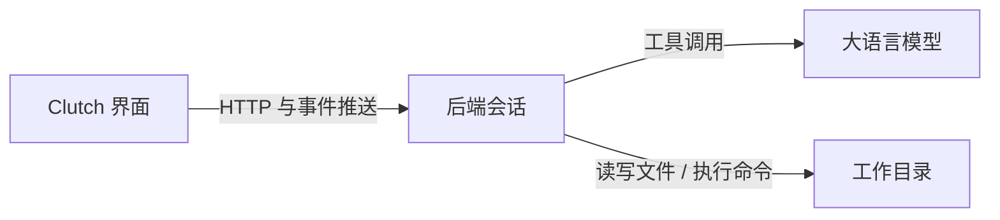
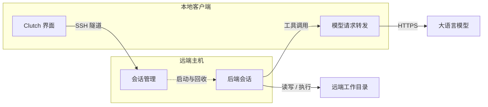

<p align="center">
  
</p>

<p align="center">
  <a href="https://github.com/Ethereal1024/Clutch/blob/master/LICENSE"></a>
  <a href="https://github.com/Ethereal1024/Clutch/releases/latest"></a>
  <a href="https://github.com/Ethereal1024/Clutch/actions/workflows/release.yml"></a>
  <a href="https://github.com/Ethereal1024/Clutch/blob/master/pyproject.toml"></a>
</p>

<p align="center">
  <a href="README.md">English</a> | <a href="README.zh.md">简体中文</a>
</p>

# Clutch

Clutch 是一个本地运行的编程智能体（coding agent）。用户提交任务描述后，Clutch 调用
大语言模型，在指定的工作目录中读取与修改文件、执行命令，直至模型结束任务或满足终止
条件。

Clutch 提供桌面应用与 Android 应用，并支持通过 SSH 在远端主机上工作。模型通过兼容
OpenAI 的接口接入，可使用任何提供该接口的服务，API 密钥由用户自行提供。

## 功能

- **任务执行**：模型在多轮循环中调用工具；模型不再调用工具时任务结束，最大轮数与重复
  调用检测用于终止无效循环。
- **文件与命令工具**：读取、检索、写入与编辑文件，执行命令。命令在工作目录内运行，受
  超时与输出长度限制。
- **网络检索**：网页搜索与正文抓取。内置无需密钥的搜索后端，也可配置 Tavily 或自建
  SearXNG。
- **项目记忆**：跨会话保存、读取与检索项目相关的事实。
- **技能**：技能按需加载，未加载的技能只占用提示中的一行描述。
- **会话文件**：一个会话对应一个文件，重新打开即恢复完整对话。
- **权限确认**：删除文件、写入工作目录之外等操作需要人工确认。
- **远程工作区**：通过 SSH 连接远端主机，在远端读写文件与执行命令。
- **组件化扩展**：文件、记忆、检索、技能与远程工作区以独立组件提供，可按需安装。

## 支持的平台

| 版本 | 支持环境 |
| --- | --- |
| 桌面应用 | Linux x86_64（deb 安装包）、macOS Apple Silicon（dmg 磁盘映像）、Windows x86_64（exe 安装程序）。安装包自带运行时，不需要 Python 与 Node.js。 |
| Android 应用 | Android 7.0 及以上，arm64-v8a 或 x86_64。 |
| 从源码运行 | Python 3.10 及以上、Node.js、uv。 |

## 安装

### 桌面应用

从 [GitHub Releases](https://github.com/Ethereal1024/Clutch/releases/latest) 下载对应
平台的安装包。

Linux：

```bash
sudo dpkg -i clutch-ui_<版本>_amd64.deb
```

macOS（Apple Silicon）：下载 `Clutch-<版本>-arm64.dmg`，打开后将 `Clutch.app` 拖入
`/Applications`。安装包未做代码签名，首次启动会被 Gatekeeper 阻止。“已损坏，无法打开”
的提示由隔离标记与缺少签名共同导致，文件本身并未损坏。清除隔离标记后即可打开：

```bash
xattr -cr /Applications/Clutch.app
```

若清除标记后仍无法打开，对应用重新签名：

```bash
codesign --force --deep --sign - /Applications/Clutch.app
```

Windows：运行 `Clutch.Setup.<版本>.exe`。安装包未做代码签名，SmartScreen 首次运行时会
提示“Windows 已保护你的电脑”，依次选择“更多信息”与“仍要运行”。

### Android 应用

从 Releases 下载 `clutch-android-<版本>.apk`（Android 安装包）并手动安装。安装前需要在
系统中允许该来源安装应用。

### 从源码运行

```bash
git clone https://github.com/Ethereal1024/Clutch.git
cd Clutch
pip install uv
uv sync                  # 后端依赖
cd ui && npm install     # 前端依赖
npm start                # 启动应用，后端会话按需拉起
```

## 配置

模型、接口地址与 API 密钥在应用的设置中配置，也可通过环境变量提供：

| 环境变量 | 说明 |
| --- | --- |
| `CLUTCH_API_KEY` | 模型服务的密钥 |
| `CLUTCH_BASE_URL` | 模型服务接口地址 |
| `CLUTCH_MODEL` | 模型名称 |

默认使用 Chat Completions 接口；若服务同时提供 Responses 接口，可在设置中切换。

联网检索的默认后端无需配置，可选后端由以下环境变量启用：

| 环境变量 | 说明 |
| --- | --- |
| `CLUTCH_TAVILY_API_KEY` | 使用 Tavily 搜索后端 |
| `CLUTCH_SEARXNG_URL` | 使用自建 SearXNG 实例 |

## 使用

1. 启动应用，在欢迎页新建或打开一个会话文件，扩展名为 `.clc`。
2. 会话的工作目录是该文件所在的目录；重新打开文件即恢复该会话的完整对话。
3. 在输入框中提交任务描述。模型调用工具的过程与结果实时显示在界面中。
4. 出现权限确认请求时，选择允许或拒绝。被拒绝的操作不执行，模型会收到对应的错误信息。
5. 在设置的 Plugins 页面安装、更新或卸载组件。

## 架构

Clutch 分为界面层与后端。界面层负责交互与事件显示，后端负责模型调用、工具执行与会话
状态；二者通过 HTTP 接口与服务端事件推送通信。每个窗口对应一个独立的后端会话，窗口
关闭时该会话结束。



使用远程工作区时，后端运行在远端主机，界面与后端之间的连接经 SSH 隧道建立。模型请求由
本地客户端转发，因此远端主机不需要配置密钥。



设计要点：

- 会话状态由事件记录生成：对话历史与界面显示来自同一份事件序列。
- 工具的执行结果与错误信息一并返回模型，供其调整后续操作。
- 工具的名称、参数、执行方式与界面显示由组件声明，客户端不内置工具的具体实现。
- 权限由规则表判定：工作目录内的常规操作默认允许，删除文件与超出工作目录的写入需要
  确认。

## 组件

文件操作、项目记忆、网络检索、技能库与远程工作区以独立组件的形式提供，不随主程序打包。
组件安装在运行后端的那台机器上，因此在本地使用与在远程工作区使用时需要分别安装。设置
的 Plugins 页面列出可用组件、安装状态与来源。

组件来源默认为应用内置的来源列表，每条来源指向该组件自身的发布包。用户可以追加自定义
来源，也可以把本地目录中的组件注册到清单中。卸载组件后，对应工具从工具列表中移除，其余
功能不受影响；未安装任何组件时，Clutch 仅提供对话能力。

如需通过镜像下载组件，设置环境变量 `CLUTCH_SOURCE_MIRROR`。镜像仅提供文件传输，组件的
完整性仍按各组件发布包中的摘要校验。

## 安全

- 命令在工作目录内执行，受超时与输出长度限制。
- 文件路径受工作目录约束，越界访问需要人工确认。
- 网页抓取会校验目标地址，拒绝内网地址与指向内网的重定向。
- API 密钥保存在应用本地配置或环境变量中，不写入仓库。

## 参与贡献

缺陷报告与功能建议请提交到 [GitHub Issues](https://github.com/Ethereal1024/Clutch/issues)。
提交代码变更前，请确认相关测试通过。

## 许可证

本项目使用 MIT 许可证，详见 [LICENSE](LICENSE)。
