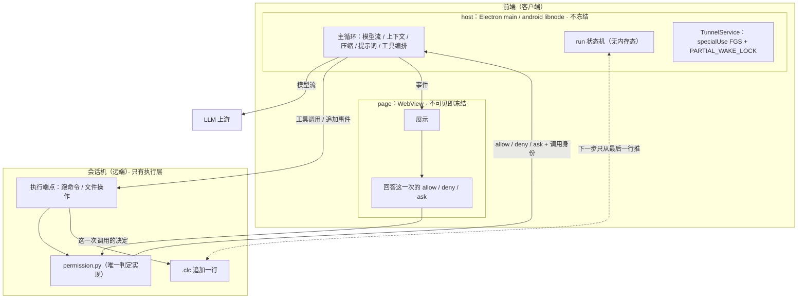

# Clutch 重构 TODO —— 主循环搬到前端，后端只剩执行层

> 本文是这次讨论的结论汇总，取代此前的 `PLUGIN_PLAN.md` / `PLUGIN_UI_PLAN.md` / `COMPONENTS.md` / `DECISIONS.md`（已在 `f811753`、`101d85e`、`5d773cb` 删除）。
> 基线：`HEAD = ca42859`（0.1.66）。工作区里 `M clutch-websearch` 是**用户未提交的 WIP**，不要 stage、不要回滚；`clutch-memory/`、`scanerr.py` 是未跟踪的临时物，不要提交。
> **补记（P-C 之后）**：文档写成之后工作区又往前走了——现在的 `HEAD` 是 `98fd74f`（0.1.69），`M clutch-websearch` 那笔 WIP 已在 P0-6 里按 D7 **整体重写**成前端插件（用户批准的方向，仍然不 stage、不回滚）。本文其余各条保持当时的写法，凡被后来推翻的地方都在条目下面带一条“补记”。

---

## 0. 不变量（任何实现都不能违反）

| # | 规则 | 判据 |
|---|---|---|
| I1 | **前端 = 客户端整体**，含 host（Node 半边）与 page（WebView 半边）。会话机上没有主循环、没有 llm、没有提示词、没有上下文管理 | `tests/exec_layer_test.py`：`agent/` 的第三方 import 是空集，两个入口的可达图上没有模型、没有消息投影器；`agent/prompts/` 只剩机器文本（`unknown_tool.md` / `errors/` / `tools/`），顶层模板已删（P3-2 补记） |
| I2 | **执行只有一个实现**：跑命令、文件操作、权限判定都在执行层；前端只显示、只回传“这一次调用的决定” | `agent/core/permission.py` 是唯一 allow/ask/deny 实现；`ui/js/permissions.js` 无判定逻辑 |
| I3 | **不降级、不兜底、不多版本共存**。出错就报错（写进 `.clc` 给用户看），绝不换一条路悄悄继续 | 全仓搜不到 “fallback / 兜底 / 降级 / 退回” 式的第二条路径 |
| I4 | **同名组件只存在于一侧**：要么前端、要么会话机，不共存 | 市场里没有同名两份；退役形态不残留 |
| I5 | **组件 = 贡献包**（提示词/事实、工具、纯数据/文件）。组件不必须是工具，可以既无工具声明也无调用入口；协议不得强迫每个组件声明并实现调用 | 无工具组件能通过声明校验并安装 |
| I6 | **锁屏不打断**是属性，不是运气：loop 无内存态，每一步可从 `.clc` 最后一行推出 | 杀进程/解冻后接着跑，没有独立的 “resume 功能” |

---

## 1. 术语（本仓固定含义）

| 词 | 含义 | 落点 |
|---|---|---|
| **host** | 客户端上跑 Node 的那一半，**属前端**，不是后端 | 桌面：Electron 主进程（`ui/package.json` `"main":"main.js"` → `ui/main.js`）；手机：app 进程内嵌 libnode（`NodeEngine.kt` `node::Start`）→ `android/host/index.js` → `android-host.js` + `UI_NODE` 那批 `ui/*.js` |
| **page** | 客户端上的 WebView / 渲染进程那一半；不可见即被冻结 | `ui/index.html` + `ui/renderer.js`（一个 bundle：`ui/renderer.modules.json` 里的 25 个模块，源文件 `ui/bridge-shim.js` + `ui/app.js` + `ui/js/*.js` 仍进仓、仍进构建，但页面只加载这一个）+ `ui/version.js`（发布脚本改写的数据文件，单独一个标签） |
| **前端** | host + page，两者都在用户自己设备上 | 同上 |
| **会话机** | 远端，只有执行层 | `agent/` 收缩后剩下的部分 |
| **桥** | page → host 的唯一通道 | 桌面 `ui/preload.js`（`ipcRenderer.invoke`）；手机 `ui/bridge-shim.js` → `127.0.0.1:8899` HTTP+SSE（`android/host/bridge-server.js`） |

判别 host/page 的实操规则：**被 `ui/main.js` 或 `android/host/*.js` 用 `require("./…")` 引的 = host；`ui/renderer.modules.json` 收进 bundle 的、或 `ui/index.html` 直接 `<script src>` 引的 = page。**（目录不能当判据：`ui/app.js` 是页面脚本；它现在被 bundle 收进去，而不是单独一个标签。）

---

## 2. 目标架构



图里 `FGS` 与 host 是同一个框：前台服务保的是**进程**（host 跑在里面），保不了页面——这正是 loop 必须待在 host 的原因。它具体挡住哪些威胁、还缺哪两个信号，见第 9 节（P5）。

---

## 3. 已定决策（不再讨论）

| # | 决策 |
|---|---|
| D1 | 主循环在 **host**（前端里跑 Node 的那一半）。依据：`ui/llm-proxy.js` 已经在 host 里做长连接流式上游请求且手机屏幕关着也能跑；`ui/tunnel-ladder.js:14-19` 已把“策略不能待在会被冻结的那一半”写成规则；页面侧有冻结的实测记录（`ui/js/sse-stream.js:113`、`:140-160`） |
| D2 | `.clc` 写入 = **option A**：前端产出事件，执行层 append 一行 |
| D3 | 权限职责全在执行层；`agent/api/routing.py:78-81` 的 `/api/permission/respond`、`/api/permission/trust` 折进执行端点；`PermissionRequestEvent` 不再是 run 事件 |
| D4 | 近端推送**版本匹配**的后端到远端 → 不存在兼容矩阵 |
| D5 | 组件 ≠ 工具；组件可以没有声明、没有调用 |
| D6 | 手机前台服务类型 `dataSync` → **`specialUse`**（拿掉 6h/24h 上限） |
| D7 | **不做** `BOOT_COMPLETED` 开机自启；保留 `START_STICKY` + `$HOME/tunnel.state` 的用户意图语义 |
| D8 | 前端搜索（websearch）只以前端组件形态存在；cli 形态彻底删除 |
| D9 | 客户端**可以**在会话机上主动卸载已退役组件（P0-7 的前提已批准） |
| D10 | `ui/js/components-panel.js:118-123` 的 exec-bridge 路径**不算**降级 → 保留，不改代码 |
| D11 | Android 的客户端插件域排在**桌面版发布之前**（P1-6 是发布的前置条件，不是发布后的活） |
| D12 | 模型流的 mid-stream 重试**保留**；取代价是“每次重试都必须是 `.clc` 里的一条事实”，不是页面上的 toast |
| D13 | `plugin.md` 不存在，不再查找；HEAD 就是全部，`agent/prompts/*` 与 `README*` 即为文档全集 |
| D14 | 类型闸门 = **JSDoc + 每文件一行 `// @ts-check` + `tsc --noEmit`**，就跑在 `.js` 上：零构建步骤、CommonJS 形状不变、`node tests/*.test.js` 一行不改。**不做** `namespace`，**不做** `tsc --module none` 的逐文件产出（那只是把全局改个名字，契约照旧）。打包器（esbuild IIFE）推迟到 P7-3，前置是 P1-6。P4 要删的代码不打类型。详见 §11 **补记（TS 重写之后已作废）**：host 半现在是 `ui/src/host/*.ts` + `ui/tsconfig.host.json` 编译就地出 `ui/*.js`，逐文件 `// @ts-check` 与 `ui/tsconfig.check.json` 都已删除；闸门从“每文件自愿进门”改成“整个 host 树一个配置”。**补记（渲染器转 TS 之后）**：渲染器也整体 TypeScript——`ui/src/renderer/*.ts`（29 个模块）+ `ui/tsconfig.renderer.json`，esbuild 打成 `ui/renderer.js`，`ui/renderer.modules.json` 删除；`npm run typecheck` 现在跑两份配置，见 §11 P7-3 补记 |

**执行顺序**：P0 → P1-1…P1-6（P1-6 = Android 客户端插件域，发布前必需，已落地）→ P2 → P3 → P4 → P6。P5（手机保活）与 P2–P4 无冲突，可随时并行插入，建议越早越好（它只是原生层的两处小改动，但决定了“锁屏不打断”能不能被验证）。

---

## 4. 阶段一（P0）：契约与不变量，先删后建

> 目标：把“两条路”压成一条。此阶段不改运行行为，只删容忍与兜底，并把声明模型定死。

- [x] **P0-1 声明模型：按能力资产推导落点，删掉 `subject` 推导**
  - `ui/components.js` `destinationOf`：保留 `entry`+`starts` 的**冲突报错**；**删掉** “既无 `service`/`launch` 又无 `entry` ⇒ 报错” 那一条（无工具组件合法）。
  - 落点规则：`service`/`launch` → 会话机；`entry` → 客户端；两者皆无 → 该组件没有进程，只贡献提示词/事实/数据。
  - 已落地：`PLACE_*` 注释重写；`!starts && !what.entry` 现在返回 `PLACE_CLIENT`（不是错误）。Python `client_side` 早已同义，无需改。`tests/components-view.test.js` §13 改为断言“无错误 + 判决函数里不再有 declares-neither 字样”。
- [x] **P0-2 删除旧词容忍**：`agent/tools/catalog.py` 里 `interface` / `runs_on` 被“忽略”的那段改成**报错**；子模块声明里也不得再出现这两个词。
  - 已落地：`RETIRED_WORDS`、`Component.retired`、`_refine` 累积（精化后仍然拒绝）、`component_diagnostics` 为每个退役词发一条 fatal；原先“既无 service 又无 launch ⇒ 请声明 entry”的分支删除（与 P0-1 同一条不变量 I5）。`tests/catalog_test.py` 同步。
- [x] **P0-3 删除市场多级读**：`ui/components.js` 的 远端 → 缓存 → 内置快照 三级链，改为**读一次**，失败就报错 + 重试按钮。（`ui/market.snapshot.json` 保留为“市场索引的产物”，不再是运行时兜底。）
  - 已落地：`SNAPSHOT_FILE` / `INDEX_CACHE` / `originOf` / `cacheIndex` 删除，`readIndex()` 只读一次；`origin`/`note` 整套词汇从前端（`components.js` → `components-view.js` → `components-panel.js`）移除——只有一份索引，没有“哪份列表”可分辨；失败即空列表 + 一条原因 + `#plug-reload` 重试。
  - 快照不再是运行时资产：从 `ui/verify-build-config.js` 资产清单、`ui/electron-builder.yml` 打包、`scripts/sync-android-host.sh` 的 `UI_NODE` 全部移除；`ui/market.snapshot.json` 只作为 `scripts/market_index.py` 的产物/发布源保留。
  - 测试迁移：`tests/market.test.js` §5 改为“一次读 + 失败即报告 + HOME 上什么都没写”；`tests/market-chain.js` 现在回报 `homeFiles`（断言空）；`tests/net-fetch.test.js`、`tests/components.test.js`、`tests/components-view.test.js`、`tests/bridge-server.test.js`（改用 `CLUTCH_SOURCE_MIRROR` 指向假 supervisor，不再伪造缓存文件）同步。
- [x] **P0-4 exec-bridge 路径：保留（已判“不算降级”，见 D10）**：`ui/js/components-panel.js` 的说明与分支原样不动。它服务的是“会话机的组件通道没应答时，工具仍走直连执行”这一事实；注释里已经写清它与组件通道的区别（`an exec bridge is not a component channel`）。本条只需在验收清单里标为“有意保留”，避免后续误删。
  - **有意保留，不改代码。**
- [x] **P0-5 文案去机器化**：`ui/js/components-panel.js` 里 “the machine its declaration names” 与 `README.md` / `README.zh.md` 里 “Components are installed on the machine that runs the backend” 类句子，改成“由声明本身决定”。
  - 已落地：`plugPlaceName` 的未知落点改为 “the place its declaration names”（句子仍是名词短语，`from/on …` 都读得通）；两处注释改成“place”词汇；`README.md` §Components 与 `README.zh.md` §组件 改为“由组件自己的声明决定”，并把“远端→缓存→快照”的旧读法改成“只读一次、失败即报错 + 重试”。
- [x] **P0-6 删除 websearch 的 cli 形态**
  - 子模块 `clutch-websearch/`：`websearch.py`、根 `component.json`（`interface:"cli"`、`launch`→`websearch.py`）、`pyproject.toml`、`tests/test_websearch.py`、`tests/conftest.py`、`tests/stub_server.py`。
  - `plugin/component.json`：`clutch-websearch-client` → `clutch-websearch`，去掉 `interface` / `runs_on`。
  - 主仓：`agent/config.py:90-99`（`web_search_timeout` / `web_search_max_results` / `tavily_api_key` / `searxng_url`）、`agent/tools/catalog.py:640-641`、`README.md:128-129`、`README.zh.md:112-113`。
  - ⚠ `M clutch-websearch` 是用户 WIP：改之前先确认，改完不要 stage。
  - **已落地（D7：整体重写成前端形态，不留兼容层、不留 Python 引擎）**：
    - 子模块只剩插件：`plugin/{component.json,index.js,http.js,html.js,backends.js}`——引擎链（tavily→searxng→bing RSS→ddg HTML）是真 JS 移植，含相关性守卫、按查询文字选 bing market、私网围栏与重定向逐跳复检、字节上限、GET 超时恰好重试一次（POST 不重试）。`README.md` 重写成插件的文档，`.gitignore` 只剩 `node_modules/`，`.ruff_cache` 删除。
    - 子模块自带 `tests/plugin.test.js`（46 条，零依赖、loopback stub、真 HTTP）：抽取、两个解析器、相关性守卫、围栏（loopback / link-local / 私网 v4+v6）、传输（超时、重试、字节上限）、链的降级与全失败渲染。
    - 主仓端到端规格 `tests/client-plugin-websearch.test.js`（29 条）走真 `ui/plugin-host.js` + 推送投影；`tests/channel_test.py` 的 `_pushed_projection` 钉住推送后的 `entry` / tools / `command`。
    - `agent/config.py`：`web_search_timeout` / `web_search_max_results` **删除**（已无读者）；`tavily_api_key` / `searxng_url` **留下**——`catalog.DEFAULT_BACKENDS` 仍靠它们回答 `$backends`；那段注释改写成“工具在客户端，这里只剩 `$backends` 的宿主事实”。`README` 的两行环境变量**不改**：插件进程拿到的仍是客户端环境，`CLUTCH_TAVILY_API_KEY` / `CLUTCH_SEARXNG_URL` 照样有效。
    - 测试迁移：`tests/tools_inst_test.py` 的 `web_search` / `web_fetch` 换到 `load_skill` / `read_file`（通用信封的三种载体改走 skills CLI；缺参走 `load_skill` 的必填位置参数；数字强推走 `read_file` 的 `max_chars`）；`tests/components_api_test.py` 的“checkout 归档安装”改用 `clutch-skills`（`load_skill` + `python -m clutch_skills`）；`tests/rendezvous_test.py` §2c 的模板启动断言改用 `clutch-skills`；`tests/tool_decl_dump.py` 的 checkout 名单去掉 websearch，两个 `web_search_*` 固定值随之删除。
    - **漏了一条，扫全量时才露头**：`tests/components.test.js` 把 `clutch-websearch` 当作“仓边那个 checkout”来装（读它的根 `component.json`、拷 `websearch.py` 与 `pyproject.toml` 组发布包、断言解包后入口在根、再走 reverse verbs）——根 `component.json` 一删，第 4b 节就 `ENOENT` 崩了。改法是把这个 fixture 换成 **`clutch-skills`**（同一类东西：会自己声明、跑在会话机、有版本号 0.1.2），入口断言从 `websearch.py` 改成 `clutch_skills/__main__.py`，发布包的 `launch` 照真声明写 `["{py}", "-m", "clutch_skills"]`；`fs.cpSync` 拷那个包目录（`python -m` 的入口是一个目录，不是一个文件）。**为什么不是“留着 websearch 当前端 fixture”**：这台机器上的 `/api/components/install` 只收会话机形态，前端插件根本不该被上传（I4）——所以 fixture 必须换，不是断言放松。
    - `market/entries.json` 的 websearch 行**保留**：它是一条“往客户端装”的发布行，等 P6-3 按前端 manifest 重新发布并 bump（本环境发不出去）。
    - 后果（D7 明说）：P-C 落地到 P6-3 之间，`web_search` / `web_fetch` **不在工具面上**——插件还没发布，谁也没有它。
- [x] **P0-7 退役组件必须能被撤掉**：`ui/components.js:1127+` `ensureComponents()` 只装不删 → 增加“已退役组件主动卸载”（**客户端可在会话机上删除组件：D9 已批准**）。首个要清的实例：本地 `~/.clutch/components/registry.json` 里的 `clutch-websearch 0.1.0+75ffbfe0`（cli 形态）。
  - 删除必须是**显式**的：一次安装会话里只清“市场已无、本机还留着”的名字，并在面板上说出删了什么；不做后台静默清理。
  - 已落地：`ui/components.js` 新增 `retireComponents()`，在 `ensureComponents()` 里**先于装**跑一次（同一个 deadline）——先撤后装，一个名字不会有一瞬间住在两侧（I4）。
    判据只有一份名单：市场行 + 本仓 checkout，逐个过 `destinationOf`。只撤两类：①名单里**完全没有**这个名字（市场已无、本机也没有 checkout）；②名单里判给了**客户端**（会话机上的那份必须走，客户端的域是 `ui/plugin-host.js`，不是这个端点）。
  - 反面的三种情形都不删：声明 `place: null`（更薄的 manifest、或自相矛盾的声明）**不是判决**，一个缺字段的发布不得抹掉一份能跑的安装；名单读取有任何一条出错、或名单为空，整段不跑（“读失败”不是“名单里没有”）；被拒（有进程在跑）落进 `errors`，组件留着，主机自己的句子照抄。
  - 显式与可见：每个名字一次 `DELETE`，每个名字一行 `progress`（`<name> <version> let go: <原因>`），`out.retired` 带 `{name, version, reason, status}`；`ui/tunnel-bootstrap.js` 的汇总行加 `retired=<名字,逗号分隔|0>`。没有静默清扫，也没有第二条清理路径。
  - 面板上说出来（2024 后续）：`installComponents(base, onPass)` 把同一次 pass 的答案交回调用方 → `ui/tunnel-connect.js` 存进 `state.componentsPass = {…, base}`（`ui/tunnel-core.js`）→ `ui/components-view.js` 的 `list()` 在 `pass.base === target(win).base` 时原样带出 `pass` → `ui/js/components-panel.js` 的 `plugPassLine()` 在列表下画一行（撤掉了哪些名字/版本/原因，以及“没能撤掉”的按主机原话）。只画一次、只在真有事时画；日志文件仍在，面板不再是唯一出口。`pass` 只属于它跑过的那台机器，别的机器上不继承。
  - 测试：`tests/components.test.js` §6c 起真 supervisor 验四种情形——“市场搬去客户端”“市场已无”都会撤且日志有名字，“无判决”与“名单读失败”都原地不动。`tests/components-view.test.js` §2b 验 `pass` 的三种答案（本机原样带出、别的机器不继承、读不出就不画）；`tests/components-panel.test.js` §39 验面板那一行（名字+版本+原因、一条移除=一句话不是一行、拒绝用主机原话、什么都没撤就不画）。
  - ⏳ 待验证（P0-6/P6-3 之后）：本机 `clutch-websearch 0.1.0+75ffbfe0` 现在仍被判给会话机（checkout 的 `launch` + 市场 manifest 还是 cli 形态），所以 P0-7 不会动它——这是对的（名单还要求它）。等 P6-3 把前端形态的 manifest 发出去，下一次连接时它会以“属于客户端”被撤掉；**P6-4 的装机复验必须在 P6-3 之后做**。
- [x] **P0-8 测试基线**：`tests/no-local-fallback-test.js`（4 条 FAIL）随 P0-3/P0-4 一起转绿；`tests/remote-bootstrap-e2e.js` 需要 `CLUTCH_E2E_HOST/USER/PASS`，跑不了的写进说明。
  - 已落地（P0-1…P0-7 之后各跑一遍，全部与既有基线一致或更好）：
    - node 全量：`tests/*.js` 除 `remote-bootstrap-e2e.js` 共 68 个文件全绿（`tests/no-local-fallback-test.js` 已 0 FAIL）。
    - `.venv/bin/python -m pytest tests/ -q` → `17 passed, 3 errors`：三条 error 全是 `tests/project_lock_test.py` 缺 `tmp` fixture（既有问题，非本次）。
    - `.venv/bin/python -m tests.catalog_test` → all passed。
    - `.venv/bin/python -m ruff check agent scripts` → 5 条既有错误，无一在被改文件里（`agent/config.py:10`、`stream_runner.py:50`、`agent/tools/answers.py:24`、`scripts/market_index.py:187`、`scripts/ui-render-bench/run.py:20`）。
    - `tests/remote-bootstrap-e2e.js`：需要 `CLUTCH_E2E_HOST` / `CLUTCH_E2E_USER` / `CLUTCH_E2E_PASS` 与一台真机，本环境跑不了；§14 已把这条连同需要的变量写在验收命令里，作为“需要凭据”单列，不当默认门禁。
    - 补记（P1-6/P5-2 之后）：旧 sweep 用的是 `tests/*.test.js`，**漏掉了全部 43 个 `tests/*-test.js`**（连字符命名），所以这两条过期断言一直没进基线。改用两条 sweep 之后抓出两条，修的是断言不是产品：
      - `tests/sse-liveness-test.js`：Run/Stop 早在 P1-4 就搬进 host loop 了，这个 runner 还在驱动页面自己的 `POST /api/stop`——切片里的 `stop()` 一读 `window.clutchRun` 就是 `ReferenceError`（Node 没有 `window`）。现在补 `global.window.clutchRun` 并连 `hostCall` 一起切片；§6 = 桥断了（`throw` 无 code）→ 对话框 + 松开按钮 + 重解析，新增 §6b `{ok:false, code}`（会话答应了但拒绝 → 内联、**不算**丢会话）和 §6c 没有 loop 的构建（说实话，不发明第二条停止路径），§7 原样保留“送达就闭嘴”。反证：删 `setStatus("idle")` → 2 红；`connectionLost` 换成 `notice` → 3 红；`hostCall(host.stop())` 换回 `apiFetch("/api/stop")` → 5 红。
      - `tests/no-local-fallback-test.js`：`api:base` 在 P1-6 之后的形状是 `const base = (await …) || null; announcePlugins(base); return base;`，旧断言还在找 `return (await …) || null;`。改成**按 handler 切片**再断言（`return base;` 在文件里不止一处，整文件匹配会自欺）：两端都钉“解析 → 记住 → 广播 → 返回同一个 local”，且 handler 体内没有任何字面量 `http://127.0.0.1:端口`。反证：host 的 `return base;` 改成 `return base || "http://127.0.0.1:8890";` → 3 红。

**P0 完成判据**：全仓不再存在第二条读路径/降级路径；`plugin/component.json` 与市场条目里没有 `interface`/`runs_on`；市场只读一次。

---

## 5. 阶段二（P1）：主循环搬进 host

- [x] **P1-1 新建 host 侧 run 模块**（`ui/run-state.js` 折叠 + `ui/run.js` 循环）
  - 状态机：`start` → 迭代（模型 → 工具 → 模型 …）→ `final`；**无内存态**：每次进入循环都从 `.clc` 最后一条推下一步。
  - 取消：`stop` 只是一个意图标记 + 正在飞的那次调用被 abort；不依赖任何页面存活。
  - 已落地第一步：`ui/run-state.js` —— 纯折叠 `foldRun(events)`，从事件数组里答“这一轮开着吗 / 下一步是什么”：`idle+start`（没有 turn）、`model`（模型该说话）、`tool+calls`（这些调用还没有结果）、`final+{status,summary}`（答案已经在日志上、`final` 还没落）；并给出 `task`（本轮第一条 user_message）、`steps`（本轮已有几次模型回合）、`emptyReply`（空回复不是完成）、`at`（本轮在传入数组里的起点，方便按同一窗口再推一次）。
    - 只认 `DURABLE_TYPES` 六种（`user_message` / `assistant_message` / `tool_call` / `tool_result` / `final` / `compaction`）：`step_start`、各种 delta、`llm_retry`、`state_update`、`permission_request` 从不落盘，读了就是读一行不存在的日志。
    - 两处“看起来像猜”的地方是有意的：① 调用有记录、结果没有 ⇒ 仍答 `tool`（日志没记结果，重跑是对日志的诚实读法；要求不重复的副作用由工具自己做成幂等，不由循环猜）；② 助手回合有正文、`final` 没落 ⇒ 答 `final` 并用那句已落盘的正文收尾，而不是再问模型一遍。
    - 测试：`tests/run-state.test.js`（八个段落：词表、idle、开局、调用的四种残缺形状、答案没落 `final`、循环自己插的 user_message、跨 turn 边界、坏行不猜）。
  - 已落地第二步：`ui/run.js` —— 循环本身，全端口注入（`read` / `append` / `derive` / `model` / `runTool` / `text`），缺端口立刻 `TypeError` 报端口名。`start(task)` 落 `user_message`；`step()` 重读日志、折叠、只执行折叠给出的那一个答案（`idle` / `stopped→final aborted` / `tool` / `final` / 否则 `speak()`）；`drive()` 走到 `idle` 或 `final`，不会自行放弃。唯一的内存态是 stop 意图（外加正在飞的那次 `AbortController`），`final aborted` 只由 `step()` 写，所以进程中途死掉也不会留下一条假的“已取消”。
    - 事件顺序照 `agent/loop.py`：助手消息（含 `tool_calls`、`reasoning`）先落，随后才是各条 `tool_call`（带 `ui`/`path_arg` 的默认值），每个调用一条 `tool_result`。`finish_reason == "length"` 只落一条 `user_message`（`max_tokens` 文案），不落助手消息、不执行那批调用；空回复落助手消息 + 循环自己的 `user_message` 再问。
    - 失败策略：模型/工具抛错时若已 `stop` 就收成 aborted `final`，否则原样抛出（一个字都不写，调用继续挂着等下一次 `step()`）。
    - 测试：`tests/run.test.js`（九个段落：端口、整轮、续跑、孤答案、空回复、截断、Stop 的四种位置、失败不吞、`start` 不变量、step 竞态、append 时间戳）。
  - 还没做：把组合根 `createRunHost`（`ui/run-host.js`，见 P1-4）接进 `ui/main.js` / `android/host`、真正的 append 端点（P2）、工具执行端口（P3）。`derive` 已经是真的（`createDerive`）。
- [x] **P1-2 模型客户端**（chat 线）：`ui/llm-client.js` —— 一轮流式对话 + 重试阶梯 + “循环要认的错误码”，与 `ui/llm-proxy.js` 共用上游拼接（为此 `ui/llm-proxy.js` 导出 `getAgent`）。
  - 保留的数字是 loop 的：`READ_TIMEOUT_MS = 240000`（`llm_read_timeout`，按**块间隔**计，每来一个字节就重开；流不断就永不因长而断）、`STALL_PROBE_MS = 20000`（`STALL_PROBE_S`）、`MAX_BACKOFF_MS = 60000`（D12 封顶）。
  - 事件翻译是 `chunk_handle.py` 的四处 handler 的直译：`reasoning` → `text` → `tool_call_start`/`tool_call_delta` → `finish`（`finish` 带累计正文、按 index 排好的调用、累计 reasoning）。同一个块里就把 name+arguments 送来的调用，仍然是 start 之后紧跟一条 delta——与 Python 一致。
  - 重试阶梯：`discard = 已交付`（一个事件都没交付时不必丢）；通知形如 `{type:"retry", attempt, max:0, code, discard, message:"… — retrying (N/…)"}`，不限次数，Stop 是唯一出口；退避 1,2,4,8,16,32 后停在 60。
  - 错误码照 `agent/llm/client.py`：`connection` / `timeout` / `api_error`（带 `providerMessage`）/ `context_window_exceeded`（400 + `/context/`）/ `cancelled`。传输层 reset、EPIPE、`ERR_STREAM_PREMATURE_CLOSE`、`socket hang up` 都归 `connection`。
  - **有意不搬**：Python 的线程 watchdog 与 `PATH_POLL_S`/`PATH_WAIT_MAX_S` 预检是为“阻塞读里停着一个线程”服务的；Node 自己拿 socket，静默超时就直接销毁这次尝试。探针只保留一个用处：区分“provider 在想”和“路没了”。
  - **两条线都在**：`chat`（`chunk_handle.py`）与 `responses`（`openai_responses_client.py` + `response_handle.py`）由同一个 `protocol` 设置选，请求体、事件翻译、收尾各自成块（`WIRES`）。responses 的三处桥：会话是 item 列表（message / function_call / function_call_output）、系统提示是顶层 `instructions`、工具是扁平的；`response.completed`/`response.incomplete` 收尾，`response.failed`/`error` 直接抛（窗口溢出仍归一成 `context_window_exceeded`），`max_output_tokens` 报 `length`。两种“体结束了”的含义分开：chat 缺 finish 块 = 截断（重试）；responses 本来就靠终止事件报结论，跌掉一个也只是把已到的内容当答案。
  - **延后项**：① 每条重试落一行 `.clc` 挂在 P2（host 还没有 append 通路，且 `DURABLE_TYPES` 与 `ui/run-state.js` 的“六种”契约、`tests/run-state.test.js`、Python 侧的读端要一起改）；② `keepalive.py` / `openai_base.repoint` 随 P1-3/P1-4 的上游管理一起做——`ui/llm-proxy.js` 已经持有上游与 key。
  - **重试（D12）**：`mid_stream_retry` 语义照搬——重试从零重发，`discard` 通知调用方丢掉刚死那次已交付的内容；loop 与压缩器本来就靠 accumulator 重建，所以两者都 opt-in。
  - 三条硬约束：① 每次重试产出一条事件（attempt 号 + 原因）并 append 进 `.clc`；② 退避到 60s 封顶、不限总次数（与 `ui/tunnel-ladder.js` 的 never-gives-up 同形），**Stop 是唯一出口**；③ 这里的“可见”指 `.clc` 里的事实——页面关掉、掉线，重试照样继续、照样记账。
  - 要删的是**实现方式**不是行为：`stream_runner.py:266` 的 `unbounded` 布尔（一个不带状态的 `while`）换成“每次尝试都是一条事件”。现在“死掉的客户端”表现为永久 spinner、没有错误，正是这个无状态循环造成的。这段要等 P1-4/P3 把桌面与手机都切到 `ui/run.js` 之后再删——现在删掉的是还在服役的代码。
- [x] **P1-3 上下文 / 压缩 / 提示词**：`agent/prompts/*.md`（244 行）与上下文裁剪逻辑搬进 host；提示词作为前端资源随 app 走。
  - 已落地第一步：**提示词随前端走**。`agent/prompts/*.md` 的 16 个顶层模板原样复制到 `ui/prompts/`，`ui/prompt.js` 是 `agent/prompts/__init__.py` 的直译：`load(name)` 每次读文件（dev 下改文案立刻生效，没有构建戳），`render(template, vars)` 是 `string.Template.safe_substitute` 的语义而非近似——`$name`/`${name}`、`$$` → `$`、`$1`/`${}`/结尾的 `$` 都是字面量、未知占位原样保留、值只代入一次（值里的 `$` 不再展开）、`undefined`/`null` 视为“没给”。`names(text)` 用同一套语法答“这个模板要哪些槽位”，`say(key)` 给 `ui/run.js` 的 `text` 端口供 `cancelled` / `empty_response` / `max_tokens` 三条文案。
    - **`$HOME` 不是槽位**：`env_windows_cmd.md` 说的是“这台机器上 `$HOME` 不存在”，渲染后那个 `$` 必须还在；`tests/prompt.test.js` 的槽位契约把 `HOME` 列为永不代入项。
    - `agent/prompts/{tools,errors}/` 留在后端（工具/执行层的措辞，P3）；`agent/prompts/*.md` 暂时是**同字节的第二份**——P4-1 与 `agent/core/{context,compaction}.py`、`agent/llm/*` 一起删。这期间的约束由测试守着：两边文件名集合相同、每个模板字节相同，删掉一边后自动只查 `ui/prompts/`。
    - 打包：`ui/electron-builder.yml` 的 `files:` 是全量 `ui/`，模板自动进 deb；手机侧 `scripts/sync-android-host.sh` 把 `prompt.js` 加进 `UI_NODE` 并 `cp -r ui/prompts "$NODEJS_PROJECT/ui/"`（模板由 `__dirname` 解析，只拷模块不拷目录 = 手机第一次要说话时 ENOENT），`tests/android-assets.test.js` 守住这条。
  - 已落地第二步：`ui/context.js` —— `agent/core/context.py` 的直译，纯函数、只吃数据。`deriveMessages({events, task, mode, components, shell, memory})`：最新一条 `compaction` 之前的历史不进上下文（头换成 `compaction_head.md`），窗口里的读写路径按 `tool_call.path_arg` 收集成 `compaction_files.md`（最近优先、去重、上限 6）；`toMessages` 投影 user / assistant（`content`、`reasoning_content`、`tool_calls` 按线的形状）/ tool 三类，`repairDangling` 强制配对契约（调用没有结果 ⇒ 只留正文、结果没主人 ⇒ 丢、空助手句 ⇒ 丢）；系统消息按 mode（`chat`/`work`，别的模式什么都不说）→ 组件自己的话 → 本地 shell（`bash`/`cmd`，`posix-sh` 零差异）→ 项目记忆锚（`recall.md`，只有真有 `path` 才写，只写文件名与大小）的次序拼接；本轮任务再用 `task.md` 注入一次，且只当日志首条 user_message **就是**这个任务时才把它从窗口里去掉（续聊时会话的第一句需求不能被抹掉）。`createDerive(facts)` 把会话事实钉住，返回的正是循环的端口形状 `({events, task}) => messages`——`tests/context.test.js` 里有一处把他接进真的 `createRun` 验证这个形状。
  - 已落地第三步：`ui/event-text.js` + `ui/compaction.js` —— `agent/events.py:event_text` 与 `agent/core/compaction.py` 的直译。`createCompactor(ports)` → `{shouldCompact, compact}`，字节算术贯穿全程：`shouldCompact()` 就是 `windowBytes >= contextWindowBytes` 一次比较，没有 token 估算。压的是**整个当前窗口**（已在内存里，零磁盘读）：只序列化 `user_message`/`assistant_message`/`tool_call`/`tool_result`（`final` 是这一轮的结论、`compaction` 是它自己带的头，都不是“说过的话”），投影共用 `eventText`，单个 tool_result 截 500 字符并留下 `\n[truncated]` 标记；`compaction.md` 的 `previous_summary` 取最新一条 `compaction` 的摘要，没有就写 `(none)`。成功后 append 一条 `compaction` 再把窗口滑到它 `log_offset` 的位置——历史不会第二次进入上下文。
  - 端口边界：注入 `read()` → `{items, windowBytes, cprStart, lastCompaction}`、`append(event)` → **已持久化**的事件（带 `log_offset`）、`slideWindow(offset)`、`stream({messages, tools, signal})`（正是 `ui/llm-client.js` 的 async generator）、`contextWindowBytes`；`cpr_start` / `window_bytes` / 窗口滑动仍是 `.clc` 日志层的事实（`agent/core/lazy.py:3-7,124-145`，窗口 = `[cpr_start, file_end)`），随 P2 接上。`onProgress` 可构造时给也可每次调用给，产出 `{type:"compaction_delta", chars, done, note}` 供页面原样广播；`retry` 事件照搬（`discard:true` 丢掉刚死那次的半截摘要并把计数归零）。
  - 失败不是策略问题：压不动就答 `false`，这一轮带着现有上下文继续（`<=1` 条事件 / 空摘要 / Stop / 调用出错都一样），并且**说出来**——`warn` 默认 `console.error("[clutch] …")`，同时补一条 `done:true` 的 delta，实时块不会永远转圈。没有第二条兜底路径。
  - `tests/event-text.test.js`（六种事件的文本、非字符串/未知事件的“什么都不说”、裁剪标记与前缀不占额度）与 `tests/compaction.test.js`（端口缺失即 `TypeError`、阈值、窗口为 1 不压、模板与 transcript、500 截断、200 字符节流、discard、成功 append + `slideWindow(log_offset)`、空摘要/异常/Stop 各自的 `false` 与告警、坏订阅者不致命）钉住以上。
  - 打包：`event-text.js`、`compaction.js` 已进 `scripts/sync-android-host.sh` 的 `UI_NODE`（`compaction.js` 依赖 `event-text.js`，`tests/android-assets.test.js` 的 require 闭包会守住）。
- [x] **P1-4 桥上的 run 命名空间**：桌面 `ui/main.js` 加 `ipcMain.handle("run:*")`；手机 `android/host/bridge-server.js` 加同语义 handlers。页面通过 `/events` **只作观察**：页面掉线不取消任何东西，“运行中”状态由 host 广播。
  - 已落地第一步（岔口已定，按推荐做）：`read` / `append` / `slideWindow` 三个端口改成 **async**，`state()` / `start()` 跟着 async（IPC handler 本来就 await）。**没有**内存日志缓冲：日志不在这个进程里（桌面走 supervisor HTTP、手机走 loopback bridge），缓存一份就等于有第二个真相来源，`kill -9` 会丢尾巴，正好破坏 I6。`derive` 与 `text` 仍是同步的纯函数。
  - 已落地第二步（压缩进了循环）：新增两个必填端口 `shouldCompact()` / `compact({signal})`，加一个可选端口 `observe(result)`（页面广播，失败被吞——画不出来的页面没有改变工作）。次序归 `work()`：只在**要问模型之前**查窗口，`shouldCompact()` → `compactTurn()`（把 `inflight` 的 `AbortController` 指过去，所以 Stop 能中断摘要）→ 返回 `true` 就答 `{did:"compact"}`，`drive()` 再读一遍、重新 derive；返回 `false` 则用现有消息继续；期间 `stopped` 就直接收成 aborted `final`。模型调用抛 `context_window_exceeded`（provider 的算法，不是我们的）时**强制压一次**再重问，压不动就原样抛——不编造一个 `final`（`agent/loop.py:214-235` 的直译）。
  - 已落地第三步（组合根）：`ui/run-host.js` 的 `createRunHost({log, llm, tools, session, contextWindowBytes, onEvent?, warn?})` → `{start, stop, step, drive, state}`（就是 `ui/run.js` 自己那五个答案，没有第二套状态机）。它把 `createRun` + `createDerive` + `createCompactor` + `prompt.say` 接在一起，并负责唯一一件事：**两套事件词表的对译**。`model` 端口每次都问 `tools.schemas()`（组件的启用/禁用在同一轮的两步之间也是真的），把 `llm-client` 的 `text`/`reasoning`/`tool_call_start`/`tool_call_delta` 译成页面既有的 `text_delta{content}`/`reasoning_delta{content}`/`tool_call_delta{tool_call_id,name,delta,ui}`，`retry` 译成 `llm_retry{attempt,max_retries,discard,message}`，`finish` 不译（答案由循环落盘）；返回的 `toolCalls` 每条按 `tools.ui(name)` / `tools.pathArg(name)` 盖上声明。`observe` 译成 `state_update{key:"execution_status",value}`：`idle` / `final` 且 `status==="error"` → `error`、`final` 的其它 → `finished`、其余 → `running`；host 自己的 `step`/`drive` 在抛出前再补一条 `error`（永远转圈的 spinner 不是错误信息）。
  - **发现并修掉的接线错**：`log.read()` 只有一种形状——压缩器的 `{items, windowBytes, cprStart, lastCompaction}`，而循环要的是事件数组。组合根里 `readEvents()` 做这个适配（丢掉 offset，`ui/run.js` 不认字节偏移），并且对 P2 提一条硬要求：`items` 必须回溯到**至少** `min(cprStart, 当前未闭合 turn 的第一行)`。压缩器自己按 `offset >= cprStart` 过滤，多出来的头它不花钱；而折叠是从“打开这一轮的那条 `user_message`”答出 `task` 的（`ui/run-state.js`），轮中的一次压缩会把那一行推到 `cprStart` 之前——只给窗口，续跑的那一轮就会带着空任务去问模型。
  - 测试：`tests/run-host.test.js`（74 条：端口逐个缺失即 `TypeError`、窗口必须是正数、一轮 model→tool→model→final 的完整账——`schemas()` 每次模型调用一次、`ui`/`path_arg` 盖上、`runTool` 收到 `{call,signal}`、日志里只有六种 durable 而 `onEvent` 只见 display、`state_update` 序列 running×3→finished、小窗口触发压缩且窗口滑到 `log_offset`、压缩后任务仍在上下文里、`retry`→`llm_retry`、工具抛错→先 `error` 再原样抛且不落 `final`、续跑那一轮照旧、Stop 用真的 `cancelled.md` 文案、空日志 `idle`）；`tests/run.test.js` 第 10 段是这套次序的契约。
  - 已落地第四步（IPC/bridge 接线）：`ui/run-session.js` 接进 `ui/main.js` 的 `run:start`/`run:stop`/`run:step`/`run:drive`/`run:state` ipcMain handlers（每窗口一个实例，`runInstances` Map，`win.on("closed")` 时 `stopAndFlush` 写 aborted final）；同步接进 `android/host/android-host.js` 的 `clutchRun` bridge namespace（单窗口，`runInst` 槽，`loadSessionRun()` 懒加载——phone 还不跑循环，P1-6 前 UI_NODE 不扩展）。`ui/preload.js` 暴露 `window.clutchRun{start,stop,step,drive,state,onEvent}`。Stop 收尾：`stopAndFlush(run)` → `run.stop()` + `drive()` 捕 rejection + `run.step()` 写 aborted final。
  - 端口接线：`derive: createDerive({mode, components, shell, memory})`、`model:` 上面的 `llm.ask` 翻译层（`tools` 来自 P3-1 的工具声明；P3 之前只跑无工具 turn）、`stream: llmClient.stream`（给压缩器）、`text: prompt.say`、`runTool` 到执行端点（P3-2）。广播：`state_update` + 各类 delta 走 `/events`，durable 六种只进 `.clc`。
- [x] **P1-5 页面退为 view**：`ui/js/permissions.js` 只显示 `allow/deny/ask` + 回传用户对**这一次调用**的决定；`ui/js/sse-stream.js` 保持 `document.hidden → suspend / 回来 resync` 的姿态不变。
  - 已落地：`ui/js/render-events.js` 的 `run()` / `stop()` 不再碰 `/api/run` / `/api/stop`（`ui/js` 里已无这两个 URL，路由表里那两条留给 P4 删），改走 `window.clutchRun.start(payload)` → `drive()` / `stop()`。`hostCall()` 把两种壳的答复归一成一个带 `.code` 的 `Error`（`ui/preload.js` 答 `{ok:false,error}`、`ui/bridge-shim.js` reject，页面不该知道自己是哪一个）；没有 code 或 `no_session` → `connectionLost(...)`，`project_mismatch` 留在页内说清楚。`opened` 标志决定失败时要不要 `setStatus("idle")`：轮中间失败把“运行中/出错”的权威留给 host 自己的 `error` 帧。
  - **`/api/session` 不加 `project` 键**（推翻本项最早的计划）：会话“打开的项目”就是已经在那五个键里的 `memory.path`，`tests/session_api_test.py` 钉死的答复形状不动。`ui/run-session.js` 拿 `memory.path` 当比对值。
  - **payload 里的 `project` 是断言不是目的地**：会话只有一个打开的项目，append 从不带路径。名字对不上（或根本没有打开的项目）就抛 `code = "project_mismatch"` 的 `Error`，消息里点名两个文件，**一行都不 append、一下都不执行**——这是“别把这一轮写到别的项目里”的唯一防线。实例重建键 = `base + mode + project`（`ui/main.js` 的 `runInstances`、`android/host/android-host.js` 的 `runInst`）。
  - **必须广播持久化追加，页面才可能有画面**：`agent/api/log.py` 的 `_log_append` 落盘后按 `project=str(project.path)` 广播这条**持久**事件；`agent/api/events.py` 实时尾巴的 `project` 过滤放宽成只对**非**持久事件（`getattr(ev, "log_offset", None) is None`）生效——否则看着这个文件的窗口永远等不到那行日志（持久事件已经由各自的项目广播收窄过一次）。
  - `agent/api/exec.py` 的权限询问也补上 `project=`：host 驱动的运行 `run_project=None`，旧过滤形同虚设，询问会漏给所有窗口。
  - `ui/js/permissions.js` **不改**：答复走 `/api/permission/respond` 与 `/api/permission/trust`，那本来就是会话侧 `exec.py` 的闸门，“这一次调用”的语义在那里成立；页面只显示与回传，符合本项要求。
  - 测试：`tests/run-session.test.js` 12c/12d/12e（同名项目放行、不同名拒绝且消息点名两个路径并零 `POST /api/log`/`/api/exec`、没有打开项目时拒绝）、`tests/log_api_test.py` 第 4 段（按项目收窄的广播 + `log_offset` 原样到达 + 别的项目队列为空 + 不带过滤照样收到）、`tests/conn-lost-modal-test.js`（`run()`/`stop()` 里的 `connectionLost(` 仍在）、`tests/bridge-shim.test.js`（`start(payload)` 的元数两端一致）。
- [x] **P1-6 Android 的客户端插件域（发布前必需，D11）**：`createPluginHost` 原先只在 `ui/main.js:165-182`，`android/host/android-host.js` 只有反向转发、没有插件宿主，`ui/js/components-panel.js:61` 的 `client:false` 即由此而来。**已落地**：手机现在拥有和桌面同一个插件域对象，只在一个端口上不同——怎么起一个插件。
  - **前提事实（决定整条实现形状）：`child_process.fork` 在 Android 上不可能工作**。引擎不是可执行文件，而是 nodejs-mobile 的 libnode **加载进 app 进程**（`android/app/src/main/cpp/native-lib.cpp` 直接 `node::Start`，argv `["node","index.js"]`；`jniLibs/arm64-v8a/libnode.so`，版本由 `scripts/fetch-android-libnode.sh` 钉在 v18.20.4），所以 `process.execPath` 就是 app 自己——fork 会把 app 当 node 再 exec 一次然后死掉。同一份 build 的 `config.gypi` 源码清单里有 `lib/worker_threads.js` 与 `lib/internal/main/worker_thread.js`，**worker_threads 是编进去了的**。（本环境无外网，这两条是从 vendored 头文件/gypi 读出来的，不是抄文档。）
  - **`createPluginHost` 新增 `spawn` 运行时端口**：默认仍是 `child_process.fork`（`{cwd, env, stdio:["ignore","ignore","pipe","ipc"]}`），桌面一个字都没变；手机传 `ui/plugin-worker.js` 的 `spawnInWorker`。适配器形状**故意做成 child-like**（`.on("message"|"error"|"exit")`、`.send()`、`.kill()`、`.stderr`），所以 host 只有一条代码路径，不会漂成“手机上的行为不一样”。
  - **隔离与可杀**：worker 有自己的 isolate/heap（插件紧循环冻不住 host 的事件循环，而 P1-4 之后那正是整轮 turn 的循环）、`terminate()` 能停掉紧循环（等价于 fork 的 SIGKILL，只是没有进程）、加载期抛错只杀线程不杀 app。仍然是一次调用一个线程：没有 socket/timer/被改过的模块跨两次调用存活。`ui/plugin-child.js` 为此改成双传输（`send`/`listen`/`leave`），worker 里 `process.exit` 会结束整个 app，所以 `leave()` 在 worker 里是 no-op。
  - **唯一的差异必须写下来**：worker **不能 chdir**（node 禁止，工作目录属于进程），所以这种运行时下插件要靠 `__dirname` 或 `CLUTCH_PLUGIN_DIR` 找自己的文件（两者永远正确），而传给 `fs` 的**相对**路径按 **app 的** cwd 解析；fork 下每次调用的 cwd 就是插件目录。`tests/plugin-host.test.js` 把这条钉成事实（两者读到 `beside`，相对路径 `ENOENT`），而不是留给插件作者去踩。
  - **没有运行时也是一种回答**：若那份引擎连 worker_threads 都没有，`spawn` 改成抛一句话（“this phone's engine cannot start a plugin … install the component on the session machine instead”），`call()` 的 try/catch 把它包成 `<name> could not be started: …`。域本身仍然可用（list/install/remove 正常），失败可读——而不是“插件在回答前就退出了”（I3 要避免的正是那种错误信息）。
  - **接线（`android/host/android-host.js`）**：`pluginHost = createPluginHost({log, execBridge: () => tunnel.tunnelStatus().execBridge || "", execLimits, spawn: spawnInWorker || 上面那句抛错})`、`pluginLink.useHost(pluginHost)`；`componentsView` 多一个 `plugins: () => pluginHost`（页面于是不再读到 `client:false`；“装到哪台机器”仍是 N4 的答案，有隧道时是远端 supervisor）；`announcePlugins(base)` 只在 `backendKind === "tunnel"` 时 `pluginLink.offer(base)`（声明是 push，永不 await），接在 `clutchApi.baseUrl` 与梯子的 `onUp` 上；`redeclare(res)` 在 `res.ok && res.place === "client"` 时 `pluginLink.refresh()`，接在组件的 install/remove/setDisabled 三个写口上；`tunnel.onTunnelEnd` → `pluginLink.hopLost()`、`clutchTunnel.disconnect` → `pluginLink.stop()`（在 `releaseAllBackends()`/`stopTunnel()` 之前）。
  - `scripts/sync-android-host.sh` 的 `UI_NODE` 补进 `plugin-child.js plugin-host.js plugin-link.js plugin-server.js plugin-worker.js`（`tests/android-assets.test.js` 的“每个 `useUI()` 名字都在 `UI_NODE` 里”“shipped 模块的每个 `ui/` 相对 require 也 ship”“ship 了 `plugin-host.js` 就 ship 它的运行时”三条现在都过）。
  - 测试：`tests/plugin-host.test.js` 新增“fork 不可能时”的整段——同一批 fixture 换 `spawn: spawnInWorker` 跑：正常回答、`__dirname`/`CLUTCH_PLUGIN_DIR` 找到 payload 而相对路径 `ENOENT`、抛错带插件自己的话、入口加载失败、紧循环 500ms 被 terminate 且之后 host 与本进程照常工作、没有运行时时的 `could not be started: …`。打包不受影响：`ui/electron-builder.yml` 只带一个 ignore（`ui/` 下全部 ship），`ui/verify-build-config.js` 实跑通过（28 个运行时资产）。
  - 与本项的关系：`web_search` 今天仍是 session 侧的 `"interface": "cli"` 组件（`launch.argv`），手机端的前端插件载荷要等 P6-3 发布；本项只保证“装到这台手机上的前端插件能被这台手机执行”，不负责发布任何一个插件。域不存在时手机上点“装到本机”只会是一句拒绝——现在那是一个真的域。**补记（P-C 之后）**：`clutch-websearch` 的 checkout 已经是前端插件（`entry` + `run`，无 `service`/`launch`），但**已发布的**那一份仍是旧的 cli 形态、P6-3 之前不会变——所以这句话对“装到手机上的载荷”仍然成立，只是原因换成了发布，而不是子模块的形态。

**P1 完成判据**：桌面与手机都能在 host 里跑完一次带工具调用的 turn，页面刷新/关闭不影响它。

---

## 6. 阶段三（P2）：`.clc` 走执行层（option A）

- [x] **P2-1 追加语义**：前端产出事件（D2），执行端点只负责 append 一行；`agent/core/persist.py`（32 行）的追加路径保持不变。
  - 已落地：新增 `agent/api/log.py` 的 `LogMixin`，三个端口进 `agent/server.py` 的 `Handler` 组合、路由在 `agent/api/routing.py:47-79`：`GET /api/log`（读）、`POST /api/log`（append）、`POST /api/log/window`（滑动 `cpr_start`）。
  - append 的答复是 `{offset, event}`——offset 就是那一行在**磁盘上**的字节起点（`log.append(ev)` 盖的 `log_offset`），host 拿它当 `slideWindow()` 的坐标，不需要自己算偏移。**只收 `DURABLE_TYPES` 六种**：`text_delta` / `state_update` / `llm_retry` / `permission_request` 一律 `not_durable` 拒绝并**保证文件不变**（展示词表不是日志；`ui/run-state.js` 只认六种，落一条不存在的行就是喂给折叠一行假事实）。非 JSON / 缺 `type` / 缺 `event` 同样拒绝。只读项目两个写端都答 `409 {"error":"project is read-only","code":"read_only"}`，读端照常工作。
  - `LazyEventLog.turn_start()`（`agent/core/lazy.py`，`aligned_start` 之后）答“当前未闭合 turn 从哪一行开始”：先看驻留区，行不够就按块**向前**读，读到文件头就答 0；turn 已闭合（有 `final`）则答 0（没有轮头可回溯）。这是 P1-4 那条硬要求的执行层答案。
- [x] **P2-2 窗口读取不变**：`agent/core/lazy.py`（318 行）按头部定宽字节偏移读 `[cpr_start, file_end)`；格式 `agent/project/format.py`（202 行）不动，**旧文件必须还能打开**。
  - 给 host 的 `read()` 端点答 `{project, items, windowBytes, cprStart, lastCompaction}`，且 `items` 回溯到 `min(cprStart, 当前未闭合 turn 的第一行)`（P1-4 的组合根要求）：模型上下文仍是 `[cpr_start, file_end)` 那段窗口，压缩器按 `offset >= cprStart` 自己过滤；多读的“轮头”只为一件事——折叠要靠打开这一轮的那条 `user_message` 答出 `task`，轮中压缩会把那一行推到窗口之外。
  - **头的确切含义**：不是“只那一行 task”，而是**从打开这一轮的那条 `user_message` 一直铺到 `cprStart` 的整段前缀**。原因是 `ui/context.js` 的 `deriveMessages` 在**最新一条 `compaction` 处**切片，压缩之前的历史本来就不会第二次进模型；而 `ui/run-state.js` 的折叠需要最新一条 `final` 之后的**整段**才能把这一轮折完整（`{pendingToolCalls}`、`steps`、`task` 都要）。给半截反而会让折叠漏掉一批调用。
  - **实现里发现并修掉的真 bug**（`_items`）：① 驻留列表只在打开时物化一次，滑动只搬边界，所以窗口必须再按 `offset >= cpr_start` 过滤一遍（与 `agent/core/compaction.py:91` 同一条判据），否则滑过之后旧记录还留在答复里；② `cpr_start` 被滑到**第一条驻留记录之下**时（反向滑动，格式允许任何区段起点），`[cpr_start, 第一条驻留)` 那段要从磁盘 `read_page` 补读，而不是静默截断——静默截断就是“看起来对了”的丢数据。docstring 里记了这两条理由。
- [x] **P2-3 恢复即“无 resume 功能”**：冷启动/解冻后读日志尾部 → 未闭合的 turn 继续。验收见 §14。
  - 端口这一半已经成立（`GET /api/log` + `turn_start()`）；整条要等 P1-4 把 `createRunHost` 接进 `ui/main.js` / `android/host`（宿主进程重启后由它 `state()` → `step()`）。两半都已落到代码里：租约在 `agent/api/run_state.py` + `RunState.busy`，问句在页面（见下面“实现时修正”）。
  - **P1-5 留下的已知缺口**：host 驱动的运行不设 `state.run_project` / `state.busy`（那两格现在只有 `agent/api/run.py` 这条退役路径写），所以 SSE 重连时的状态帧会报 `idle`，可能把页面的“运行中”抹掉。页面刷新/掉线不影响运行本身（I6 仍然成立），只是重连后要等下一帧才恢复。修在 P2-3：状态帧的真相应当来自 host（`run.state()`），而不是 SSE 自己记的 busy。**已修**：host 的租约写的就是 `state.busy`，于是 `/api/health` 的 `in_flight`、SSE 状态帧、切项目的两道闸、工作区回滚、信号释放路径六个读点同时说真话——不是给状态帧换了第二个真相，而是把那唯一一格填上。
  - **缺口怎么修：不是改状态帧，是让 host 说出来**。`state.busy` 是“有一轮在飞”的**唯一**出处——`/api/health` 的 `in_flight`（`agent/api/routing.py:28`）、SSE 重连时那帧 `execution_status`（`agent/api/events.py:252`）、切项目的两道闸（`agent/api/project.py:22,64`）、工作区回滚（`agent/api/workspace.py:100`）、`agent/base.py:246` 的“读锁不许在跑的时候被收回”、信号释放路径（`agent/server.py:339`，**不加锁**读它）都读同一个格子。与其让状态帧另找一个真相（那就是第二个答案），不如让 host 把“我在跑”写进去。新端点 **`POST /api/run/state`**（`agent/api/run_state.py`），请求体 `{busy, project?, ttl_ms?}`：`busy:true` 是认领并续约，`busy:false` 是交还；`project` 与 `/api/run` 同一个词——一次**被检查的声明**，不是目的地，不一致就 409 拒掉，而不是把这一轮记到另一个窗口的 `.clc` 上。
  - **它是一条租约，不是一把闩**（这条决定整个形状）。默认 TTL 120 s，host 每 20 s 续一次，turn 结束/Stop/抛错时交还。为什么不是“一次置位、进程死掉也留着”：host 会死——`kill -9`、手机被系统回收、隧道断在半路——而闩是没有人能解的死锁：项目切不了、session 被 supervisor 当成“还有活在飞”而永远不被回收。反过来，租约只会答错一次，而且两侧代价不对称：**把“在飞”答错成忙**，代价是一个延迟 120 s 的项目切换和一次迟到的回收；**把“空闲”答错成闲**，代价是页面在一次真的运行中被画成 idle、以及一个跑到一半的 turn 被回收。所以 TTL 宁长勿短，续约宁勤勿懒（20 s 对 120 s 是 6 次容错：一次卡顿、一次隧道抖动都不会掉租约）。
  - **过期是懒判的：`RunState.busy` 变成属性**。getter 只看 `_busy` 和 `run_lease_until`（monotonic 截止时间），**不加锁**——`agent/server.py:339` 是在信号处理里读它的，那里没有锁可拿，而两个属性的读在 CPython 里本来就是原子的；setter 在置 False 时顺手清掉截止时间。这样六个读点（上面那一串）一个都不用改，而租约到期的那一毫秒起，所有读点同时看到 `False`，不需要任何定时器。**没有租约的置位永不过期**：退役的 `/api/run` 仍然只写 `start()`/`finish()`（无截止时间），于是 P4 删掉它之前，旧路径的行为一个字都不变——而且一个“没有截止时间却在飞”的槽是旧路径的证据，host 的认领会被 `run_active` 拒掉，不会被租约悄悄改写。
  - **409 的三种拒绝，各说各的**：`no_project`（没有项目可跑）、`project_mismatch`（这个 session 开的是另一个 `.clc`）、`run_active`（槽被另一个 host 的租约占着——两个窗口各起一个 driver 就会把同一轮写两遍，这正是要把租约做成**被等待的**认领、而不是 fire-and-forget 的原因）。`busy:false` 却不是拒绝：不持有者的交还答 `200 {released:false}`，因为“我本来就没占着”不是错误，重复的 Stop 不该报错。
  - **host 侧只有一处**：`ui/run-session.js` 的 `hold()` / `renew()` / `release()`，包住 `start` / `step` / `drive` / `stop`——组合根是唯一知道“这一次 turn 属于这个 base、这个项目”的地方，`run:*` 的四个接线点（桌面 `ui/main.js`、手机 `android/host/android-host.js`）一个字都不用动。认领**要等**（`run_active` 必须能拦住第二个 driver），续约**不等**（每 20 s 一次，`unref()` 的定时器不拖住进程，失败只 warning）；**404 就是“这台 session 还没有这个端点”**，记下来不再问，运行照旧——租约是让状态说实话的，不该变成一个新的运行前提。`stop()` 仍然是同步的（它只置意图），租约在写完 `aborted` final、折叠回到 `idle` 的那一刻交还。
  - **恢复就是一次 `drive()`，没有第二套代码**：`ui/run.js` 每一步都重读日志、重新折叠，内存里什么都不留，所以“冷启动后继续”不是一条新路径——`state()` 答 `{phase:"open"}` 就接着 `drive()`，答 `idle` 就是没有事情可做。缺的只是**谁在冷启动后问这一句**：页面在 boot 时调 `clutchRun.state({mode, project})`，宿主按需建实例（与 `run:start` 共用同一段“base/mode/project 变了就重建”的逻辑，`run:state` 因此接受与 `run:start` 相同的 `{mode, project}` 载荷），`phase !== "idle"` 就 `drive()`。这条放在页面而不是宿主：loop 属于**看着它的那个窗口**（两个窗口对同一个 `.clc` 各有自己的实例，租约仲裁谁在驱动），宿主侧的“启动即恢复”会在没有任何窗口看着的时候开始花钱，而且恢复用的 mode 只能猜。
  - **收尾**：`tests/run_state_test.py` 用真的 HTTP 服务钉住租约（认领 → `/api/health` 与 SSE 状态帧都说 running；到期 → idle；交还；三种 409；旧路径的无租约置位永不过期），`tests/run-session.test.js` 钉住 host 侧（start 认领、drive 结束交还、`run_active` 拦住第二次 start、404 可以照常运行）。
  - **实现时修正（三条，都是写代码时才看见的）**：① 上面那句“页面在 boot 时问”**不能挂在 `render-events.js` 的载入期**——`currentProject` 声明在更晚加载的 `ui/js/project.js` 里，一碰就是 TDZ，`tests/ui-load-order-test.js` 会红。真正的挂点是最后一个脚本 `ui/js/boot.js`（`connectSSE()` 之后）与“用户打开项目”那一刻（`project.js` 的 `openProject`，在 `refreshRollbackAnchors()` 之后——先让行上屏，再让 turn 动）。两处调的是同一个 `resumeTurn()`。而**开机那次调用在页面还没有项目时是空操作**：这个页面不自动重开上一个项目（全仓没有这样的代码），所以 `currentProject === ""` 就返回；有效的触发实际上总是“打开项目”。这一条同时说明为什么恢复必须放在页面：要是有自动重开，宿主侧的“启动即恢复”就该是首选；没有自动重开时，唯一的“有人在看”信号就是打开项目这个动作。② `run:state` 现在是**和 `run:start` 同一条 `ensureRunInstance()` / `ensureRun()`**：实例不在就按 `{mode, project}` 建（三事实 `base`/`mode`/`project` 变了就重建），所以恢复不是“先建再问”而是“问就等于建”，页面不需要第二条构造路径（`createSessionRun(` 在 `ui/main.js` 与 `android/host/android-host.js` 各只剩一处）。③ 拒绝现在**带 `code` 过两道线**（`ui/main.js` 的 IPC 答复、`ui/preload.js`、`android/host/android-host.js`）：`run_active` 与 `no_session` 在页面上是两种话——前者说“另一个窗口在驱动这一轮”，后者才是连接丢了；没有 `code` 的那种只能一律按断线报，那就是把一次正常的双边仲裁画成故障。
  - **自动验收已绿**：`tests/resume-turn-test.js`（24 条）钉住页面这一半——`resumeTurn()` 是唯一入口、只在“有项目且本窗口不忙”时问、载荷与 `run:start` 同形 `{mode, project}`、`phase !== "open"` 就什么都不做、`open` 才 `drive()`（与 Run 按钮同一次调用）、页面自己不读日志也不写日志、另一个窗口的驱动报成“被另一个窗口驱动”而不是死会话、恰好两个调用点（boot 与 openProject）且后者在回放之后、`run:state` 走共享构造且不再自造 `phase:"idle"`、两处 `createSessionRun(` 各一、载荷穿过 preload 与手机 shim。`tests/run-session.test.js` 的 14–19 段钉住租约；§14 的 `kill -9` 手测仍是本项的人工判据（它要一次真的模型调用）。

**P2 完成判据**：进程被 `kill -9` 后重启，turn 从最后一条继续，`tools-enhence.clc` 之类历史文件仍可读。

---

## 7. 阶段四（P3）：工具编排在前端，执行在远端

- [x] **P3-1 工具声明与编排**：`agent/tools/catalog.py` 的声明解析/模式（1,031 行）并入 JS；工具目录与提示词片段属前端资源。
  - 已落地（声明层）：`ui/tool-decl.js` 是 host 的声明层——解析、按合并序 refine、`$config` / `$backends` / `$skills` 求值、按 mode/gate 过滤、`mutates` / `undo` / `pathArg` 派生；`ui/prompts/tools/` 是六个 `agent/prompts/tools/*.md` 的逐字节副本（P4-1 之前两边必须相同，`tests/prompt.test.js` 同时检查名字与字节）。`tests/tool_decl_dump.py` 是 Python 那边的 oracle（直接导出 `catalog.registrations()` 与派生结果），`tests/tool-decl.test.js` 拿它与 JS 逐字段比对——“搬过来”因此是被钉住的等价，不是重写一遍自己的假设。
  - 已落地（机器的那一半）：`GET /api/declarations`（`agent/api/decls.py` + `agent/api/routing.py` + `agent/server.py` 组合）一次答出 host 需要的八件事 `available` / `backends` / `config` / `declarations` / `facts` / `host` / `mode` / `project`，**永远 200**（没有项目是合法状态，不是错误）。`declarations` 是 `catalog.registrations()` 原样（合并序、不派生、`$config.<field>` 不展开——展开是前端的事）；`available` 说的是**代码**在不在（所以声明因 `interface` 一词被拒的 `clutch-websearch` 仍是 `true`）；`config` 只给被声明真的点过名的数值格子；`host` 是 `DEFAULTS` / `ACCESS` 参数 / `GATE_WORDS`。`tests/decl_api_test.py` 44 条钉住形状：秘密不外泄（`api_key` 与 `SECRET` 不出现）、未点名的开关不出现、`$config.read_max_chars` 在原文里保持未展开、`.clc` 字节不变、`GET /api/declaration`（少个 s）仍是 404。
  - 两处**故意**的差异，都是“前端比 Python 多说一句”：`tool-decl.js` 把非致命诊断按 `ignoring …` 说出来（Python 算了却从不显示），并且 `diagnostics()` 会返回它们；另有一个待决问题——`mutates` 现在照抄 Python（`tool.ui.mutates ?? (snapshot || host != null)`），于是 `grep_memory` / `read_memory` 报 `mutates: true`；要改得同时动 `registry.ui`、JS、`tests/tool-decl.test.js` 的固定值和 `tests/catalog_test.py:571-580`。
  - `access` / `access_arg` 不搬（D3：判定只在执行层），`path_arg` 搬了（`ui/context.js` 的 `compaction_files.md` 靠它收集文件）。
- [x] **P3-2 执行调用**：每类工具在前端做参数与展示，实际动作打执行端点；`agent/tools/registry.py`(662)、`rendezvous.py`(763)、`components.py`(1013)、`recall.py`(303)、`agent/supervisor.py`(696)、`agent/procmgr/*` 收缩为**执行层的进程管理**。
  - 已落地第一半（执行端点）：`agent/api/exec.py` 的 `ExecMixin`，两个端口 `POST /api/exec`（一次调用）与 `POST /api/exec/cancel`（同一次调用的中断），路由在 `agent/api/routing.py:80-86`，`agent/server.py` 的 `Handler` 组合与端点清单同步。
  - 请求是 `{name, arguments, tool_call_id, mode?}`：`arguments` 只能是模型产出的**原始 JSON 文本**（权限判定读的是文本——它要 split 一条命令，不信一棵预解析的树），`tool_call_id` 必填（结果要按它配回调用，中断也要按它找到还在跑的进程），`mode` 与 `/api/run` 同一个词（工具的可用性本来就按 mode 过滤）。
  - 答复就是 `Envelope` 的三个字段 `{tool_call_id, content, is_error, diff}`：host 直接把它当 `tool_result` durable 事件 append，**不需要知道工具是什么**。执行端点自己不写任何事件（测试钉住了“日志里一条 `tool_result` 都没有”）。
  - 退回请求形状的两条：无项目 409、只读项目 409（`code:"read_only"`，与 `api/log.py` 的写端同一句话）。**工具做过的事一律 200 + `is_error`**：参数解析失败、未知工具、权限被拒、命令失败——变成 HTTP 错误就是把模型自己的错藏到 host 的重试后面。
  - `POST /api/exec/cancel {tool_call_id}`：`run_command` 这类工具轮询的就是这个 event（`transport.run(cancel=…)` 每 0.15 s 看一次，`_kill_tree` 后再答 `aborted`）。没有它，“客户端走开”就只能靠 socket 断开——而断开的 socket 杀不掉一个进程组。Stop（`POST /api/stop`）同样会 set 所有在飞的 event（`RunState.exec_cancels`），所以在 `/api/run` 退役之前页面的 Stop 也照样管用。
  - 前端一半已落地：`ui/tool-client.js` 把一次调用发成 `{name, arguments, tool_call_id, mode}`、把 `{content, is_error, diff}` 折成循环的 `{content, isError, diff}`；`is_error: true` 是**结果**（工具的错要喂给模型），只有请求本身答不了才抛（409 无项目 / 只读带 `code:"read_only"`）。Stop 先发 `POST /api/exec/cancel {tool_call_id}` 再丢掉那一头的连接（断开的 socket 杀不掉进程组），而 exec 请求本身**没有超时**——它可能正卡在一个等人的权限问答上。`ui/log-client.js` 是 P2 的三个端口：`append` 把答复里**旁边**的 `offset` 折到记录上成为 `log_offset`（压缩要滑到这个坐标），三个端口都不缓存、失败就是错误（空日志等于“这一轮结束了”，是断线能给出的唯一错误答案）。
  - 两份客户端都对着真的本地 HTTP 服务跑，不是对着自己的假设：`tests/log-client.test.js` 31 条、`tests/tool-client.test.js` 37 条（含 Stop 时同一 id 的 cancel 真的到达服务端）。
  - **已落地**：两个客户端（`ui/log-client.js`、`ui/tool-client.js`）已接进 `ui/run-session.js` 组合根，`tools.schemas()` / `ui()` / `pathArg()` 从 `ui/tool-decl.js` 接到 `tools` 端口，`run:*` 已在 `ui/main.js` 与 `android/host/android-host.js` 注册（P1-4 第四步）。
  - **已落地第二半（Python 侧：执行层没长回循环）**：`tests/exec_layer_test.py` **不看目录、读导入图**——从 `agent/` 仅有的两个入口出发（`python -m agent.server`，和冻结的 `agent-supervisor` → `agent/supervisor.py`，`scripts/supervisor_entry.py` 引它的 `main`），走遍相对 / 绝对 / `from . import x` / `importlib.import_module("…")` 四种导入，祖先包算在内（import `a.b.c` 会执行 `a/__init__.py`）。测试**不在图里**：只被测试引的模块，按定义就不在执行路径上。钉住的七件事：
    - **入口面恰好两个**：`agent/` 里只有两处 `if __name__ == "__main__"`，就是那两个根，所以“可达”绕不过第三个启动器；
    - **59 个模块里 58 个可达**，唯一的孤儿是 `agent/core/context.py`（231 行，循环的消息投影器）。孤儿名单是**写死的**（`ORPHANS`），冒出第二个就红——是“申明”而不是“发现”；
    - 执行层不 import 它，`derive_messages` 这个标识符在 `agent/` 里除它自己定义那处以外不出现（注释可以提，代码不行：注释里的名字不是标识符，标识符才是会跑的东西）；
    - **提示词文本是同一条线**：执行层只渲染 `errors/*`（工具结果的错话）、`unknown_tool.md` 和 `tools/<name>.md` 那类描述（`agent/tools/host.py:179` 的 `_prose` 现算名字）；顶层模板（`system.md` / `mode_*.md` / `task.md` / `compaction*.md` / `env_windows_*.md` / `recall.md`）**一条都不在执行层的渲染表里**——顶层 `.md` 就是循环的装配文本。另有六个 `budget_exceeded` / `cancelled` / `compaction` / `doom_loop` / `empty_response` / `max_tokens` **整仓没有任何 Python 模块渲染**，而它们在 `ui/prompts/` 里都有对家：这六段话已经搬到 host 了；
    - `agent/` 的第三方 import **是空集**：没有模型 SDK、没有 HTTP 客户端，机器上**没有能拿来说模型话的东西**；
    - 执行层真的接着线：`agent/api/exec.py`、`agent/tools/{registry,rendezvous,components,recall}.py`、`agent/supervisor.py` 都在图上（“可达”因此不是空集的废话）；
    - 全仓没有一条 import 语句还指着退役的 `agent.loop` / `agent.llm` / `agent.core.compaction` / `agent.api.run`（注释可以描述它们，import 不行——import 是启动时的 `ImportError`，注释不是）。
  - **这条判据现在是可执行的**：上面七条就是 P3 完成判据“执行层不 import 任何模型/提示词模块”的可跑版本。旧结论“没有可裁的了”也因此不是感觉：函数级扫描（`tmp/deadfuncs.py`）只翻出 `do_OPTIONS`（`BaseHTTPRequestHandler` 的钩子）——循环的代码是真的搬完了，剩的是**只被测试用的投影器**和**已经搬到 host 的提示词文本**。
  - **断言会咬人（自证，不是只会变绿）**：在 `agent/api/exec.py` 末尾临时加 `from agent.core.context import derive_messages` → 三条同时红（孤儿、可达、import 者不在 tests 下）；加 `_probe = render("system.md")` → 提示词那条红；新建 `agent/tmp_orphan.py` → 孤儿名单红并点名 `UNEXPLAINED`；新建一行 `import agent.loop` → 退役 import 那条红。四次都逐字节还原（`agent/api/exec.py` 的 sha256 前后同为 `8501f3ab…`）。还钉了走图器自己：合成包证明四种导入都跟得住、`from .beta import thing` 里的**符号**不会被当成模块、没人 import 的文件会被报成孤儿。
  - **接进发布门**：`.github/workflows/release.yml` 的 `verify` 加了一步 `Verify the execution layer`（`python3 -m tests.exec_layer_test`，离线、纯标准库——门自己不会因为依赖失败，与门里其它几个扫描同一个理由），`tests/release_graph_check.py` 的 `SCANS` 同步加上它，于是“release graph 原子”这条检查同时钉住“这个扫描真的在门里”；`verify` 上那句 “the three scans” 改成 “the scans below”。
  - 全量：`tests/*_test.py` 现在 24 个，**23 绿**，唯一红仍是 `tests/tools_inst_test.py`（P0-6 那笔 WIP 的同一条根因，见 P4-3）。
  - **补记（P-C 之后）：24/24 全绿**。`tests/tools_inst_test.py` 不再是红——它 pin 的 `web_search` / `web_fetch` 随 `clutch-websearch` 整体转前端退出工具面，用例迁到 `load_skill` / `read_file`（清单见 P0-6）。
  - **补记（组件设置那笔之后）：`tests/*_test.py` 现在 25 个**——新增 `tests/settings_test.py`（声明里的 `settings` 表、`host.settings` 的投递、`GET`/`POST /api/components/settings` 两条路由）。本轮实测 **22 绿、3 红**，三条都与这块无关：`tests/tools_inst_test.py`（P0-6 的老账）、`tests/exec_layer_test.py`（工作区里**未跟踪**的 `scripts/stream_probe.py` 仍 `import agent.llm.proxy`，扫描照实报它）、`tests/rendezvous_test.py`（`clutch-ssh-workspace` 子模块的当前状态）。后两条要清也是清工作区/子模块，不是改代码。
  - **补记（清完工作区之后）：`tests/*_test.py` 现在 26 个，实测 24 绿、2 红**——新增的第五个是 `tests/picker_api_test.py`（picker/create 那两笔：`ProjectExists` 的 409 `code:"project_exists"`、`fs_mkdir` 的 `valid_name` 拒绝面）。删掉工作区里那坨未跟踪的垃圾（`scripts/stream_probe.py`、14 个 `.e2e-ssh-workspace-*`、`.tmp-probe/`、`backup-ui-20261117-232432/`、`tools/` 的两个跑测试脚本）之后，`tests/exec_layer_test.py` **自己就转绿了**——它报的从来是工作区，不是代码，这条正好反证它扫得没错。剩下两条红与这一轮无关：`tests/tools_inst_test.py` pin 6 个工具而登记表现在发 8 个，因为 `clutch-websearch` 的 `plugin/component.json` 仍声明 `web_search` / `web_fetch`（把 `2ebd1af` 拉进一个 worktree、接上同一份组件 checkout 跑同一段代码，结果一模一样：**不是这轮改出来的**）；`tests/rendezvous_test.py` 仍是 `clutch-ssh-workspace` 的当前状态（`the ssh plugin serves a foreign filesystem`）。**更正（见 §13 M5-b）**：`tools_inst_test` 那 8 个工具的真实来源不是 `clutch-websearch/plugin/component.json`，而是本机残留的已退役 cli 形态安装 `~/.clutch/components/clutch-websearch/0.1.0+75ffbfe0`（`build_tools` 也读安装根）；用例改成自己 repoint 安装根之后转绿，同时露出两条被 fail-fast 挡住的真过期（`load_skill` 的 `--settings` 组、`--live` 的库根），也一并修了。
  - **补记（§13 M5 之后）：26 个用例里 25 绿、1 红**——`tests/tools_inst_test.py` 已转绿（M5-b），唯一剩下的红是 `tests/rendezvous_test.py`，它卡在 `clutch-ssh-workspace` 的 0.2.0 WIP 上（M5-c，不是本仓的债，子模块不动）。
  - **遗留（不是本阶段能做的，与 P0-6 同一阻塞）**：`agent/core/context.py` 的**删除**——`derive_messages` 被四个测试引用（`tests/lazy_check.py` / `selfcheck.py` / `local_shell_test.py` / `catalog_test.py`，最后一个是用户的 WIP），删它要重写 `lazy_check` 的等价断言；`agent/prompts/` 顶层模板的删除同理。这两块清掉之后 `agent/` 约 **14,970 行**。
  - **补记（P-C 之后，两条遗留都已清完）**：`agent/core/context.py` 删除，等价覆盖搬成 `tests/context.test.js`（D4）；`agent/prompts/` 顶层 15 个模板删除，执行层只剩下 `unknown_tool.md`、`errors/`、`tools/` 这些真正的机器文本（D1–D3）。实测 `agent/` = **14,995 行 / 59 个模块，孤儿 0**（`tests/exec_layer_test.py` 的 `ORPHANS` 现在是空表）。
- [x] **P3-3 权限唯一实现**：`agent/core/permission.py`(484) 留下并只回答 `allow` / `deny` / `ask` + 那一次调用的身份；`routing.py:78-81` 折进执行端点。
  - 已落地：判定搬进 `agent/api/exec.py`——`PermissionGate` 的构造与 `agent/base.py:start_task` 完全同参（`evaluator` / `on_ask` 发 `PermissionRequestEvent` 给广播 / `auto_allow=cfg.non_interactive` / `is_attached` = 广播里有窗口在看这个项目 / `trust=state.trust_armed`），`require(name, arguments, workspace, registry.access(name), registry.access_arg(name))` 与 `loop.py:_execute_tool` 逐字相同。**判定实现只有 `core/permission.py` 一份**，调用方暂时有两个（旧的 `/api/run` 循环与执行端点），第二个随 P4-1 删循环一起消失。
  - 一个 `ask` 会**阻塞这一个请求**，直到 `POST /api/permission/respond` 回答它，或者 Stop 把它解成 deny；窗口不在时按 `DETACH_GRACE_S`（30 s）等一个能回答的窗口，然后如实答 “no user interface connected to confirm this action”——这条规则与一次在飞的 run 相同（SSE 抖动一秒不该把一次本可批准的读变成 deny）。
  - `RunState.gates` / `RunState.exec_cancels` 是这一次落地新增的两个格子：一次 turn 里可能同时挂着多个调用（一个 run 的 gate 只有一个槽，`state.gate`），而 `_permission_respond` 和 `_stop` 必须能找到**每一个**还答得了的门。留下的门就是再也答不了的会话，所以测试断言每个调用结束（无论成败）之后 `gates == []`、`exec_cancels == {}`。
- [x] **P3-4 事件模型**：`PermissionRequestEvent` 退出 run 事件序列（它是“一次调用的问答”，不是“这一轮的一步”）。
  - 已落地：它只在广播上走（页面画那个对话框），从不 append——`agent/events.py` 的 `DURABLE_TYPES` 六种里没有它，`POST /api/log` 会以 `not_durable` 拒掉它，执行端点的测试直接断言 `.clc` 里一条都没有。

**P3 完成判据**：前端仓库里没有任何权限判定分支；执行层不 import 任何模型/提示词模块——这两条各有一个可跑的检查（权限那条是 `tests/exec_api_test.py` + P3-3；提示词那条就是 `tests/exec_layer_test.py`，且它同时被发布门的 `verify` 跑）。

---

## 8. 阶段五（P4）：删掉后端的循环与残留

- [x] **P4-1 删除**：`agent/loop.py`(346)、`agent/llm/*`（~1,700，含 `keepalive.py` / `proxy.py` / `llm_clients/*` / `openai_base.py`）、`agent/api/run.py`（`/api/run`、`/api/stop`）。
  - 已删：`agent/llm/*`（全部：`client.py` / `factory.py` / `keepalive.py` / `proxy.py` / `llm_clients/*`）、`agent/loop.py`、`agent/api/run.py`、`agent/core/compaction.py`，以及只测这些的 `tests/{loop,llm_client,llm_keepalive}_test.py`。
  - **`agent/api/events.py` 留下**（原计划一起删，实际它不是 `/api/run` 的附属品）：SSE 订阅与按项目的 fan-out、`replay` / `since` 的窗口分页与 `_owed_records`、权限问答的回传（`_permission_respond` / `_permission_trust`）、SSE 重连与 host 轮询共用的 `reclaim_write_claim`。`agent/core/context.py` / `agent/core/errors.py` 同样留下。删掉的话 P2 的日志窗、P3-3 的问答框、写锁的 reclaim 都失去传输层。
  - **`/api/stop` 的替代是“按调用取消”**：`agent/api/exec.py` 的 `_CallCancel(threading.Event)`，`set()` 先跑 `deny()`（把这一次调用在 gate 里所有 pending 的 ask 判 `deny`）再 `super().set()`，于是“取消一个进程”顺带把“这次调用自己的权限问答”解决掉；`_exec` 把 `cancel.deny` 绑成 `gate.pending_ids()` 的批量 deny。没有第二条全局取消路径，Stop 也不会误杀另一个窗口正在等的那次问答。
  - **`RunState` 只剩租约**：`state.gates` 是 gate 的唯一真相（`live_gates()` 遍历），`busy` 变成只读属性，`state.finish()` 删除；`/api/run/state` 是同项目续租 / 异项目 `409 project_mismatch` / 非持有者 `released:false`。原 `state.busy = …` 的写法在测试里全灭，也是这轮测试改造的起点。
  - **回归修复（P4-1 的连带，必须记一笔）**：`Workspace.begin_turn` 原先只被删掉的 `agent/loop.py` 调过，循环一走，**整轮 rollback 的日志就再也没开过**——`/api/workspace/checkpoints` 永远是空的。现在由 `agent/api/log.py` 的 `_log_append` 在 append 出 `UserMessageEvent` 之后调 `workspace.begin_turn(event.log_offset)`：客户端写任务行就等于开 checkpoint，journal 的 anchor 与 replay 帧的 `offset` 是同一个数（`tests/server_test.py:_rollback_after_real_run` 把两者钉成相等）。
  - 测试侧同步：所有还假设 `POST /api/run` / `state.busy = …` 的用例都改成**脚本化 turn**（claim `POST /api/run/state` → append `user_message` → append `tool_call` → `POST /api/exec` → append `tool_result` → append `final` → release）。不再存 `api_key`、不联网，所以原先“有 key 才跑”的段落（workspace tree、revert、rollback、`.clc` 持久化）现在无条件跑：`tests/server_test.py` 268 ok；`tests/supervisor_test.py` 111 ok（第 17 节重写成纯 liveness，`_MockLlm` 与 `http.server` 导入删除）。
  - 遗留（不是本阶段能做的）：`agent/prompts/*.md` 的删除与整份 `agent/prompts/` 的退役，被用户未提交的 WIP 挡着（见 P0-6 同一阻塞）；`agent/core/terminate.py`（`max_turns` / `doom_loop_limit` / `abort_on_doom_loop`）随 P4-3 一起处理。
  - **补记**：两条都已落地——`agent/core/terminate.py` 随 P4-3 删除（策略归 host 的 `ui/run.js`）；`agent/prompts/` 顶层模板随 P-B 删除，只留 `unknown_tool.md` / `errors/` / `tools/` 这份机器文本（见 P3-2 补记）。
- [x] **P4-2 清理配置**：`agent/config.py:46` `llm_read_timeout`、`:52` `llm_max_retries`、`:90-99` 搜索相关。
  - 已删：`llm_request_timeout`、`llm_read_timeout`、`llm_max_retries`、`llm_retryable_status` —— 这四个的读者是 `agent/llm/*`，循环一走就是死配置。
  - 留下（各有活着的读者，不是漏删）：`llm_reasoning_effort` / `llm_api_protocol`（host 仍把它们交给客户端去发请求）、`llm_context_window_bytes`（日志窗口与分页按字节算，落盘偏移量依赖它）、`tavily_api_key` / `searxng_url`（只剩 `$backends` 这一个 host 事实的读者）、`max_turns` / `doom_loop_limit` / `abort_on_doom_loop`（现在归 host 的循环：`ui/run.js` + `GET /api/session` 的 `limits` 键，见 P4-3）。
  - **补记（P-C 之后，搜索旋钮只剩两个）**：`web_search_timeout` / `web_search_max_results` 已删——它们的读者是 Python 的搜索工具，而工具本体已搬到客户端插件（它自己用 `CLUTCH_WEBSEARCH_*` 环境变量）。留在这里的只有 `tavily_api_key` / `searxng_url`，作用是把“这台机器配了哪些搜索后端”答给 `$backends`（`catalog.available_backends`）；**目前全仓没有组件 schema 再花 `$backends`**，所以这条事实链有机制、无消耗者——留着的理由是不把已有的 host 事实和它的测试拆掉，不是还有谁在问。
- [x] **P4-3 体量：搬走循环的最后一段，再把“2,000–3,000 行”按实测改成够得着的判据**
  - **搬走的最后一段 = `agent/core/terminate.py`（61 行）**：`max_turns` / `doom_loop_limit` / `abort_on_doom_loop` 三条策略原本在 Python 里，现在归 host 的循环。`ui/run.js` 的 `readLimits(ports)` 读的是 `GET /api/session` 新增的**第六个键** `limits`（`agent/api/session.py` 把 `cfg.max_turns` / `doom_loop_limit` / `abort_on_doom_loop` 原样答出，Python 侧不再判定），`ui/run-session.js` 把线上的 snake_case 归一成 `{maxTurns, doomLoopLimit, abortOnDoomLoop}` 交给 `createRun`。**没有 `limits` 就是两条守卫都关**（`NO_LIMITS`）：那是老 fake、老会话的意思，所以 ~20 处 `sessionBody` 字面量一个字都不用改。
  - **四条语义决定（“照搬”之外必须选的地方，都写进了 `ui/run.js` 的头注释）**：
    1. **预算数的是“已发生的步数”**，不是“本进程调了几次模型”：计数来自 `ui/run-state.js` `foldRun()` 的 `steps`（最新 `final` 之后的 `assistant_message` 条数）。所以杀进程、锁屏、重启之后接着跑，预算不会归零重来（I6）。Python 的 `turn` 计数器是有内存态的，正是搬不过来的那一类东西。
    2. **被 max-tokens 截断的那一回合不记账**：它不落 `assistant_message` 行，因此不花预算。这是**对 Python 的一处有意偏离**（那边 turn 在模型还没答完时就已经加了）。
    3. **doom 窗口是有意留在内存里的唯一一处**：`doomCalls` / `doomWarned` / `doomCall` 每个 `createRun` 一份，`start()` 清空；比较的是**名字 + 原始参数串 + 原始结果内容**，结果一变就是进展。首次命中把说明**追加在真结果后面**再标 `is_error`（不吞结果：模型仍看得见它跑过什么）；原样重复第二次就不再执行——`abortOnDoomLoop` 真则收局，假则只写一条“只有 doom 说明”的 `tool_result` 让这一轮继续。
    4. **`doomLoopLimit <= 0` = 关掉守卫**。Python 那边 `limit=0` 是“每次调用都警告”，没有意义；这里取“0 = 不要这条守卫”，与 `maxTurns: 0` = 无预算同构。
  - **测试**：新增 `tests/run-limits-test.js`（8 节：无 `limits` 两条守卫都关、三个非法值的报错、预算在**调模型之前**就 abort、resume 后接着数且 `model.count() === 0`、doom 首次警告并追加、升级为 abort 且不再执行、`abortOnDoomLoop:false` 时只写说明、结果在变就是进展、换一个调用就原谅、`start()` 重置窗口）。`tests/run-host.test.js` 加负预算被拒；`tests/prompt.test.js` 第 5 节改成真渲染 `doom_loop`（`$tool`）/ `budget_exceeded`（`$max_turns`）与五键表；`tests/session_api_test.py` 加 `limits` 的形状/默认值/`max_turns=7, doom_loop_limit=2, abort_on_doom_loop=False` 的原样镜像；`tests/selfcheck.py` 的 doom/budget 段整段删掉，改一行指针。`ui/prompts/doom_loop.md`、`ui/prompts/budget_exceeded.md` 从此有活着的读者。
  - **`eval/harness.py` 删除**：它调 `server.start_task(...)`、`agent.run(task)`、`Config(max_turns=…)`——三个都在 P4-1 之后不存在，文件连 import 都过不去，所以不是“待修”而是“已死”。`eval/s2_landing`、`s3_bugfix`、`s4_refactor` 留着：那是数据（`task.md` / `seed/` / `verify.sh`），不是代码。
  - **体量：原来的数字来源已过期，按实测重定**。实测 `HEAD 98fd74f` 的 `agent/` = **17,675 行** Python；现在 **15,226 行，净 −2,449（−13.9%）**。删掉的 16 个文件共 **2,490 行**：`llm/*` 1,745、`loop.py` 348、`compaction.py` 184、`api/run.py` 152、`terminate.py` 61；补进 41 行（`/api/exec` 的拒绝分支、`RunState` 租约、`limits` 第六键、`_log_append` 里 `begin_turn` 的回归修复）。
  - **“2,000–3,000”错在哪**：它假设会话机最后缩成“一个瘦执行端点”。但 D1 搬走的是**主循环**，不是**动作**——I2 说判定只在执行层、D3 说权限只在这里、P3-2 说进程管理留在执行层。循环全身上下只有 2,490 行；剩下的 15,226 行里没有一行是“因为循环没搬走才留着的”。
  - **实测下限 = 15,226 行，逐模块的归属**：

    | 模块 | 行数 | 为什么它不搬去前端 |
    |---|---:|---|
    | `agent/tools/` | 7,646 | **动作本身**：跑命令（`workspace.py` 721 / `shell.py` 311 / `localshell.py` 199）、做传输（`rendezvous.py` 763 / `transport.py` 367）、装组件（`components.py` 1,013 / `inst.py` 216）、记忆与检索（`recall.py` 303 / `answers.py` 173 / `facts.py` 156）、声明解析（`catalog.py` 1,057，同时是 `tests/tool-decl.test.js` 的 oracle） |
    | `agent/core/` | 2,127 | `permission.py`（485）是**唯一**的 allow/ask/deny——I2 的判据原文就写在这个文件上；`project_lock.py`（422）+ `lock_reconcile.py`（378）保证一个项目一个写者；`lazy.py`（364）/ `procstat.py`（154）是它们的底座 |
    | `agent/api/` | 1,870 | 客户端唯一能说话的 HTTP 面：`exec`（一次调用）/ `log`（append 事件）/ `project`+`workspace`（打开、回滚）/ `decls`（`GET /api/declarations` 八件事）/ `events`（SSE：replay + live + 权限问答的再通告）/ `session`（六件事，含 `limits`） |
    | `agent/procmgr/` | 856 | P3-2 点名留下的“执行层的进程管理”：`supervise.py` 348 / `kill.py` 326 / `stdio.py` 129 |
    | `agent/`（顶层） | 2,281 | `server.py` 514（Handler 组合 + 端点清单）、`supervisor.py` 705（会话机侧进程生命周期）、`base.py` 383（`RunState` 租约与 broadcaster）、`events.py` 273（落盘事件形状）、`browsing.py` 223、`config.py` 121 |
    | `agent/project/` | 427 | 项目格式与它的锁：`__init__.py` 225 / `format.py` 202 |
    | `agent/prompts/` | 91 | **补记（P-B 之后）**：只剩真正的机器文本——`unknown_tool.md`、`errors/*`（工具结果的错话）、`tools/*.md`（工具描述，客户端有一份逐字节镜像，D3）。顶层 15 个模板已删（循环的话只住在 `ui/prompts/`，D1–D3）|

  - **还剩下的可降空间（都不是本阶段能做的）**：`agent/prompts/` 整体退役（P0-6 同一阻塞）；`agent/core/context.py`（231 行）host 侧已无读者，只剩四个测试引它的 `derive_messages`，其中 `tests/catalog_test.py` 是用户的 WIP 不能碰——“清掉”这两块之后约 **14,970 行**，那才是真正的下限。除此之外没有可裁的：剩下的每一行都有活着的调用者。
  - **补记（P-C 之后，两块都清完了）**：`agent/core/context.py` 删除，等价覆盖搬成 `tests/context.test.js`（D4）；`agent/prompts/` 顶层 15 个模板删除。实测 `agent/` = **14,995 行 / 59 个 py 模块，孤儿 0**——比上面那个“约 14,970”的估计多 25 行，因为估计没算 P-C 期间新补的行。
  - 另记一笔（不是代码）：`agent/config.py:114` 与 `agent/core/permission.py:333` 的注释还写着 “eval harness”，指着一个已经不存在的工具，跟 P4-4 的文档一趟改。
  - **重跑“全套”时翻出来的四条红**（旧 `tmp/runpy.sh` 只跑 8 个文件，所以它们一直没露头；现在改成跑 `tests/*_test.py` 全量，只有 `run_state` / `session_api` 走 `-m`）：
    - `tests/hostconfig_test.py` 与 `tests/rendezvous_test.py` **在 HEAD 就是红的**：用 `git archive HEAD` 建了个干净检出复现，两条报错一字不差，所以与 P4 无关。前者在 subprocess 里把 `sentinel = object()` 当 log 传给 `gate_project`（`str(log.path)` ⇒ AttributeError），改成带 `path` 的桩——它测的是“文档教的 `cachedir` 真的绑到了 `project` 条件上”，桩必须能回答 `.path`；后者还在期待 `memory.py`，而组件早就是独立的 websearch CLI（`component.json` 的 `launch.entry` = `websearch.py`）。**两条都只动测试**。
    - `tests/trust_countdown_test.py` 是 **P4-1 的遗留**：它调 `srv.app.start_task(...)` 拿一个活 gate，而那个方法随循环一起删了。现在按 `agent/api/exec.py` 的同一形状自己装配 `PermissionGate(trust=lambda: state.trust_armed, …)` 并注册进 `state.gates`——测的仍是同一件事：“`POST /api/permission/trust` 翻转的就是活 gate 读的那个标志”，只是不再假装这一侧还会开一局。
    - `tests/tools_inst_test.py` **不修**：它 pin 的 `web_search` / `web_fetch` 没进注册表，是因为 `clutch-websearch/component.json` 还写着退役词 `interface`（P0-2 之后是 fatal），也就是 P0-6 那笔用户 WIP 的同一条根因。它红着是对的。**补记：P-C 之后它已绿**——根因不再是 WIP，而是搜索工具整体转成了客户端插件，所以那几条用例从执行层的工具面迁到 `load_skill` / `read_file`（清单见 P0-6）。
  - 全量结果：23 个 `tests/*_test.py` 里 22 绿，唯一红的就是上面那条 WIP 漂移。**补记（P-C 之后）：24 个 24 绿**，那条漂移随工具面迁移消失。
- [x] **P4-4 文档**：`README.md` / `README.zh.md` 的架构段落改写；`docs/android/*` 里“native shell 是舞台”的说法补上“host 才是跑 loop 的那半”。
  - **`docs/android/*` 不存在**，所以这一条的目标就是 `android/README.md`（仓库里的 Android 文档全集）。头部加了一段“谁跑什么”：**libnode 宿主就是主循环所在的那一半**，模型流/上下文/压缩/提示词/工具编排都在 `ui/run.js` 一带，与桌面 Electron 主进程同一份代码；Kotlin 壳只做三件事（起引擎、端 WebView、把进程留在前台），`agent/` 只剩执行层——所以锁屏冻住的只有 page，循环照常在 host 里跑。下面按时间顺序的复盘会提到 `agent/loop.py`、`agent/core/compaction.py`、`tests/loop_test.py` 这些已搬走的路径，加了一条引用块说明“复盘本身不改写”，因为历史记录的价值就在它没被改写。
  - **`README.md` 架构段落整段重写**（+38/−33，后续再压了三句长句）：先一句话分两半——**client 跑循环**（模型流、上下文、压缩、提示词、工具编排），**machine 只执行**（跑命令、读写文件、判权限、追加事件日志），“机器上没有一行代码请求模型，客户端上没有一行代码跑命令”；再把 client 拆成 **host**（桌面 = Electron 主进程，Android = 应用内的 libnode 进程）与 **page**（WebView，不可见就被 Android 连同定时器一起冻住，所以循环放不进去；page 只显示事件、一次回答一条询问、从不判定）。一张 mermaid 图（client/machine 两个 subgraph、模型在 client 外侧、allow/ask/deny 由 PERM 回到 HOST）。远程工作区一段：远端只有执行端点与 `.clc`，**模型请求从客户端发出，所以远端不需要密钥**。设计要点五条，其中两条是这次分离才成立的判据：**“循环没有自己的内存态”**（每一步都能从 `.clc` 最后几行推出来——杀进程、锁屏、重开窗口都接着日志跑）与**“判定只有一个实现”**（权限规则在机器上判，page 只回答眼前那一条）。
  - **`README.zh.md` 架构段落等价重写**（+31/−28）：同一结构、同一张图的中文边标签、同一组设计要点，中英逐节对齐。
  - **安装注释的词汇跟着改**：`uv sync # 机器那一侧的依赖`、`cd ui && npm install # 客户端的依赖`、`npm start # 启动客户端：循环在这边跑，会话机只负责执行`（英/en 同义），原来写的是“装依赖、跑起来”这种不区分两半的说法。
  - **两处过期注释顺手改**（P4-3 记的那笔，属于“把一句已经不真的话改真”，不是重排）：`agent/config.py` 的 `non_interactive` 与 `agent/core/permission.py` 的 auto-allow 分支都还写着 “eval harness”，而 `eval/harness.py` 已经删了；现在写 “unattended: no one to ask”。
  - **校验**：`tmp/readme_check.py` 绿——heading 14/14、bullet 18/18、table row 11/11、步骤 6/6、fence 10/10、`CLUTCH_*` 6/6，中英无断链/断图，无超宽行；顺手把三句超过 25 词的英文长句压短（WebView 冻结、组件声明、组件放在哪），现在最长 25 词。**mermaid 图本身无法在本机验证**（`ui/node_modules` 里没装 mermaid），只保证语法结构是 mermaid 10 能解析的那几种（`subgraph id["title"]` + 引号内标签）。
  - 全量 Python 复跑结果见 P4-3 最后一条：23 个 `*_test.py` 22 绿，唯一红的是 `tests/tools_inst_test.py`（用户 WIP 漂移，不修）；`selfcheck.py`、`lazy_check.py` 绿；两条 JS 扫描分别是 32/34（2 条已知 WIP 红）与 46/46。**补记（P-C 之后）**：`*_test.py` 24 个全绿；`tests/client-plugin-websearch.test.js` 29 项、子模块 `clutch-websearch` 46 项也都绿。
- [x] **P4-5 `plugin.md`（已关闭，D13）**：仓库 HEAD 里不存在此文件（只有 `README*`、子模块 README、`agent/prompts/*`、`android/README.md`），用户确认不再查找。文档全集 = HEAD；“`plugin.md` 的内容已过时”这条意见因此落地为“没有这个文件，无内容需要改”。

**P4 完成判据**：`grep -rE "llm|prompt|stream" agent/` 只剩执行层必需项（实测 29 个文件命中，逐条看过：全是权限问答的 “prompt”、SSE 的 “stream”，以及 `config.py` 里留给 host 发请求用的三个 `llm_*` 旋钮）；**行数不再当判据**——每个模块在 P4-3 的表里有归属理由，按行数裁人只会裁到执行层。

---

## 9. 阶段六（P5）：手机锁屏 / 生命周期

> 结论先说：**能保持运行，但不能保证不被打断。**前者靠 P5-1/2/3，后者靠 I6。

- [x] **P5-1 前台服务换类型**（D6）
  - `AndroidManifest.xml`：加 `FOREGROUND_SERVICE_SPECIAL_USE`；`android:foregroundServiceType="dataSync|specialUse"`，并加
    `<property android:name="android.app.PROPERTY_SPECIAL_USE_FGS_SUBTYPE" android:value="coding agent turn in flight: model stream and ssh tunnel must outlive a locked screen" />`
  - `TunnelService.kt:174-192` `startForegroundCompat()`：API 34+ 用 `FOREGROUND_SERVICE_TYPE_SPECIAL_USE`，34 以下 `DATA_SYNC`（平台兼容分支，不是降级）。
  - 已落地：manifest 的权限、type 掩码、subtype property 与注释都改成“一轮在飞的 turn”，`startForegroundCompat()` 现在是三段（≥34 specialUse / ≥29 dataSync / <29 两参），`dataSync` 只剩在 34 以下的分支里（34 的 6h 预算正好落在那条不用的分支）。`tests/android-fgs.test.js` 静态钉住：type 掩码、两个权限、subtype 非空且说明用途、服务不 exported、34 分支在 dataSync 分支之上（dataSync 一旦挪到上面就会在 34+ 生效）、targetSdk/compileSdk ≥ 34、D7 无 `BOOT_COMPLETED` 且 `START_STICKY` 还在。Kotlin 真机编译要在有 SDK 的机器上做（本环境无）。
- [x] **P5-2 唤醒锁的持有条件补一个信号**
  - 现状：只有 `wantsTunnel()`（`$HOME/tunnel.state == "up"`，`TunnelService.kt` + `android/host/android-host.js:152`）。**缺陷**：turn 开局的模型调用不需要隧道，隧道关着时锁会被放掉，屏一黑 CPU 就挂起。
  - 改法：`$HOME/run.state`（`"busy"` / 其他）由 host 写，service 只读；`want = wantsTunnel() || runBusy()`。native 仍然只读不猜。
  - ⛔ 依赖 P1-4：`run.state` 的写方是 host 的 run 命名空间（`run.start` / `step` / 收尾时写，页面掉线也照写）。在它存在之前只改 native 等于让 service 去读一个永远不存在的文件——那是猜，不是信号。落地时必须在同一处把“谁写、什么时候清”钉死，不然锁会永久持有。
  - **已落地（P1-4 已在前序落地，故不再被阻塞）**。三条实现决定：
    1. **信号跟着“在飞的工作”，不跟着租约**：P2-3 的租约在 turn 只“开着”（等用户下一句）时仍然持有（`settle()` 续心跳），若唤醒锁跟租约会为一轮没人推进的 turn 一直占着 CPU——那是耗电换安心。`ui/run-session.js` 新增 `onBusy` 端口 + `inflight` 计数：`start`/`step`/`drive` 入口 `noteBusy(1)`、`finally` 里 `noteBusy(-1)`，只在**边沿**上回调（第一个进入 → `true`，最后一个返回 → `false`）。用计数不用布尔：Stop 的 flush 可能在 drive 还没退栈时进来，外层不能把内层还需要的标记清掉。
    2. **写方只有 android host**：`android/host/android-host.js` 抽出 `writeMarker(file, want)`（读—比对—只在变化时写，失败只记一次日志），`writeWakeMarker` 变成它的 `tunnel.state` 包装（`"up"`/`"down"` 原样保留，`tests/tunnel-ladder-test.js` 的钉法不变），新增 `writeRunMarker` = `run.state` 写 `"busy"`/`"idle"`，作为 `onBusy` 传进**唯一**的 `ensureRun()` 建实例路径。桌面 `ui/main.js` 不传 `onBusy`（桌面没有要告知的 native 服务），因此桌面行为零变化。
    3. **开机清一次**：`start()` 里紧挨着 `tunnel.state` 的 stale 清理，同样 `unlink $HOME/run.state`，且都在 `createBridgeServer` 之前——上一个进程 life 被 kill -9 时留下的 `"busy"` 会让这个 life 的 CPU 永远醒着，而这之前不可能有 loop 在跑。
  - **读方（`TunnelService.kt`）**：`runMarker = File(filesDir, RUN_STATE_MARKER)`、`runBusy()` = `readText().trim() == "busy"`；`applyWakeState()` 现在收的是**原因**（`wakeReason(): String?`，`tunnel`/`turn`/两者/`null`），`acquireWakeLocks(why)` 把原因写进 `[wake] CPU held: $why`，释放日志改成 “neither a tunnel nor a running turn wants it”——电池报告里必须能一眼分出是“为隧道”还是“为一轮”醒着，这两种要修的东西不一样。
- [x] **P5-3 电池豁免的提示时机**：现在只在“有隧道意图”时问一次（`batteryExemptionAsked`）；改成“存在在飞的 turn 且未豁免”时提示一次（不要每次 turn 弹）。
  - ⛔ 同上，判据要读 `$HOME/run.state`，随 P5-2 一起做；提示只一次，且由页面读 host 广播的 busy 状态，不在 native 里猜。
  - **已落地**：`MainActivity.offerBatteryExemption()`（`onResume` 里跑，所以天然只在用户回到前台时问）现在按**两个理由**判断——`markerSays(TUNNEL_STATE_MARKER, "up")` 或 `markerSays(RUN_STATE_MARKER, "busy")`，两个都没有就完全不问。判据仍是引擎自己写的那一个词（`run.state` 的写方是 loop 的 busy 边沿，也就是页面读到的那个 busy 状态落盘的结果），native 一个字都不猜；“只问一次”仍由 `batteryExemptionAsked` 守住，且 `markBatteryExemptionAsked()` 在 `show()` **之前**（“以后再说”也是一个答案）。turn 理由有自己的一套文案（`battery_title_turn` / `battery_message_turn`）：用户此刻被请求保护的是“正在跑的模型/工具调用”，不是“一个站着的隧道意图”，两句话要说的不是一件事。共用一个 `markerSays(name, word)` 读法，比对的是**精确的词**（不是“文件存在”）。
  - **静态钉住**：新增 `tests/android-wake.test.js`（39 项）。三个文件必须说的是**同一个词**：host 写的 `"busy"`、service 轮询的 `"busy"`、activity 提示用的 `"busy"`——失败信息直接报三方各自读到什么，改名不会静默。另钉：文件名三方一致、`run.state` 只有 host 写（Kotlin 里 `runMarker.writeText` 为零）、`onBusy` 只在 android host 的 `ensureRun` 上传、桌面 `ui/main.js` 既无 `onBusy` 也不认识这两个文件名、开机 stale 清理在 `createBridgeServer` 之前且紧挨 `tunnel.state`、`wakeReason()` 的 `null` 分支、`acquireWakeLocks` 必须带 `why`（旧的硬编码日志回来了会红）、P5-3 的 `if (!tunnel && !turn) return` 与“先记后弹”。变异验证：Kotlin 里 `"busy"`→`"working"` → 3 红（含 `host "busy" / service "working"`）；删 `ensureRun` 的 `onBusy` 行 → 2 红；把 `val turn = …` 改成 `false` → 2 红；删开机 unlink → 2 红；`if (!tunnel && !turn)` 退化成 `if (!tunnel)` → 1 红。全部还原后 39/39 绿。
- [x] **P5-4 不做开机自启**（D7）：不加 `BOOT_COMPLETED`；`START_STICKY` 与现有语义保持。
  - 已落地（本就是现状，现在由 `tests/android-fgs.test.js` §5 守住）：manifest 与 service 里都没有 `BOOT_COMPLETED`，也没有 `RECEIVE_BOOT_COMPLETED` 权限；`START_STICKY` 原样。
- [ ] **P5-5 验收实验**：锁屏 10 分钟、中间走一次工具调用 → 看 `.clc` 里那几步时间戳是否连续跨过锁屏；若停在半路，logcat 的 `[wake] CPU released: …` 会指出锁在哪一刻丢了。

**P5 完成判据**：`android/README.md` 记录实测结果（含机型、是否已给豁免），并如实写明“未授予豁免时 Doze 会断网 + 忽略 wake lock”。

---

## 10. 阶段七（P6）：市场与发布

- [x] **P6-1 刷新索引**：`scripts/market_index.py --write` 重生成 `market/entries.json`（schema 2）与 `ui/market.snapshot.json`；`--check` 作为门禁。
  - 顺手修掉既有 ruff `E501 scripts/market_index.py:187`。
  - **已收口（实测）**：`--write` 跑过 → `market index: wrote ui/market.snapshot.json (4 entries)`；`git diff --stat market/entries.json ui/market.snapshot.json` **为空**——重生成是逐字节的 no-op。原因不是“脚本没干活”，而是四条钉住的 `version` 正是各自 release 今天实际带的版本（脚本把 pin 里的 manifest 取回来比对 name/version/schema，对不上就 `Problem`），所以索引只在该 bump 某一行时才有事可做，而那件事属于 P6-3。
  - 门禁：`python3 scripts/market_index.py --check` → rc=0（`ui/market.snapshot.json matches market/entries.json`）。发布链路本身是 `.github/workflows/market.yml`：master 上 `market/**`、本脚本或快照一有变动就跑 `--check` 再把**committed 的**快照作为资产发到固定 tag `market`／资产名 `index.json`——所以本地“写完无 diff”就是发布前的正确状态。
  - `ruff check scripts/market_index.py` 全绿（`E501` 早由 M3 折掉）。
- [x] **P6-2 市场条目**：`clutch-websearch` 只剩前端形态（`entry` + 无 `service`/`launch`）；同名不得同时出现在两侧（I4）。
  - **补记（仓库这半已经可查、且是绿的）**：市场行本身在 schema 2 里**没有** `interface` / `runs_on` 这种“哪一侧”的字段（`market/entries.json` 的行只有 id/name/manifest/version/summary/tags/homepage/license，`manifest_sha256` 由脚本生成），`tests/market.test.js:90` 就断言四行都不带这两个词；全仓 `websearch.py` **0 引用**、`"interface"` 只剩测试里的退役词探针。所以“同名出现在两侧”的唯一残留就是**已发布的那份 manifest**（v0.1.0，`interface: "cli"`）——它随 P6-3 一起消失，不是仓库里还有第二份可删。
  - **补记（P6-3 发布之后：这一项整条成立）**：`v0.2.0` 的 manifest 里**没有** `interface` 键（`{"schema": 1, "name": "clutch-websearch", "version": "0.2.0", "declaration": {…}, "artifacts": {"any": {…}}}`，`sort_keys` 顺序），声明 `plugin/component.json` 里也没有；市场只留一行、钉的是 `v0.2.0`，旧的 `v0.1.0` manifest 不再被任何一行指向——所以“同名两份、一份 cli”这件事连同残留一起没了。
- [x] **P6-3 发布**：`clutch-websearch` 前端版本（manifest + digest）需要用户或凭据——当前环境发不出去。**前置 P1-6（Android 客户端插件域）已落地**（`:200`，`[x]`），现在唯一的阻塞是发布凭据；**注意**：这条发布之前，`web_search` / `web_fetch` 不在工具面上（D7）——市场里那一行（`market/entries.json` / `ui/market.snapshot.json`，P0-6 故意留着）要等这条一起刷新。
  - **补记（把“没凭据”拆细：能推代码，不能建 release）**：本机**没有** `gh`（`rc=127`），`GITHUB_TOKEN` / `GH_TOKEN` 不在环境里，`~/.config/gh` / `~/.netrc` / `~/.git-credentials` 都不存在——**创建 release 资产的 API 凭据确实没有**。但 `~/.ssh/id_ed25519` 认作 `Ethereal1024`（`ssh -T git@github.com` → `Hi Ethereal1024!`）；`git push --dry-run` 两边都答“可以”（父仓 `Everything up-to-date`——有权限、只是没东西要推；组件仓 `* [new branch] HEAD -> master`——换权限就会是 `Permission … denied`）——**推 commit / 推 tag 的权限是有的**。缺的是最后那一步：`gh release create`（或用 run 自带 `GITHUB_TOKEN` 的 workflow）。两条路：(a) 给本机一个 token / `gh` 登录，本机手工发；(b) 组件仓自带 `release.yml`（`clutch-workspace` / `clutch-ssh-workspace` 都有：校验 tag↔version、`git archive` 出 tar、`scripts/release-manifest.py` 出 `clutch-component.json`、`gh release create`），websearch 仓**远端 main 上已经有了**（见下条）——那条路要**在 `Ethereal1024/clutch-websearch` 上提交并推一个公开 tag**，超出本仓“不替用户 commit”的约定，得用户点头。
  - **补记（子模块的 checkout 落后远端 2 个提交，这是新事实）**：`git ls-remote` / `fetch` 之后 `origin/main = 21317a3`，本地 `main` 还停在 `2a3db5f`；落后的两个提交正是 **`6f89661 build: the release is this module's own, and the manifest is its contract`** 与 **`21317a3 build: a release listing must not fail the release it is describing`**——也就是说发布机器（`release.yml` + `scripts/release-manifest.py` + `.gitattributes`）在远端**已经存在**，只是本机这份 checkout 里看不见（`ls` 里当然也没有）。它们写的是 **cli 形态**：`pyproject.toml` 还在、Tests 步是 `pytest`、tar 是 `git archive HEAD`、tag 校验读**根** `component.json`。前端形态要改的正是这四处（`node tests/plugin.test.js`；tar 从 `HEAD:plugin` 出、成员落在 tar 顶层；版本读 `plugin/component.json`，它现在写的是 **0.2.0**），改完才谈得上 `v0.2.0` 这条 tag。
  - **补记（为什么这一轮不动它）**：本机 checkout 是**脏的**（删了 py 实现、多了 `plugin/`），父仓还有 151 项未提交；在没有用户点头之前，既不能在组件仓提交推送，也不能发布一个“和仓库对不上”的包。发布前必须先落 commit（组件仓的改动叠在 `21317a3` 之上）。
  - **已收口（路线 B：仓自带 workflow 发，本机只推 commit 与 tag）**：用户点头后按 (b) 走，全程没用个人 token。
    - 组件仓 `main` 上四个提交叠在 `21317a3` 之上：`0624335 feat: the component is a client plugin now`（删 `websearch.py`/`pyproject.toml`/三个 py 测试/根 `component.json`，加 `plugin/{component,index,http,html,backends}.js` 与 `tests/plugin.test.js` 46 检查）、`36142b9 build: the release ships the plugin tree`（workflow 改前端形态：`node tests/plugin.test.js`、`git archive HEAD:plugin`、版本读 `plugin/component.json`、`gh release create` 三个资产）、`f9d647d build: the manifest names no interface, because the declaration is one`、`76343cd chore: a local py_compile leaves nothing to commit`。推送 `21317a3..76343cd main`，annotated tag **`v0.2.0`** 打在 `76343cd`。
    - **注意 `origin` 是 https、没有凭据**：`git push` 会挂在询问用户名那一步（无输出 30 s+）；推的时候显式用 `git@github.com:Ethereal1024/clutch-websearch.git`（ssh 密钥认作 `Ethereal1024`）就正常。父仓的 `origin` 本来就是 ssh，没有这个问题。
    - **一处必须改的假话**：`scripts/release-manifest.py` 原先把 `interface` 列进 `REQUIRED` 并写进 manifest，可前端声明**不能**带它——宿主把 `interface`/`runs_on` 列为退役词（`agent/tools/catalog.py:643`、`ui/tool-decl.js:98`），写了整条 refused。本机实跑就是 `the declaration names no interface`，所以照原样 CI 只会在这一步失败。删掉 `REQUIRED` 里的键与 manifest 里的这个字段（docstring 同步），`declaration`/`artifacts` 形状不变；`market_index.py` 只读 name/version/schema/artifacts，不受影响。
    - 发布 run **42344411064**（`release`，head_branch `v0.2.0`）**success**，八个 step 全绿（tag↔version 校验、`node tests/plugin.test.js`、`git archive HEAD:plugin`、`release-manifest.py`、`gh release create`）。三个资产：`clutch-websearch.tar.gz` 13898 B sha `f5b6f6a5…`、`component.json` 2343 B sha `1e432286…`、`clutch-component.json` 372 B sha `289f7b80…`。
    - **下载验过的字节**：manifest 里 `artifacts.any.sha256 = f5b6f6a5…`（= tar 的实际 digest = GitHub 记的 asset digest）、`declaration.sha256 = 1e432286…`（= 发布的 `component.json`）；tar 成员就是 `backends.js component.json html.js http.js index.js` 五个、在**顶层**——`entry: "index.js"` 与声明同目录，客户端解开就是一个能装的目录。
    - 环境注记：本机 `github.com` 的 DNS 一度给到不可达的 `20.205.243.166`（curl 443 超时、`ssh` 正常），而 `api.github.com` 与 `urllib` 通——验证资产时用 `curl --resolve github.com:443:140.82.121.3`（正常返回 200）；`git archive` 的 tar 字节还受本机 git/gzip 版本影响（本机造的 tar 是 `b2895255…`），所以 digest 只能拿**发布的那份**比，比本地造的那份没意义。
    - 市场随之 bump：`market/entries.json` 的 websearch 行 `version` → `0.2.0`、`manifest` → `…/download/v0.2.0/clutch-component.json`；`scripts/market_index.py --write` → rc=0（`wrote ui/market.snapshot.json (4 entries)`），快照里 `manifest_sha256` 变成 `289f7b80…`（= 发布 manifest 的字节）；`--check` rc=0（约 30 s，它要取四条 manifest）。父仓提交 **`5b645f8`**（只这两个文件）推 `master`。
    - 发布链路验完：父仓 `market` workflow run **42344808602** success，`https://github.com/Ethereal1024/Clutch/releases/download/market/index.json` 2291 B、sha `c0ca791a…`，与 committed 的 `ui/market.snapshot.json` **逐字节相同**，websearch 行 `0.2.0` / `manifest_sha256 289f7b80…`。
    - 于是 D7 那句“这条发布之前 `web_search` / `web_fetch` 不在工具面上”到此结束：索引里那一行现在指向一个真的、能装的前端插件。
    - **用客户端自己的代码把这条链走了一遍**（`tmp/live-spec.js` / `tmp/live-artifact.js`，`HOME` 指到 `tmp/home`，不碰本机 registry）：`specForName("clutch-websearch")` 读**活的**索引 → 按 `manifest_sha256` 取回 manifest → 按 `declaration.sha256` 取回声明，得到 `{name, version 0.2.0, entry index.js, subject network, tools [web_search, web_fetch], keys [entry,name,subject,tools,ui,version]}`；`destinationOf` → `{"place":"client","read":true,"error":null}`；`installVersion` → **`0.2.0+f5b6f6a5ed4959c1`**；`downloadPinned` 按 pin 取回 13898 B 的 tar（digest 自校验通过），成员 `backends.js component.json html.js http.js index.js`——`entry` 与声明同目录，解开就是一个能装的插件目录。
    - **发布的那份字节自己会跑**：把下载的 tar 解到 `tmp/extract` 后 `require("./index.js")` 只导出 `run`（函数），`component.json` 就在 `entry` 旁边；`run(["web_fetch", '{"url":"https://example.com","max_chars":200}'])` 返回正文、`run(["web_search", '{"query":"example domain","max_results":3}'])` 返回 bing 的 3 条——不是“文件摆对了”，是装到别处也能用。
- [ ] **P6-4 装机复验**：本机 `~/.clutch/components/registry.json` 里那条 `clutch-websearch 0.1.0+75ffbfe0`（cli）必须被 P0-7 清掉。
  - 现状（本轮实测，未变）：registry 里三条，`clutch-websearch 0.1.0+75ffbfe0171b8f5a`（digest `75ffbfe0…`）仍在，与 `clutch-workspace 0.1.1+b63edf52…`、`clutch-skills 0.1.2+43105093…` 并列。它要等 P6-3 的新 manifest 发出去、下一次连接时才被判给客户端并撤掉——**顺序不能反**。
  - **补记（P6-3 已发布，这一项只差一次真实连接）**：市场钉的 manifest 已是 `v0.2.0`（无 `interface`、`entry: "index.js"`、两个工具），仓里能做的都做了；本机 `~/.clutch/components/registry.json` **还是那三条**，`clutch-websearch 0.1.0+75ffbfe0171b8f5a` 原封不动。撤销发生在客户端连接/登录之后（P0-7 的“判给客户端”那一步），本环境没有那次连接，所以**没有**假装它已经清了——留给用户：下一次连上之后核对 registry 只剩 `clutch-workspace 0.1.1+…` 与 `clutch-skills 0.1.2+…`，且工具面上出现 `web_search` / `web_fetch`。

---

## 11. 阶段八（P7）：类型闸门（D14 落地）

不是把 `.js` 改成 `.ts`，也不加构建步骤：**JSDoc + 每文件一行 `// @ts-check` + `tsc --noEmit`**。产出的 `.js` 与今天逐字节同类，`require` 的形状不变，34 个 `node tests/*.test.js` 一个都不用改。

> **补记（TS 重写之后：本节以下只描述历史）**：这条“不加构建步骤”的前提被推翻了。host 那一半做了整体 TypeScript 重写（分支 `ts-rewrite`：`f480991` 是重写前的样子、`712f78d` 是 host 半之后的样子）：41 个 `ui/*.js` → `ui/src/host/*.ts`，`ui/tsconfig.host.json` 编译**就地**出 `ui/*.js`（`ui/build-host.js`，头部带“GENERATED FILE + 源文件 sha256”），`npm run typecheck` 现在跑的是这份配置；`ui/tsconfig.check.json` 已删除，`ui/electron-builder.yml` 的 `files` 与 `ui/verify-build-config.js` 的 `EXCLUDED_FILES` 里那两条 `tsconfig.check.json` 也一起删了，换成了 `src/**` / `build-host.js` / `tsconfig.host.json` / `*.ts`（`node ui/verify-build-config.js` 仍 OK）。
> - 为什么不“保留 pragma 闸门、再把文件一个个搬”：两套规则并存，每个文件都要被问“算哪边”，而 pragma 对 `.ts` 根本没有意义（`.ts` 默认就被检查）——那正是“两个系统”的形状。一个系统：`ui/` 下面谁带 `.ts` 源，谁就在编译里。
> - **棘轮没有丢，只是换了底座**：`ui/tsconfig.host.json` 里 `strict: false` 带注释写着为什么，以及下一步怎么翻。量过：`strict: true` 是 **1,402** 条错误，`--strict false --noImplicitAny` 是 **1,058** 条（756×TS7006、127×TS7005、54×TS7031、53×TS7018、40×TS7034…）。每一步的顺序写在配置里——先绿，再标类型，最后翻那一行——而不是把闸门一次性调到红着没人跑。
> - 代价写清楚了：产出是 **tsc 重排过的 `.js`**（4 空格、`if (x) y();` 变块、文件头多一截 `Object.defineProperty(exports,"__esModule",…)`，惰性、无害）。所以**断言“代码怎么写”的测试改读 `.ts` 源**（`tests/durable-types.test.js`、`tests/ssh-tunnel.test.js`、`tests/tunnel-reconnect.test.js`），而**断言“产出与源一致”的测试是新加的** `tests/host-built.test.js`（源↔产出 digest、无缺失/无陈旧/无孤儿产出、恰好 41 个模块、无 ESM `exports.` 残留、无幸存 pragma）。
> - 其余三块仍是 `.js`，各自转的时候各带自己的构建，**不回到 pragma**：渲染器 `ui/js/*.js`（受 `file://` 不许 module script 的限制，见 D-6）、`android/host/*.js`（手机是 libnode 18，没有类型剥离，只能吃编出来的 `.js`）、`clutch-websearch/plugin/*.js`（tar 里必须已经是 `.js`）。
>   - **补记（三块都转完了）**：渲染器见本节末的“渲染器也转 TS 之后”那一节，插件见同处的“插件也转 TS 之后”那一节；三块各带自己的构建（渲染器 `ui/build-renderer.js` 用 esbuild，Android host 与插件各是一个 tsc 就地编译的薄壳/自足脚本），没有一块回到 pragma。
> - **Android host 已转（本轮）**：`android/host/*.js` 4 个模块 / 1,223 行 → `android/host/src/*.ts`，`android/tsconfig.host.json` + `android/build-host.js` 编译**就地**出 `android/host/*.js`。编译、打 banner、比 digest 这三件事没有从 `ui/build-host.js` 抄第二遍，而是抽成 `ui/build-ts.js`，两边各是一个薄壳（`ui/build-host.js`、`android/build-host.js`）——两棵树，一条实现。`ui/build-host.js` 的导出面一个没变（`tests/host-built.test.js` 仍绿），重建后 41 个 `ui/*.js` **逐字节未变**（`git status` 干净），这是"抽公共件没改行为"的证据。
>   - 目录为什么是 `android/host/src/` 且脚本在上一级 `android/`：sync 脚本拷的是 `cp android/host/*.js`，构建脚本若躺在 `android/host/` 里会跟着进 APK；`src/` 是目录，那条 glob 匹配不到。`tests/android-built.test.js` 把这条钉住（`android/host/*.js` 必须**全部**是产物、sync 里必须有一条 `--check`、`src/` 不许被拷），外加"手机那一半只有 4 个模块"（`index`/`android-host`/`bridge-server`/`artifact-provider-android`）。
>   - 新加的一处配置依赖：`android/tsconfig.host.json` 的 `typeRoots: ["../ui/node_modules/@types"]`。仓库里只有一份 TypeScript 和一份 `@types/node`（都在 `ui/node_modules`，版本钉死），不为第二棵树再 `npm install` 一次；`ui/build-ts.js` 也从那里 `require.resolve` 编译器。
>   - 一上来是 **17 条**错误（4 个文件），全是形状问题：destructured options 没有注解（`createAndroidHost({tunnel,…}: any = {})`、`createBridgeServer({…}: any = {})`）、`new Set()` 推出 `Set<unknown>`（→ `Set<any>`）、`fetchBuf` 的 `Promise<Buffer>` 返回类型、`bus.broadcast` 声明成零参（→ `(...args: any[]) => void`）、`(e as any).stack`。
>   - 两个**读源码文本**的测试改读 `.ts`：`tests/android-wake.test.js`、`tests/resume-turn-test.js`（与 ui 那三个同一条理由——tsc 会重排语句）。命令三条：`node android/build-host.js`（编）、`--check`（不碰 tsc，只比 digest）、`--typecheck`（`--noEmit`）；`scripts/sync-android-host.sh` 在拷贝前跑 `--check`。

- [x] **P7-1 闸门本身（已落地）**
  - `ui/tsconfig.check.json`：`allowJs: true` + `checkJs: false` + `noEmit: true`，`module: commonjs`、`moduleResolution: node`、`types: ["node"]`、`skipLibCheck: true`；`strict: false` / `noImplicitAny: false` 是**故意的**——一上来开 strict 就是上千条历史噪音，闸门会立刻变成“没人跑的那条命令”。
  - `checkJs: false` + 每文件一行 pragma，就是这套东西的**棘轮**，三条理由都是实测的：
    1. 一个文件的错误不会伪造到邻居身上。反证：`checkJs: true` 时 `llm-proxy.js(21,29)` 会因 `proxy-agent` 没有类型解析把整个程序拖红，`settings-mirror.js(64,7)` 也跟着报——那些根本不是被点名的文件的问题。
    2. 棘轮看得见：打开文件就知道它在不在闸内，不用去查一份清单。
    3. 加进来是有成本的动作，所以“这个文件值不值得打”会被真的想一遍。
  - 规矩（写死）：**文件先改干净再加 pragma**；**永远不为某一个文件放松全局开关**（放松一条 = 给所有文件放松）。
  - `typescript@5.9.3` 进 `ui/devDependencies`（`@types/node` 本来就在 `ui/node_modules` 里）；`npm run typecheck` = `tsc -p tsconfig.check.json`。
  - `ui/electron-builder.yml` 的 `files` 与 `ui/verify-build-config.js` 的 `EXCLUDED_FILES` 都写了 `tsconfig.check.json`：闸门的配置只属于仓库，不属于装出来的 app（这两份资产清单本来就必须同时改）。
  - 已入闸 **15 个文件 / 3,907 行**（`ui/*.js` 共 14,149 行，27.6%），选的是**已经归位**的那一栈：
    `run.js`、`run-state.js`、`run-host.js`、`run-session.js`（host 主循环）、
    `log-client.js`、`tool-client.js`、`tool-decl.js`（会话与执行端点）、
    `llm-client.js`（模型客户端）、
    `prompt.js`、`context.js`、`compaction.js`、`event-text.js`（提示词与上下文）、
    `settings-mirror.js`、`net-fetch.js`、`preload.js`（设置与网络、preload 面）。
  - 闸门第一次跑就吐了两条真话（这也是它存在意义的样本）：
    - `net-fetch.js` 的 `netFetch()` 用 `(...args) => fetch(...args)` 兜底 → 调用方的 `signal` 在类型上**消失**了，而这恰好是这个文件存在的理由（“一次读不能被信号忽略”）。改成 `(url, init) => fetch(url, init)`，两个参数写出来。
    - `settings-mirror.js` 的 `ensureSettingsMirror(data, log = () => {})` 一直被 `log("…")` 调用：默认值是个零参函数，等于“调用方传的那句话被静默吃掉”。默认值改成有 JSDoc 的 `(msg: string) => void`。
  - **暂不入闸的，和为什么**（写下来，免得下一轮以为是漏了）：
    - `main.js`（5 条错误，全在邻居身上：`createPluginHost({execBridge…})` 的 opts 没类型、`tunnel.state`、`e.stack` on `unknown`）——要先给 `plugin-host.js` / `tunnel-*` 打类型，那是雪崩不是棘轮。它是 P1-5 的改动现场，值得打，但顺序是先有 P7-2 那种“跨模块契约”再回来。
    - `bridge-shim.js`（6 条）：读 `window.CLUTCH_BRIDGE_BASE`、`document` 这类**宿主**全局 → 要写全局声明才过闸。P7-3 消掉的是**我们自己的**全局作用域（bundle 是一个 IIFE），宿主全局照旧得声明；**不为了让它过闸去声明全局**。
    - `llm-proxy.js`：`require("proxy-agent")` 没有类型解析（`TS2307`）。等上游类型或写一个 `.d.ts` 存根，都不在 D14 的最小面里。
    - **P4 要删的代码一律不打类型**：`agent/api/run.py`、`agent/loop.py`、`agent/llm/*`、`agent/api/events.py` 的循环侧。给要删的东西写类型是纯沉没成本。同理：不为迁就类型去改 Python 接口，不动 `.clc` 字节格式（`agent/project/format.py`）。
- [x] **P7-2 六种 durable 事件类型：一份事实源 + 跨语言断言**
  - 现状是两份手抄：`agent/events.py:231` 的 `DURABLE_TYPES` 与 `ui/run-state.js:40` 的 `new Set([...])`。两边各加一个类型，测试不会红——直到线上某条事件被当成显示事件丢掉。
  - 做法：`ui/events.d.ts`（或 TS 从 `ui/run-state.js` 导出的常量）当 JS 侧唯一事实源，再加**一条断言测试**读出 Python 那一份逐字比对。
  - 这条界限要写清：**TS 保证的是“JS 自己内部一致”，保证不了 Python↔JS 一致**。跨语言那侧仍然靠字节对照（`tests/prompt.test.js`、`tests/tool-decl.test.js`：Python 的 `prompt.md` / 工具声明 ⇄ JS 的渲染结果逐字节相等）。所以 P7-2 永远是“断言”，不是“类型”。
  - **已落地**：没有新建 `ui/events.d.ts`——它要占一份文件名、要被页面/闸门加载，而 JSDoc 的 `@typedef` 就在用它的那个模块里，闸门照样看得见（D14 说的“一行 pragma 就是一个棘轮”，`.d.ts` 会是第二个棘轮）。`ui/run-state.js` 现在是：① `@typedef` 的六个字面量联合 `DurableEventType`；② `Record<DurableEventType, true>` 的 `DURABLE_FLAGS` 对象字面量；③ 由 `Object.keys(DURABLE_FLAGS)` 推出的 `ReadonlySet<DurableEventType>`。②↔①的双向一致由闸门钉住（实测：把 `final` 写成 `finals` → `error TS2561 ... Did you mean 'final'?`；删掉 `final` 与 `compaction` → `TS2739 ... missing the following properties`），③因此不可能与①②再分家（同文件同对象）。
  - **跨语言那一半是 `tests/durable-types.test.js`（16 条）**，它把 `agent/events.py` 当**文本**读（没有 Python↔JS 类型桥可滥用）：① 两边的集合**相等**而不只是相交，失败消息点名方向（`only in Python: note`）；② 每个 durable 名在 Python 侧都真有一个事件类（`type: str = "…"` 的默认值），所以 `/api/log` 不会接受一个读端建不出来的类型；③ `agent/` 里 `DURABLE_TYPES` **只有一处定义**，且 `agent/api/log.py` 用的是导入的那个集合（`kind not in DURABLE_TYPES`）而不是自己的列表；④ 渲染器里没有第三份拷贝——任何 `ui/*.js` / `ui/js/*.js` 的方括号字面量里出现 ≥3 个名字就算一份拷贝，实测只允许 `ui/compaction.js` 的 `TRANSCRIPT`，而它被钉成“durable 减 `final`/`compaction`”**两个方向**都钉（多一个 durable 类型不会偷偷进摘要窗口，摘要里也不会多出一个 durable 之外的名字）；⑤ 八个只在显示侧的类型（`text_delta`/`reasoning_delta`/`tool_call_delta`/`compaction_delta`/`step_start`/`state_update`/`permission_request`/`llm_retry`）在两边都不是 durable，而且都是真事件（不是这张清单里的错字）；⑥ 折叠的判据就是那个集合。
  - 反证跑过：Python 加一个 `"note"` → 4 条红（含“没有事件类”）；JS 侧删两个键 → 4 条红 + 闸门 `TS2739`。**两边都不能单方面加名字**，这正是 P7-2 要的那条断言。
- [x] **P7-3 渲染器打包（esbuild IIFE；前置 P1-6）**
  - 收益**不是类型**，是删掉全局作用域 + 加载顺序契约：`ui/index.html` 从 32 个 `<script>`、0 个 `type="module"`（`win.loadFile`（`ui/main.js:258`）走 `file://`，而 `file://` 明确拒绝 module script）变成 **7 个标签，其中渲染器只有 1 个**；页面不再是“按顺序往 `window` 上挂 25 个文件的东西”的一个程序。**顺序不再是名字解析的契约**（同一个作用域 + 函数提升足以跨文件），只剩顶层副作用的顺序（`bridge-shim.js` 第一、`boot.js` 最后），由“加载不抛”那条断言钉着。
  - 做法：esbuild 打成一个 IIFE bundle。**不做** `tsc --module none` 的逐文件产出（每个文件一个 IIFE，全局还在），**不做** `namespace`（那只是把全局改名，契约照旧）。
  - **判据改写成它真正保证的东西**：原来那句“`ui/index.html` 只剩一个 `<script>`”把三件不同的事混成一件。剩下的 6 个标签各有不改的理由：
    - 5 个 vendored 三方库（marked / DOMPurify / highlight / mermaid / MathJax）是**别人的全局**，不是我们的模块；mermaid 与 MathJax 打进来还要在 `file://` 下验证它们自己的 lazy 加载，**这里没有浏览器能验证**——不拿“少 4 个标签”换一个本地验证不了的风险。`ui/index.html` 里内联的 MathJax config 同理留在页面上。
    - `version.js` 是**在 bundle 造好之后被覆写的数据文件**（`build-android-apk.sh` 写 `assets/ui/version.js`）；打进去等于把构建戳钉在构建时，而不是发布时。
  - 三个产出 + 一份事实源：
    - `ui/renderer.modules.json`：**唯一**的模块清单/顺序（`prefix` = `bridge-shim.js` 先打，`modules` = 25 个文件按页面顺序，`separate` = `version.js`）。构建、`tests/harness.js` 的 `uiModules()`、`tests/testsupport.py` 的 `ui_source()` 都读这一份。
    - `ui/build-renderer.js`：`loadModules()` / `build()` / 命令行（`--check`），并导出给测试在内存里构建。
    - `ui/renderer.js`（**进仓**）：25 个模块、10,094 行源码 → 6,167 行、225,444 字节，一个 IIFE。仓里本来就提交 `ui/vendor/*.min.js`，bundle 与它同类：一个产物，靠“重建后逐字节相等”的测试保鲜，而不是靠“有人记得跑构建”。
  - **输入是拼接，不是 ES module**：源文件是经典脚本，互相点对方作用域里的顶层名字。逐个 `import` 会把每个文件关进自己的作用域、把所有跨文件引用打断；拼接后套一个 IIFE 保留同样的绑定、同时把全局去掉。文件之间用 `"\n;\n"` 而不是裸换行：每个源文件本来是一个独立程序（文件边界上的 ASI 在干这件事），一个停在表达式中间的文件不能吞掉下一个文件的第一个 token。
  - **`window` 上现在只剩 5 个名字**：`clutchComponents`、`clutchLocks`、`clutchRun`、`clutchSettings`、`clutchUpdate`——全是 `bridge-shim.js` 的 `expose()` 故意发布的。测试断言**恰好**这 5 个（`added` 排序后与清单逐字相等），所以“多了一个全局”也会红，不只是“少了”会红。`version.js` 仍在 `modules` 里（源码读取者看到的位置不变），只在 `separate` 里被点名，所以 `uiSource()` 的语义没变。
  - **保鲜是两层的，都不是信人**：
    1. `node ui/build-renderer.js --check` **不依赖 esbuild**：bundle 的 banner 里写着输入清单 + 每个源文件字节的 sha256，`--check` 重算并对照。这条必须在**只有 node** 的地方能跑——Android 发布 job（`release.yml` 的 `android-apk`）只装了 node、没有 `ui/node_modules`——而它是个**拒绝发货**的闸：过期就红，消息直接给命令。
    2. `tests/ui-load-order-test.js` 在内存里**重建**再逐字节比对（要 esbuild，跑在有 `npm ci` 的地方），连“换了 esbuild 版本导致重印不同”也抓。
  - **测试：1 个同名重写 + 4 个改断言 + 其余 26 个切源码的一行没动**。`tests/ui-load-order-test.js` 断言 ① 页面只加载一个渲染器脚本、它前面只有 `vendor/` ② 清单顺序 = bundle 顺序、`bridge-shim.js` 第一、`boot.js` 最后 ③ 磁盘上的 bundle 就是这些源码构建出来的 ④ 加载不抛、`window` 只多那 5 个名字、整个程序在一个函数作用域里 ⑤ **反证**：`build()` 去掉 `js/stream-view.js` → 加载抛 `ReferenceError: stream is not defined`（删 `app.js` → `$ is not defined`；删 `bridge-shim.js` 或 `boot.js` 不抛——正是这 5 条断言要区分的）。原来按“每个文件一个 `<script>` 标签”断言的 4 个（`about-version` / `auto-fold` / `task-rollback` / `update-core.test.js`）改成断言**清单里的顺序**。
  - §11 那条担心（“bundle 会让 29 个切源码的测试失去可切文本”）**没有发生，也不会发生**：源文件留在仓里、留在构建里，bundle 是**在源码之上**多出来的产物，测试照旧切 `ui/js/*.js`。真正失掉的观察面只有“页面标签”这一个，而改的就是那 4 个测试。
  - **打包面（全是静默失败面，一处都不能漏）**：
    - `ui/package.json`：`build` = `node build-renderer.js`，挂进 `predev` / `prestart` / `predist`——app 不许从比源码旧的 bundle 启动，发布不许把它打进去（`predist` 是在原来那条 `check-transport-defaults.sh` **前面串上**构建，没替换）。
    - `ui/electron-builder.yml` 的 `files` + `ui/verify-build-config.js` 的 `EXCLUDED_FILES`：`app.js`、`bridge-shim.js`、`js/**`、`renderer.modules.json`、`build-renderer.js` 不进 deb（页面不加载它们，打进去就是第二份死代码）；`REQUIRED_ASSETS` 里 18 行模块清单换成一行 `renderer.js`（共 12 项，含 3 个 woff2），`node ui/verify-build-config.js` 仍 OK。
    - `scripts/sync-android-host.sh`：`assets/ui` 现在拷 `index.html`、`renderer.js`、`style.css`、`mobile.css`、`version.js`、`vendor/`——**不再有 `js/`**；拷之前先 `node ui/build-renderer.js --check`。
    - `scripts/release.sh` / `release-mac.sh`：两个脚本都直接调 `electron-builder`（不走 `npm run dist`），`predist` 那次构建不会发生 → 各自加一条 `node ui/build-renderer.js --check`。
    - `ui/tsconfig.check.json`：`exclude: ["renderer.js"]`——6k 行生成文件不进类型闸门（它没有 `@ts-check`，本来也不会被检查，但没必要每跑一次解析一遍）；它由测试保鲜，不由闸门保鲜。
  - 验证：`node --check ui/renderer.js` rc=0；`npm run typecheck` rc=0；`node ui/build-renderer.js --check` rc=0（改一个源文件后 rc=1 并给出命令，反证跑过）；两条 JS sweep 34 OK + 2 红（既有，用户 WIP 的 `prompt`/`tool-decl`）与 46/46；Python 22/23（只有既有的 `tools_inst_test.py` 红）；`ui_css_check` / `ui_fonts_check` / `selfcheck` / `release_graph_check` / `android_icon_check` / `lazy_check` 全绿。**真跑了一遍 `scripts/sync-android-host.sh`**：`assets/ui` 只剩 `index.html mobile.css renderer.js style.css version.js vendor`（无 `js/`），`--check` 在那儿也是绿的。**补记（P-C 之后）**：那两条“既有红”已经不见了——两条 sweep 现在是 **36/36 与 46/46 全绿**（文件数也涨了：`*.test.js` 36 个、`*-test.js` 46 个）。

**P7 完成判据**：`cd ui && npm run typecheck` rc=0；`ui/*.js` 里被 D14 覆盖的那一栈全部在闸内（今天 15 个文件）；P7-2 的跨语言断言在 `tests/*` 里有一条会红的（已落地：`tests/durable-types.test.js`）；P7-3 落地后 `ui/index.html` 的**渲染器**只剩一个 `<script src>`（三方库与 `version.js` 各自保留，理由见 P7-3），且 `node ui/build-renderer.js --check` 与 `tests/ui-load-order-test.js` 都绿。
**补记**：那“15 个文件”现在是 **41 个 `.ts` 源**（本节补记），命令还是 `(cd ui && npm run typecheck)`、还是 rc=0，只是它查的不再是 pragma 那一栈，而是整棵 `ui/src/host`。

**补记（渲染器也转 TS 之后，2026-02，`ts-rewrite` 分支）**：上面那一整节“拼接 + `renderer.modules.json` + 顺序即契约”现在**全部作废**——渲染器走了和 host 同一条路，只是打包器终于上场：

- **源是 ESM TypeScript**：25 个页面脚本搬进 `ui/src/renderer/*.ts`（`app.ts`…`workspace-panel.ts`，`ui/js/` 与 `ui/app.js` 已不存在），另加 4 个新的**叶子模块** `dom.ts`（`$`）/ `state.ts`（共享可变状态）/ `els.ts`（`els`、`stream`、`eventsEl`）/ `env.ts`（`IS_ANDROID`、`agentMode`），以及一份 `globals.d.ts` 声明宿主全局。**`ui/renderer.modules.json` 删除**：ESM 的 `import` 图就是清单，`boot.ts` 的 `import "./x"` 顺序就是页面顺序。
- **构建是 esbuild，不是 concat**：`ui/build-renderer.js` 用 esbuild 打一个 `format: "iife"` 的 bundle（`ui/renderer.js`，**29 个模块、6,233 行、228,984 字节**）；`file://` 拒绝 module script 这条硬约束因此是真的解了，而不是绕开。保鲜仍是两层且不靠人：`--check` 读 banner 里的源文件 sha256（digest `875671b0b035…`，不需要 esbuild、Android 发布 job 也能跑），`tests/ui-load-order-test.js` 在内存里重建后逐字节比对。
- **加载顺序从“契约”变成“语言保证”**：原来 25 个文件共用一个作用域、靠函数提升和书写顺序互相点名；现在是 ESM，模块初始化顺序由 `import` 图决定。唯一真踩到的坑是**在顶层读别的模块的 `let`**（TDZ：`import` 的绑定在对方模块求值完之前不可读写），所以 `$`、`state`、`els`、`env` 挪进**叶子模块**——没有渲染器 import 的模块 ESM 一定先初始化——`app.ts` 不再拥有任何被顶层读取的值。`API_BASE` 这个全局常量随之消失，成了 `state.apiBase`。
- **一个 TypeScript**：`ui/node_modules/typescript` 钉 **5.9.3**，esbuild **^0.28.2** 只作 `ui/` 的 devDependency，`@types/node` 只在 `ui/`；`strict: false` 到处一致——它是**声明过、量过**的棘轮，不是疏漏。闸门从一份配置变两份：`npm run typecheck` = `tsc -p tsconfig.host.json --noEmit && tsc -p tsconfig.renderer.json --noEmit`，rc=0。
- **测试：38 个 runner 跟着改，断言的还是同一件事**。`tests/harness.js` 新增 `runnableSnippet()`（剥模块语法 + esbuild 去类型，**故意不加 `format: "iife"`**：IIFE 会把顶层声明藏起来，而 vm 类 runner 要它们在全局上）与 `stateStub()`（在 vm 里跑 `state.ts`，返回声明默认值的 `state` 对象）；`rendererScript()` 建在 `runnableSnippet()` 上。改法只有五种，且都是“换地址不换断言”：切片进 eval/vm 前过 `runnableSnippet`、整模块用 `rendererScript(name)`、`global.<state 字段>` → `global.state.<字段>`、`global.API_BASE` → `global.state.apiBase`、源码扫描的 `^let x = …;` → `^\s*x: …,$`（state）或 `^export let …`（`project.ts`/`sse-stream.ts` 仍自己持有绑定）/ `^export function …`。
- **验证（本次收尾实测）**：`npm run typecheck` rc=0；`node build-host.js` 41 个模块；`node build-renderer.js` 29 个模块、6,233 行、228,984 字节，`--check` “up to date”；`node ui/verify-build-config.js` OK；**两条 sweep 全绿——`tests/*.test.js` + `tests/*-test.js` = 84/84，Python 24/24**。

**补记（插件也转 TS 之后，2026-02，`ts-rewrite` 分支 + 子模块 `clutch-websearch`）**：`clutch-websearch/plugin/` 那 4 个 `.js`（945 行）也转完了——三块里的最后一块。它比前两块多一道门，因为**这个仓自己发布、自己检出**：

- **源是 `plugin/src/*.ts`**（`http.ts` 传输/围栏/解码、`html.ts` 分词与两种抓取布局、`backends.ts` 搜索链与相关性守卫、`index.ts` ABI），**就地**编译回 `plugin/*.js`：`tsconfig.plugin.json` 放在仓根（根不在 `HEAD:plugin` 那个 tar 里），`rootDir: "plugin/src"` / `outDir: "plugin"`，`module: "commonjs"`（源本来就是 `require` 进、`module.exports` 出，ABI 一行没动）、`moduleDetection: "force"`（这些文件没有 import/export 语法，不加它每个都被读成全局脚本，共享顶层名一律报重声明）、`target/lib ES2022`、`types: ["node"]` + `typeRoots` 两处（本仓 `node_modules` 没有就忽略，`../ui/node_modules` 是 Clutch 里那一份钉死的），`strict: false` 还是同一颗**声明过**的棘轮。类型只以 `export type` 发布（`Settings`/`RequestOptions`/`Fetched`、`SearchResult`/`Token`），tsc 擦掉，产出仍是原来那四个模块。
- **构建脚本自足，不 import 父仓的 `ui/build-ts.js`**：一棵会单独发布、单独检出的树，一个伸到 `../ui/` 的构建只在 Clutch 里面能用。`scripts/build-plugin.js` 保留同一套三动词（build / `--check` / `--typecheck`）与同一个 banner 格式（`GENERATED FILE` + `source sha256`），但实现是自带的：tsc 依次从本仓 `node_modules`、`../ui/node_modules` 找，两处都没有就直说“要么在 Clutch 里建，要么 `npm i -D typescript @types/node`”。代价是约 200 行重复——在两棵看不到彼此的树里，换的是“能单独构建”。
- **发布链只加了一处**：`release.yml` 在 `node tests/plugin.test.js` 之后加 `node scripts/build-plugin.js --check`，**这一步不装 tsc**（它只重算源文件 sha256、对照产出 banner 里那个）。于是“改了源忘了重建”在打 tag 时红，而不是把上一版的模块发给客户端。artifact 的形状、manifest、digest 三步一个字没改。
- **产物形状交给 git，而规则只能写在子目录里**：实测 `git archive HEAD:plugin` **不读**仓根的 `.gitattributes`——先在根里写了 `plugin/src/ export-ignore`，`HEAD:plugin` 那个 tar 里 `src/` 照样在（子树归档看不到上层的属性文件）。所以规则落在新的 `plugin/.gitattributes`：`src/ export-ignore` + `.gitattributes export-ignore`。现在 `git archive HEAD:plugin | tar -t` 恰好是 `backends.js component.json html.js http.js index.js`；整树 `git archive HEAD` 里 `plugin/src`、`tsconfig.plugin.json`、`scripts/`、`.github/`、两份 `.gitattributes` 全不在。**一处事实一个家**：根里只留根自己的（工具链），插件的（源）跟着插件走。
- **测试**：`tests/plugin.test.js` 加 4 条——构建看得见每个源、每个产出的 digest 等于**当前**源、产出与源一一对应（无孤儿）、`plugin/.gitattributes` 里真有 `src/ export-ignore`——**50 项全绿**。顺手做了反证：往 `http.ts` 尾部加一行 → `--check` rc=1（`http.js is STALE (source a02c3bc1…, output c07c2a6e…)`），同一份树上那 4 条里恰有一条红（`stale (http.ts)`）；删掉重建，`--check` 又 “up to date”。父仓 `tests/client-plugin-websearch.test.js` 仍绿，两条 sweep 仍 **84/84** 与 **24/24**。

---

## 12. 本轮 6 问 6 答（已全部关闭，无阻塞项）

| # | 问 | 答 | 落点 |
|---|---|---|---|
| D-1 | 客户端可以在会话机上主动卸载已退役组件吗？ | **可以** | D9 → P0-7 |
| D-2 | `ui/js/components-panel.js:118-123` 的 exec-bridge 路径算不算“降级”？ | **不算** | D10 → P0-4（保留，不改代码） |
| D-3 | Android 的客户端插件域在桌面版之前还是之后？ | **之前** | D11 → P1-6（发布前置） |
| D-4 | 模型流的中途重试保留吗？ | **按推荐：保留，代价是可见** | D12 → P1-2 |
| D-5 | `plugin.md` 在哪里？ | **不找了** | D13 → P4-5（已关闭） |
| D-6 | 类型要不要上 TS / 构建步骤？ | **都不上：JSDoc + `// @ts-check` + `tsc --noEmit`，`.js` 原样** —— **补记（已推翻，见 §11 补记）**：host 半整体 TypeScript，`ui/src/host/*.ts` + `ui/tsconfig.host.json` + `ui/build-host.js` 就地编译，旧的逐文件 pragma 闸门 `ui/tsconfig.check.json` 删除；其余三块（渲染器 / Android host / 插件）转 TS 时各带自己的构建 | D14 → P7-1（已落地）；打包器推迟到 P7-3。渲染器还有一个硬约束没解：页面在 `file://` 下加载，**module script 被拒**，所以要么 esbuild 打成经典 IIFE，要么维持 concat。**补记（渲染器转 TS 之后）**：选了前者——渲染器不再 concat，源是 ESM TypeScript，`ui/build-renderer.js` 用 esbuild 打一个经典 IIFE bundle；`file://` 的 module script 限制因此真的解了，加载顺序也从“文件名解析契约”变成 ESM 的 `import` 图（见 §11 P7-3 补记）。**补记（插件转完，三块清零）**：最后一块 `clutch-websearch/plugin/*.js` 也转了，四个 tsc 就地编译的模块 + 自带的 `scripts/build-plugin.js`（不需要父仓，因为这个仓单独发布）；三棵树现在各有自己的构建，`strict: false` 三处同一个棘轮（见 §11 插件补记）|

至此没有需要用户再拍板的阻塞项。后续若出现新分叉，写进本表再动手。

---

## 13. 遗留副作用问题（不在本次主线，但要记账）

- [x] **M1** `ui/tunnel-bootstrap.js` 的“活进程身份校验”：桌面 app 还是 0.1.57，会复用任何占着 8890 的进程。
  - **已收口（代码早就落地了，只是本文没记账）**：身份问在 `ui/supervisor-client.js` 的 `supervisorIdentity(base)` —— 读 `GET /api/health`，答案分三种：`status:"ok"` 且能报出 `version`/`pid` 才是 `up`；答了但形状不对（含“一个会话子进程也答 /api/health，只有 `in_flight` 没有 `status`”）是 `foreign`；没人听是 `down`。0.1.57 及更老的 host 报不出 `version`（空串），那算**不匹配**而不是匹配——升级留下的正是那种。
  - 决定写在 `ui/server-bootstrap.js` 的 `ensureSupervisor()`：`foreign` 直接拒绝并说“port 8890 is held by a non-supervisor server … the app only runs through the supervisor”（不猜、不接管）；`up` 但 build 不同 → `retireSupervisor(seen)` 先按 `pid` SIGTERM（supervisor 收到即关会话退出），老到报不出 pid 的退回 `/api/shutdown` 请它自退，再轮询到端口真空；它赖着不走就照实说那一句手动步骤（`pkill -f agent-supervisor`），**不假装升级成功**。
  - 测试（`tests/server-bootstrap.test.js` 第 170 行起）：**真的起一个冒名进程**占住 8890，它 `/api/health` 答 `{status:"ok", version:"0.0.0-predecessor", pid: 自己}`；断言 `supervisorIdentity` 读到 `up` + 那个冒名的版本号、`ensureSupervisor()` 把它换成**这一版**的 supervisor（版本等于仓库 `VERSION`、pid 不是测试进程）、冒名进程真的退出、端口上仍是活的 supervisor。这就是 M1 要的“诱饵”。

- [x] **M2** `save_memory` / `search_memory` 报 `GET /api/clc → 404`（`clutch-memory` 退役后没人服务 `/api/clc`）——所以本轮的决定只存在于对话与本文里。—— **已收口**：`save_memory|search_memory|clutch-memory|/api/clc` 全仓 0 引用（工具面与端点都没有了，所以这条不再是“下一轮要修的 404”）。本轮的记录靠这份 `TODO.md` 与项目日志，不靠 `/api/clc`。
- [x] **M3** 既有 ruff 基线：`E501 scripts/market_index.py:187`。—— 已把那句三段式 f-string 折成“先算 `declared` 再抛”（与文件下面 version 那段同一个写法），报错文本一字未改；`ruff check scripts/market_index.py` 现在全绿。
  - **补记（全仓基线是 3 条，不是 1 条；“全绿”只对那一个文件成立）**：`ruff check agent scripts` 今天报 3 条，全是**既有**、与本次重构无关的：`agent/config.py:11 F401`（`from pathlib import Path` 从未使用）、`agent/tools/answers.py:24 I001`（import 块顺序）、`scripts/ui-render-bench/run.py:20 F401`（`os` 未使用）。后两个文件在本次重构里**逐字节未改**（`git status` 里根本不出现），`pyproject.toml` 的 `select` 一直是 `E,F,W,B,I`、没被改过——所以这三条是 HEAD 里就有的，不是本轮弄红的。按“py 只删循环那一半”的规矩**不动它们**（清 import 顺序属于整理，不是这次的任务）。CI 不跑 ruff（`.github/workflows/` 里没有这一步），所以它不挡发布；§14 那条命令的诚实读法是“3 条既有告警”。
  - **补记（§13 M5 那一轮跑门时又看见第 4 条，是我们自己的）**：`ruff check agent scripts` 报出 `agent/tools/catalog.py:434:121 E501 (123 > 120)`；`git log -L 430,436` 指到 `8894d60`（“feat(settings)”那笔，本分支未推送的提交），所以它不是既有告警，而是那一笔把一行折得太长。既然 §14 的注释把基线写成“3 条既有”，就把这一行折回去（`detail = f"…"` + `Diagnostic(component.name, "", detail)`，与相邻几句同一个写法；报错文本一字未改），`ruff check agent scripts` 回到那 3 条、`tests/catalog_test.py` 仍 `all passed`。**教训**：M3 那句“3 条”是当时的快照，重跑门之前不能当常量用。
- [ ] **M4** `scripts/market_index.py --check` 要读 github 上的 4 个 release manifest，而本开发环境到 github.com（以及 pypi.org）不通——`curl` 20 s 超时，`example.com` 却是 200——所以 §14 的市场门禁在本环境只能标为“跑不了”，不是被改坏了。同理 `tests/remote-bootstrap-e2e.js`。
  - **补记（网络已通，“不通”这条不成立了）**：`https://api.github.com/` → 200、`https://pypi.org/simple/` → 200、`example.com` → 200，`ssh -T git@github.com` → `Hi Ethereal1024!`；`scripts/market_index.py --check` 在本环境 rc=0（P6-1 已收口），§14 的市场门禁是真跑了、不是“跑不了”。
  - M4 剩下的只有后半句：`tests/remote-bootstrap-e2e.js` 要 `CLUTCH_E2E_HOST` / `CLUTCH_E2E_USER` / `CLUTCH_E2E_PASS` 指向一台真的、能被 SSH 进去并装 `~/.clutch-server` 的主机——**这三个变量在本机没有**（`env` 里无、`tests/` 里也不留默认值，脚本缺变量直接 `exit 2`）。这是 M4 唯一的阻塞。

- [x] **M5 清完工作区、跑全量时冒出来的四个异常**（记账 + 实测证据；能修的都修了，修不了的写清为什么）
  - **a. 工具调用偶尔被执行两次**（调用方的派发层，不在本仓，无代码可改）。形状很具体：**追加型 `edit_file` 会重放**——`new_string` 里含 `old_string` 前缀的写法不是幂等的，于是同一条 TODO 被追加成两份（逐字节相同）；后台 `nohup … &` 也会起两份（两个 `/tmp/pysweep.sh`、两个 `python3 /tmp/pysweep2.py` 同时在跑，日志交错、`EXIT` 记录重复，`tests/server_test.py` 因端口被占报假红 `OSError: [Errno 98] Address already in use`）。反面证据同样清楚：`echo one >> /tmp/dup-test.txt` 只追加一次、`git commit` 一次都没重放过——所以不是每一次调用都这样。规避办法（本轮一直照做）：追加型编辑之后 `grep -c` 复查；后台任务用 `ps -eo pid,args | awk` 找 PID 再按 PID `kill`（**别用 `pkill -f <脚本>`**：它会把工具自己的 shell 一起杀掉，退出码 `-15`）；每次跑用唯一的日志路径；慢用例一次一条、前台跑。
    - **复现（就在 M5 这一段里，两处）**：① §13 的 M5 整块（9 行）被逐字节追加了第二份、§7 那条“更正”句也是两份——判据是“逐字节相同”，摘掉重复的那份，没有手工重打内容；② 后台全量 sweep 起了**两个** `sh -c` 循环（PID 92514 / 92561 同时跑 `tests/*_test.py`），`tests/server_test.py` 又是端口被占的假红。两个循环按 PID 杀掉、连同被孤立的 `lock_reconcile_test --ghost` 子进程，之后给 sweep 脚本加了**单实例锁**（`mkdir /tmp/…lock || exit 0` + `trap rmdir EXIT`）：派发层再重放一次，第二次立刻退出，不会并发，红也就是真的红了。
  - **b. `tests/tools_inst_test.py` 红**（pin 6 个工具，登记表现在发 8 个）。两条根因，都不是"这轮改出来的"，也都修了。
    - **第一条（本机残留）**：多出来的 `web_search` / `web_fetch` **不是**来自 `clutch-websearch/plugin/component.json`（那是客户端插件形态、`command: "web_search {*}"`，根本不是这两个工具渲染出来的样子），而是来自本机装着的**已退役 cli 形态** `~/.clutch/components/clutch-websearch/0.1.0+75ffbfe0`——它的 `component.json` 还写着 `launch.entry: websearch.py` 与 `command: "search --envelope …"`，而 `build_tools` 会把**本机安装**一起读进表（`catalog.registrations()` 的第二个来源：checkout → 安装根 → 用户目录）。这正是 P0-7 那条"等 P6-3 发前端 manifest 才会被 `retireComponents()` 撤掉"的活证据，所以不能靠"删掉它"来修。修法是让用例自己控制这个变量：`main()` 把 `components.ROOT_ENV` 指向一个空临时目录（`check_table` 里那段"什么都没装"的块早就是这么干的），于是 pin 描述的是**仓边 checkout 的工具面**，不是"这台机器装了什么"；顺带一个副作用也一起没了——以前这段渲染 `{settings}` 会写进用户家目录（`~/.clutch/components/settings/clutch-skills.json`，内容是默认值），现在落进临时根。
    - **第二条（真的过期，换台干净机器照样红）**：表检查一旦不再 fail-fast，`check_cli_lines` 的 `load_skill` 契约就红——`clutch-skills` 的声明现在带 `vars: {"settings": "host.settings"}` 和 `[--settings {settings}]` 组，冻结的期望还是 `… --envelope show <name>`，少了 `--settings <文档>`。**这条一直是红的，只是被前面那条 fail-fast 挡住了**（`tests/testsupport.check` 第一处失败就 `sys.exit(1)`，旧版本跑出 0 条 `ok:` 就退出）。修法照同一函数里 prefix 的老规矩"问真代码、pin 顺序"：期望里插入 `settings_flag = ["--settings", statement.host_vars(声明, cfg)["settings"]]`，并断言声明确实还在 name 一个文档——哪天这个组没了，先红在断言上，而不是悄悄漂。
    - 同一段 `--live` 也连着两处同样的过期（同样被挡着）：`record["root"] == <checkout>/skills` 已不成立——CLI 服务的是**组件自己的库**（`library.root` 缺省 = `~/.clutch/skills`，首次从捆绑的 skills 种一份），不是 checkout 里那份捆绑目录。修法是不去读用户家目录：把捆绑的第一个 skill 拷进临时库，用组件自己的旋钮 `library.root`（`settings.write`，走声明的校验）指向它，再断言守护进程发布的 root **正好**是它。
    - 实测：`python3 -m tests.tools_inst_test` → **75 条 ok、rc=0**；加 `--live` → **88 条 ok、rc=0**（真起 workspace 与 skills 两个守护进程，两者都按 SIGTERM 干净退出、无泄漏）。
  - **c. `tests/rendezvous_test.py` 红（`the ssh plugin serves a foreign filesystem`）**：**不能在本仓修，也不必修**——子模块的**提交态**（gitlink `4848fca` = `clutch-ssh-workspace 0.1.1`）声明的就是 `subject: "foreign-fs"`，用例钉的正是它，干净 checkout / CI 上是绿的；红的只是用户本地那份 0.2.0 的 WIP（`subject` 改成 `workspace-fs`，`lib/remote.js` 删掉、换成 `lib/{diff,fs,tools}.js`），与 `tests/ssh-workspace-e2e.js` 那批红同一个根因。**不动那个子模块**：等它的 WIP 落地，这条自然转绿。
  - **d. 仓根越攒越多的 `.e2e-ssh-workspace-*`**：不是"忘了 `rm -rf`"——`tests/ssh-workspace-e2e.js:177` 在仓根建 `<repo>/.e2e-ssh-workspace-<pid>`，`finally`（约 314 行）**故意**在失败时留着它（"a failure leaves its evidence and a pass leaves nothing"），本轮清掉的那 14 个正是失败留下的证据。真正的缺陷是它们**没被 gitignore**（在 `git status` 里是 `??`，离被 `git add` 只差一次手滑）。修法：`.gitignore` 加 `/.e2e-ssh-workspace-*/`（锚在仓根，正是脚本的建法）。

---

## 14. 收尾验收（每阶段跑，不要攒到最后）

```bash
# 不降级
node tests/no-local-fallback-test.js            # P0-3/P0-4 之后必须 0 FAIL
# 执行层全量（26 个用例文件；25 绿、1 红，唯一红见 §13 M5-c）：没有 pytest——以 `-m` 逐个跑
# （脚本方式 `python3 tests/x_test.py` 只把 tests/ 放进 sys.path，只有本机 .venv
#  里的 editable .pth 兜住了仓库根；`-m` 在哪台机器上都对）
for t in tests/*_test.py; do python3 -m "tests.$(basename "${t%.py}")" >/dev/null || echo "FAIL $t"; done
python3 -m ruff check agent scripts --output-format concise   # 3 条既有告警（M3 补记），CI 不跑这一步

# 类型闸门：host（ui/tsconfig.host.json）+ 渲染器（ui/tsconfig.renderer.json）各一份配置，
# 一个 `npm run typecheck` 连跑两遍 --noEmit，rc=0（D14 补记）
(cd ui && npm run typecheck)

# 渲染器 bundle 与源码逐字节保鲜（不依赖 esbuild，Android 发布 job 也能跑）
node ui/build-renderer.js --check               # "up to date — 34 modules, 7660 lines"

# 插件（子模块 clutch-websearch）：三个动词一个脚本
(cd clutch-websearch && node scripts/build-plugin.js --typecheck)  # tsc --noEmit，rc=0
(cd clutch-websearch && node scripts/build-plugin.js --check)      # 不用 tsc：比 banner 里的源 digest
(cd clutch-websearch && node tests/plugin.test.js)                 # 50 项，含上面那三条的正面断言

# 两条 JS sweep 全绿：84/84（*.test.js 与 *-test.js）
for t in tests/*.test.js tests/*-test.js; do node "$t" >/dev/null || echo "FAIL $t"; done

# 日志端点（P2）：76 条 ok，rc=0；起真 server、开真 .clc
python3 -m tests.log_api_test

# 执行端点（P3）：72 条 ok，rc=0；真跑命令、真问权限、真中止一棵进程树
python3 -m tests.exec_api_test

# 声明端点（P3-1）：44 条 ok，rc=0；八把钥匙、秘密不外泄、原文不展开
python3 -m tests.decl_api_test

# 市场
python3 scripts/market_index.py --check

# 前端（含手机的资产子集：P1-6 之后 plugin-host 也 ship 到 android/host）
node tests/plugin-host.test.js && node tests/plugin-link.test.js \
  && node tests/plugin-server.test.js && node tests/components-panel.test.js \
  && node tests/client-plugin-websearch.test.js \
  && node tests/market.test.js && node tests/bridge-shim.test.js \
  && node tests/android-assets.test.js

# host 主循环（P1-1/P1-2/P1-3/P1-4/P1-5）
node tests/run-state.test.js && node tests/run.test.js && node tests/run-host.test.js \
  && node tests/run-session.test.js \
  && node tests/llm-client.test.js \
  && node tests/prompt.test.js && node tests/context.test.js \
  && node tests/event-text.test.js && node tests/compaction.test.js

# host 的会话客户端（P2/P3）：真的本地 HTTP 服务，31 + 37 条
node tests/log-client.test.js && node tests/tool-client.test.js \
  && node tests/tool-decl.test.js

# 恢复（P2-3）：页面唯一入口、共享构造、拒绝带 code（24 条）
node tests/resume-turn-test.js

# 断流半开 + 不降级（P1-4 之后 Stop 是 host IPC）：断流只报一次、Stop 送不到就松开按钮并自愈
node tests/sse-liveness-test.js && node tests/no-local-fallback-test.js

# 日志词表（P7-2）：两种语言的两份集合逐名相等（16 条）
node tests/durable-types.test.js
.venv/bin/python -m tests.run_state_test   # 本机 venv；任何机器上 python3 -m tests.run_state_test 同效

# 手机生命周期（P5-1/P5-4）
node tests/android-fgs.test.js

# 手机唤醒（P5-2/P5-3）：两个 marker 的文件名与词三方一致，只有 host 写（39 条）
node tests/android-wake.test.js

# 端到端（需要凭据）
CLUTCH_E2E_HOST=… CLUTCH_E2E_USER=… CLUTCH_E2E_PASS=… node tests/remote-bootstrap-e2e.js
```

**最终验收（一次说清什么叫做完了）**
1. 桌面：一次带工具调用的 turn 跑完，关掉窗口不影响它，重开窗口看到它还在跑。
2. 手机：同样的一次 turn，**锁屏 10 分钟**跨过至少一次工具调用，`.clc` 时间戳连续。
3. 手机：`kill -9` 掉 app 进程再打开，turn 从最后一条继续（不是从头，也不是停在半路）。
4. 会话机：`agent/` 只有执行层，且 `ps` 上看不到任何模型连接。
5. 市场：只有一个 `clutch-websearch`，且它是前端形态；本机 registry 里没有 cli 残留。
6. 全仓：搜不到第二条路径式的兜底。
7. 重连可见（D12）：拔网跑一次 turn → `.clc` 里能看到每一次尝试（attempt 号 + 原因），界面不会只剩 spinner；Stop 一定停得住；网回来之后同一次 turn 继续，不需要重开。
