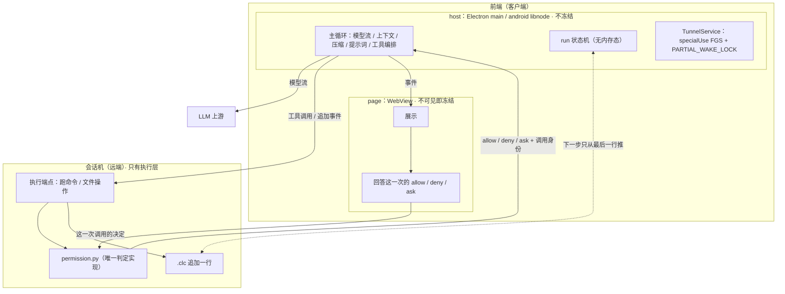

# Clutch 重构 TODO —— 主循环搬到前端，后端只剩执行层

> 本文是这次讨论的结论汇总，取代此前的 `PLUGIN_PLAN.md` / `PLUGIN_UI_PLAN.md` / `COMPONENTS.md` / `DECISIONS.md`（已在 `f811753`、`101d85e`、`5d773cb` 删除）。
> 基线：`HEAD = ca42859`（0.1.66）。工作区里 `M clutch-websearch` 是**用户未提交的 WIP**，不要 stage、不要回滚；`clutch-memory/`、`scanerr.py` 是未跟踪的临时物，不要提交。

---

## 0. 不变量（任何实现都不能违反）

| # | 规则 | 判据 |
|---|---|---|
| I1 | **前端 = 客户端整体**，含 host（Node 半边）与 page（WebView 半边）。会话机上没有主循环、没有 llm、没有提示词、没有上下文管理 | `agent/` 里找不到 run 状态机、模型客户端、prompt 文件 |
| I2 | **执行只有一个实现**：跑命令、文件操作、权限判定都在执行层；前端只显示、只回传“这一次调用的决定” | `agent/core/permission.py` 是唯一 allow/ask/deny 实现；`ui/js/permissions.js` 无判定逻辑 |
| I3 | **不降级、不兜底、不多版本共存**。出错就报错（写进 `.clc` 给用户看），绝不换一条路悄悄继续 | 全仓搜不到 “fallback / 兜底 / 降级 / 退回” 式的第二条路径 |
| I4 | **同名组件只存在于一侧**：要么前端、要么会话机，不共存 | 市场里没有同名两份；退役形态不残留 |
| I5 | **组件 = 贡献包**（提示词/事实、工具、纯数据/文件）。组件不必须是工具，可以既无工具声明也无调用入口；协议不得强迫每个组件声明并实现调用 | 无工具组件能通过声明校验并安装 |
| I6 | **锁屏不打断**是属性，不是运气：loop 无内存态，每一步可从 `.clc` 最后一行推出 | 杀进程/解冻后接着跑，没有独立的 “resume 功能” |

---

## 1. 术语（本仓固定含义）

| 词 | 含义 | 落点 |
|---|---|---|
| **host** | 客户端上跑 Node 的那一半，**属前端**，不是后端 | 桌面：Electron 主进程（`ui/package.json` `"main":"main.js"` → `ui/main.js`）；手机：app 进程内嵌 libnode（`NodeEngine.kt` `node::Start`）→ `android/host/index.js` → `android-host.js` + `UI_NODE` 那批 `ui/*.js` |
| **page** | 客户端上的 WebView / 渲染进程那一半；不可见即被冻结 | `ui/index.html` + `ui/app.js` + `ui/bridge-shim.js` + `ui/version.js` + `ui/js/*.js` |
| **前端** | host + page，两者都在用户自己设备上 | 同上 |
| **会话机** | 远端，只有执行层 | `agent/` 收缩后剩下的部分 |
| **桥** | page → host 的唯一通道 | 桌面 `ui/preload.js`（`ipcRenderer.invoke`）；手机 `ui/bridge-shim.js` → `127.0.0.1:8899` HTTP+SSE（`android/host/bridge-server.js`） |

判别 host/page 的实操规则：**被 `ui/main.js` 或 `android/host/*.js` 用 `require("./…")` 引的 = host；被 `ui/index.html` 的 `<script src>` 引的 = page。**（目录不能当判据：`ui/app.js` 是页面脚本。）

---

## 2. 目标架构



图里 `FGS` 与 host 是同一个框：前台服务保的是**进程**（host 跑在里面），保不了页面——这正是 loop 必须待在 host 的原因。它具体挡住哪些威胁、还缺哪两个信号，见第 9 节（P5）。

---

## 3. 已定决策（不再讨论）

| # | 决策 |
|---|---|
| D1 | 主循环在 **host**（前端里跑 Node 的那一半）。依据：`ui/llm-proxy.js` 已经在 host 里做长连接流式上游请求且手机屏幕关着也能跑；`ui/tunnel-ladder.js:14-19` 已把“策略不能待在会被冻结的那一半”写成规则；页面侧有冻结的实测记录（`ui/js/sse-stream.js:113`、`:140-160`） |
| D2 | `.clc` 写入 = **option A**：前端产出事件，执行层 append 一行 |
| D3 | 权限职责全在执行层；`agent/api/routing.py:78-81` 的 `/api/permission/respond`、`/api/permission/trust` 折进执行端点；`PermissionRequestEvent` 不再是 run 事件 |
| D4 | 近端推送**版本匹配**的后端到远端 → 不存在兼容矩阵 |
| D5 | 组件 ≠ 工具；组件可以没有声明、没有调用 |
| D6 | 手机前台服务类型 `dataSync` → **`specialUse`**（拿掉 6h/24h 上限） |
| D7 | **不做** `BOOT_COMPLETED` 开机自启；保留 `START_STICKY` + `$HOME/tunnel.state` 的用户意图语义 |
| D8 | 前端搜索（websearch）只以前端组件形态存在；cli 形态彻底删除 |
| D9 | 客户端**可以**在会话机上主动卸载已退役组件（P0-7 的前提已批准） |
| D10 | `ui/js/components-panel.js:118-123` 的 exec-bridge 路径**不算**降级 → 保留，不改代码 |
| D11 | Android 的客户端插件域排在**桌面版发布之前**（P1-6 是发布的前置条件，不是发布后的活） |
| D12 | 模型流的 mid-stream 重试**保留**；取代价是“每次重试都必须是 `.clc` 里的一条事实”，不是页面上的 toast |
| D13 | `plugin.md` 不存在，不再查找；HEAD 就是全部，`agent/prompts/*` 与 `README*` 即为文档全集 |

**执行顺序**：P0 → P1-1…P1-5 → **P1-6（Android 客户端插件域，发布前必需）** → P2 → P3 → P4 → P6。P5（手机保活）与 P2–P4 无冲突，可随时并行插入，建议越早越好（它只是原生层的两处小改动，但决定了“锁屏不打断”能不能被验证）。

---

## 4. 阶段一（P0）：契约与不变量，先删后建

> 目标：把“两条路”压成一条。此阶段不改运行行为，只删容忍与兜底，并把声明模型定死。

- [x] **P0-1 声明模型：按能力资产推导落点，删掉 `subject` 推导**
  - `ui/components.js` `destinationOf`：保留 `entry`+`starts` 的**冲突报错**；**删掉** “既无 `service`/`launch` 又无 `entry` ⇒ 报错” 那一条（无工具组件合法）。
  - 落点规则：`service`/`launch` → 会话机；`entry` → 客户端；两者皆无 → 该组件没有进程，只贡献提示词/事实/数据。
  - 已落地：`PLACE_*` 注释重写；`!starts && !what.entry` 现在返回 `PLACE_CLIENT`（不是错误）。Python `client_side` 早已同义，无需改。`tests/components-view.test.js` §13 改为断言“无错误 + 判决函数里不再有 declares-neither 字样”。
- [x] **P0-2 删除旧词容忍**：`agent/tools/catalog.py` 里 `interface` / `runs_on` 被“忽略”的那段改成**报错**；子模块声明里也不得再出现这两个词。
  - 已落地：`RETIRED_WORDS`、`Component.retired`、`_refine` 累积（精化后仍然拒绝）、`component_diagnostics` 为每个退役词发一条 fatal；原先“既无 service 又无 launch ⇒ 请声明 entry”的分支删除（与 P0-1 同一条不变量 I5）。`tests/catalog_test.py` 同步。
- [x] **P0-3 删除市场多级读**：`ui/components.js` 的 远端 → 缓存 → 内置快照 三级链，改为**读一次**，失败就报错 + 重试按钮。（`ui/market.snapshot.json` 保留为“市场索引的产物”，不再是运行时兜底。）
  - 已落地：`SNAPSHOT_FILE` / `INDEX_CACHE` / `originOf` / `cacheIndex` 删除，`readIndex()` 只读一次；`origin`/`note` 整套词汇从前端（`components.js` → `components-view.js` → `components-panel.js`）移除——只有一份索引，没有“哪份列表”可分辨；失败即空列表 + 一条原因 + `#plug-reload` 重试。
  - 快照不再是运行时资产：从 `ui/verify-build-config.js` 资产清单、`ui/electron-builder.yml` 打包、`scripts/sync-android-host.sh` 的 `UI_NODE` 全部移除；`ui/market.snapshot.json` 只作为 `scripts/market_index.py` 的产物/发布源保留。
  - 测试迁移：`tests/market.test.js` §5 改为“一次读 + 失败即报告 + HOME 上什么都没写”；`tests/market-chain.js` 现在回报 `homeFiles`（断言空）；`tests/net-fetch.test.js`、`tests/components.test.js`、`tests/components-view.test.js`、`tests/bridge-server.test.js`（改用 `CLUTCH_SOURCE_MIRROR` 指向假 supervisor，不再伪造缓存文件）同步。
- [x] **P0-4 exec-bridge 路径：保留（已判“不算降级”，见 D10）**：`ui/js/components-panel.js` 的说明与分支原样不动。它服务的是“会话机的组件通道没应答时，工具仍走直连执行”这一事实；注释里已经写清它与组件通道的区别（`an exec bridge is not a component channel`）。本条只需在验收清单里标为“有意保留”，避免后续误删。
  - **有意保留，不改代码。**
- [x] **P0-5 文案去机器化**：`ui/js/components-panel.js` 里 “the machine its declaration names” 与 `README.md` / `README.zh.md` 里 “Components are installed on the machine that runs the backend” 类句子，改成“由声明本身决定”。
  - 已落地：`plugPlaceName` 的未知落点改为 “the place its declaration names”（句子仍是名词短语，`from/on …` 都读得通）；两处注释改成“place”词汇；`README.md` §Components 与 `README.zh.md` §组件 改为“由组件自己的声明决定”，并把“远端→缓存→快照”的旧读法改成“只读一次、失败即报错 + 重试”。
- [ ] **P0-6 删除 websearch 的 cli 形态**
  - 子模块 `clutch-websearch/`：`websearch.py`、根 `component.json`（`interface:"cli"`、`launch`→`websearch.py`）、`pyproject.toml`、`tests/test_websearch.py`、`tests/conftest.py`、`tests/stub_server.py`。
  - `plugin/component.json`：`clutch-websearch-client` → `clutch-websearch`，去掉 `interface` / `runs_on`。
  - 主仓：`agent/config.py:90-99`（`web_search_timeout` / `web_search_max_results` / `tavily_api_key` / `searxng_url`）、`agent/tools/catalog.py:640-641`、`README.md:128-129`、`README.zh.md:112-113`。
  - ⚠ `M clutch-websearch` 是用户 WIP：改之前先确认，改完不要 stage。
- [x] **P0-7 退役组件必须能被撤掉**：`ui/components.js:1127+` `ensureComponents()` 只装不删 → 增加“已退役组件主动卸载”（**客户端可在会话机上删除组件：D9 已批准**）。首个要清的实例：本地 `~/.clutch/components/registry.json` 里的 `clutch-websearch 0.1.0+75ffbfe0`（cli 形态）。
  - 删除必须是**显式**的：一次安装会话里只清“市场已无、本机还留着”的名字，并在面板上说出删了什么；不做后台静默清理。
  - 已落地：`ui/components.js` 新增 `retireComponents()`，在 `ensureComponents()` 里**先于装**跑一次（同一个 deadline）——先撤后装，一个名字不会有一瞬间住在两侧（I4）。
    判据只有一份名单：市场行 + 本仓 checkout，逐个过 `destinationOf`。只撤两类：①名单里**完全没有**这个名字（市场已无、本机也没有 checkout）；②名单里判给了**客户端**（会话机上的那份必须走，客户端的域是 `ui/plugin-host.js`，不是这个端点）。
  - 反面的三种情形都不删：声明 `place: null`（更薄的 manifest、或自相矛盾的声明）**不是判决**，一个缺字段的发布不得抹掉一份能跑的安装；名单读取有任何一条出错、或名单为空，整段不跑（“读失败”不是“名单里没有”）；被拒（有进程在跑）落进 `errors`，组件留着，主机自己的句子照抄。
  - 显式与可见：每个名字一次 `DELETE`，每个名字一行 `progress`（`<name> <version> let go: <原因>`），`out.retired` 带 `{name, version, reason, status}`；`ui/tunnel-bootstrap.js` 的汇总行加 `retired=<名字,逗号分隔|0>`。没有静默清扫，也没有第二条清理路径。
  - 面板上说出来（2024 后续）：`installComponents(base, onPass)` 把同一次 pass 的答案交回调用方 → `ui/tunnel-connect.js` 存进 `state.componentsPass = {…, base}`（`ui/tunnel-core.js`）→ `ui/components-view.js` 的 `list()` 在 `pass.base === target(win).base` 时原样带出 `pass` → `ui/js/components-panel.js` 的 `plugPassLine()` 在列表下画一行（撤掉了哪些名字/版本/原因，以及“没能撤掉”的按主机原话）。只画一次、只在真有事时画；日志文件仍在，面板不再是唯一出口。`pass` 只属于它跑过的那台机器，别的机器上不继承。
  - 测试：`tests/components.test.js` §6c 起真 supervisor 验四种情形——“市场搬去客户端”“市场已无”都会撤且日志有名字，“无判决”与“名单读失败”都原地不动。`tests/components-view.test.js` §2b 验 `pass` 的三种答案（本机原样带出、别的机器不继承、读不出就不画）；`tests/components-panel.test.js` §39 验面板那一行（名字+版本+原因、一条移除=一句话不是一行、拒绝用主机原话、什么都没撤就不画）。
  - ⏳ 待验证（P0-6/P6-3 之后）：本机 `clutch-websearch 0.1.0+75ffbfe0` 现在仍被判给会话机（checkout 的 `launch` + 市场 manifest 还是 cli 形态），所以 P0-7 不会动它——这是对的（名单还要求它）。等 P6-3 把前端形态的 manifest 发出去，下一次连接时它会以“属于客户端”被撤掉；**P6-4 的装机复验必须在 P6-3 之后做**。
- [x] **P0-8 测试基线**：`tests/no-local-fallback-test.js`（4 条 FAIL）随 P0-3/P0-4 一起转绿；`tests/remote-bootstrap-e2e.js` 需要 `CLUTCH_E2E_HOST/USER/PASS`，跑不了的写进说明。
  - 已落地（P0-1…P0-7 之后各跑一遍，全部与既有基线一致或更好）：
    - node 全量：`tests/*.js` 除 `remote-bootstrap-e2e.js` 共 68 个文件全绿（`tests/no-local-fallback-test.js` 已 0 FAIL）。
    - `.venv/bin/python -m pytest tests/ -q` → `17 passed, 3 errors`：三条 error 全是 `tests/project_lock_test.py` 缺 `tmp` fixture（既有问题，非本次）。
    - `.venv/bin/python -m tests.catalog_test` → all passed。
    - `.venv/bin/python -m ruff check agent scripts` → 5 条既有错误，无一在被改文件里（`agent/config.py:10`、`stream_runner.py:50`、`agent/tools/answers.py:24`、`scripts/market_index.py:187`、`scripts/ui-render-bench/run.py:20`）。
    - `tests/remote-bootstrap-e2e.js`：需要 `CLUTCH_E2E_HOST` / `CLUTCH_E2E_USER` / `CLUTCH_E2E_PASS` 与一台真机，本环境跑不了；§13 已把这条连同需要的变量写在验收命令里，作为“需要凭据”单列，不当默认门禁。

**P0 完成判据**：全仓不再存在第二条读路径/降级路径；`plugin/component.json` 与市场条目里没有 `interface`/`runs_on`；市场只读一次。

---

## 5. 阶段二（P1）：主循环搬进 host

- [x] **P1-1 新建 host 侧 run 模块**（`ui/run-state.js` 折叠 + `ui/run.js` 循环）
  - 状态机：`start` → 迭代（模型 → 工具 → 模型 …）→ `final`；**无内存态**：每次进入循环都从 `.clc` 最后一条推下一步。
  - 取消：`stop` 只是一个意图标记 + 正在飞的那次调用被 abort；不依赖任何页面存活。
  - 已落地第一步：`ui/run-state.js` —— 纯折叠 `foldRun(events)`，从事件数组里答“这一轮开着吗 / 下一步是什么”：`idle+start`（没有 turn）、`model`（模型该说话）、`tool+calls`（这些调用还没有结果）、`final+{status,summary}`（答案已经在日志上、`final` 还没落）；并给出 `task`（本轮第一条 user_message）、`steps`（本轮已有几次模型回合）、`emptyReply`（空回复不是完成）、`at`（本轮在传入数组里的起点，方便按同一窗口再推一次）。
    - 只认 `DURABLE_TYPES` 六种（`user_message` / `assistant_message` / `tool_call` / `tool_result` / `final` / `compaction`）：`step_start`、各种 delta、`llm_retry`、`state_update`、`permission_request` 从不落盘，读了就是读一行不存在的日志。
    - 两处“看起来像猜”的地方是有意的：① 调用有记录、结果没有 ⇒ 仍答 `tool`（日志没记结果，重跑是对日志的诚实读法；要求不重复的副作用由工具自己做成幂等，不由循环猜）；② 助手回合有正文、`final` 没落 ⇒ 答 `final` 并用那句已落盘的正文收尾，而不是再问模型一遍。
    - 测试：`tests/run-state.test.js`（八个段落：词表、idle、开局、调用的四种残缺形状、答案没落 `final`、循环自己插的 user_message、跨 turn 边界、坏行不猜）。
  - 已落地第二步：`ui/run.js` —— 循环本身，全端口注入（`read` / `append` / `derive` / `model` / `runTool` / `text`），缺端口立刻 `TypeError` 报端口名。`start(task)` 落 `user_message`；`step()` 重读日志、折叠、只执行折叠给出的那一个答案（`idle` / `stopped→final aborted` / `tool` / `final` / 否则 `speak()`）；`drive()` 走到 `idle` 或 `final`，不会自行放弃。唯一的内存态是 stop 意图（外加正在飞的那次 `AbortController`），`final aborted` 只由 `step()` 写，所以进程中途死掉也不会留下一条假的“已取消”。
    - 事件顺序照 `agent/loop.py`：助手消息（含 `tool_calls`、`reasoning`）先落，随后才是各条 `tool_call`（带 `ui`/`path_arg` 的默认值），每个调用一条 `tool_result`。`finish_reason == "length"` 只落一条 `user_message`（`max_tokens` 文案），不落助手消息、不执行那批调用；空回复落助手消息 + 循环自己的 `user_message` 再问。
    - 失败策略：模型/工具抛错时若已 `stop` 就收成 aborted `final`，否则原样抛出（一个字都不写，调用继续挂着等下一次 `step()`）。
    - 测试：`tests/run.test.js`（九个段落：端口、整轮、续跑、孤答案、空回复、截断、Stop 的四种位置、失败不吞、`start` 不变量、step 竞态、append 时间戳）。
  - 还没做：把组合根 `createRunHost`（`ui/run-host.js`，见 P1-4）接进 `ui/main.js` / `android/host`、真正的 append 端点（P2）、工具执行端口（P3）。`derive` 已经是真的（`createDerive`）。
- [x] **P1-2 模型客户端**（chat 线）：`ui/llm-client.js` —— 一轮流式对话 + 重试阶梯 + “循环要认的错误码”，与 `ui/llm-proxy.js` 共用上游拼接（为此 `ui/llm-proxy.js` 导出 `getAgent`）。
  - 保留的数字是 loop 的：`READ_TIMEOUT_MS = 240000`（`llm_read_timeout`，按**块间隔**计，每来一个字节就重开；流不断就永不因长而断）、`STALL_PROBE_MS = 20000`（`STALL_PROBE_S`）、`MAX_BACKOFF_MS = 60000`（D12 封顶）。
  - 事件翻译是 `chunk_handle.py` 的四处 handler 的直译：`reasoning` → `text` → `tool_call_start`/`tool_call_delta` → `finish`（`finish` 带累计正文、按 index 排好的调用、累计 reasoning）。同一个块里就把 name+arguments 送来的调用，仍然是 start 之后紧跟一条 delta——与 Python 一致。
  - 重试阶梯：`discard = 已交付`（一个事件都没交付时不必丢）；通知形如 `{type:"retry", attempt, max:0, code, discard, message:"… — retrying (N/…)"}`，不限次数，Stop 是唯一出口；退避 1,2,4,8,16,32 后停在 60。
  - 错误码照 `agent/llm/client.py`：`connection` / `timeout` / `api_error`（带 `providerMessage`）/ `context_window_exceeded`（400 + `/context/`）/ `cancelled`。传输层 reset、EPIPE、`ERR_STREAM_PREMATURE_CLOSE`、`socket hang up` 都归 `connection`。
  - **有意不搬**：Python 的线程 watchdog 与 `PATH_POLL_S`/`PATH_WAIT_MAX_S` 预检是为“阻塞读里停着一个线程”服务的；Node 自己拿 socket，静默超时就直接销毁这次尝试。探针只保留一个用处：区分“provider 在想”和“路没了”。
  - **两条线都在**：`chat`（`chunk_handle.py`）与 `responses`（`openai_responses_client.py` + `response_handle.py`）由同一个 `protocol` 设置选，请求体、事件翻译、收尾各自成块（`WIRES`）。responses 的三处桥：会话是 item 列表（message / function_call / function_call_output）、系统提示是顶层 `instructions`、工具是扁平的；`response.completed`/`response.incomplete` 收尾，`response.failed`/`error` 直接抛（窗口溢出仍归一成 `context_window_exceeded`），`max_output_tokens` 报 `length`。两种“体结束了”的含义分开：chat 缺 finish 块 = 截断（重试）；responses 本来就靠终止事件报结论，跌掉一个也只是把已到的内容当答案。
  - **延后项**：① 每条重试落一行 `.clc` 挂在 P2（host 还没有 append 通路，且 `DURABLE_TYPES` 与 `ui/run-state.js` 的“六种”契约、`tests/run-state.test.js`、Python 侧的读端要一起改）；② `keepalive.py` / `openai_base.repoint` 随 P1-3/P1-4 的上游管理一起做——`ui/llm-proxy.js` 已经持有上游与 key。
  - **重试（D12）**：`mid_stream_retry` 语义照搬——重试从零重发，`discard` 通知调用方丢掉刚死那次已交付的内容；loop 与压缩器本来就靠 accumulator 重建，所以两者都 opt-in。
  - 三条硬约束：① 每次重试产出一条事件（attempt 号 + 原因）并 append 进 `.clc`；② 退避到 60s 封顶、不限总次数（与 `ui/tunnel-ladder.js` 的 never-gives-up 同形），**Stop 是唯一出口**；③ 这里的“可见”指 `.clc` 里的事实——页面关掉、掉线，重试照样继续、照样记账。
  - 要删的是**实现方式**不是行为：`stream_runner.py:266` 的 `unbounded` 布尔（一个不带状态的 `while`）换成“每次尝试都是一条事件”。现在“死掉的客户端”表现为永久 spinner、没有错误，正是这个无状态循环造成的。这段要等 P1-4/P3 把桌面与手机都切到 `ui/run.js` 之后再删——现在删掉的是还在服役的代码。
- [x] **P1-3 上下文 / 压缩 / 提示词**：`agent/prompts/*.md`（244 行）与上下文裁剪逻辑搬进 host；提示词作为前端资源随 app 走。
  - 已落地第一步：**提示词随前端走**。`agent/prompts/*.md` 的 16 个顶层模板原样复制到 `ui/prompts/`，`ui/prompt.js` 是 `agent/prompts/__init__.py` 的直译：`load(name)` 每次读文件（dev 下改文案立刻生效，没有构建戳），`render(template, vars)` 是 `string.Template.safe_substitute` 的语义而非近似——`$name`/`${name}`、`$$` → `$`、`$1`/`${}`/结尾的 `$` 都是字面量、未知占位原样保留、值只代入一次（值里的 `$` 不再展开）、`undefined`/`null` 视为“没给”。`names(text)` 用同一套语法答“这个模板要哪些槽位”，`say(key)` 给 `ui/run.js` 的 `text` 端口供 `cancelled` / `empty_response` / `max_tokens` 三条文案。
    - **`$HOME` 不是槽位**：`env_windows_cmd.md` 说的是“这台机器上 `$HOME` 不存在”，渲染后那个 `$` 必须还在；`tests/prompt.test.js` 的槽位契约把 `HOME` 列为永不代入项。
    - `agent/prompts/{tools,errors}/` 留在后端（工具/执行层的措辞，P3）；`agent/prompts/*.md` 暂时是**同字节的第二份**——P4-1 与 `agent/core/{context,compaction}.py`、`agent/llm/*` 一起删。这期间的约束由测试守着：两边文件名集合相同、每个模板字节相同，删掉一边后自动只查 `ui/prompts/`。
    - 打包：`ui/electron-builder.yml` 的 `files:` 是全量 `ui/`，模板自动进 deb；手机侧 `scripts/sync-android-host.sh` 把 `prompt.js` 加进 `UI_NODE` 并 `cp -r ui/prompts "$NODEJS_PROJECT/ui/"`（模板由 `__dirname` 解析，只拷模块不拷目录 = 手机第一次要说话时 ENOENT），`tests/android-assets.test.js` 守住这条。
  - 已落地第二步：`ui/context.js` —— `agent/core/context.py` 的直译，纯函数、只吃数据。`deriveMessages({events, task, mode, components, shell, memory})`：最新一条 `compaction` 之前的历史不进上下文（头换成 `compaction_head.md`），窗口里的读写路径按 `tool_call.path_arg` 收集成 `compaction_files.md`（最近优先、去重、上限 6）；`toMessages` 投影 user / assistant（`content`、`reasoning_content`、`tool_calls` 按线的形状）/ tool 三类，`repairDangling` 强制配对契约（调用没有结果 ⇒ 只留正文、结果没主人 ⇒ 丢、空助手句 ⇒ 丢）；系统消息按 mode（`chat`/`work`，别的模式什么都不说）→ 组件自己的话 → 本地 shell（`bash`/`cmd`，`posix-sh` 零差异）→ 项目记忆锚（`recall.md`，只有真有 `path` 才写，只写文件名与大小）的次序拼接；本轮任务再用 `task.md` 注入一次，且只当日志首条 user_message **就是**这个任务时才把它从窗口里去掉（续聊时会话的第一句需求不能被抹掉）。`createDerive(facts)` 把会话事实钉住，返回的正是循环的端口形状 `({events, task}) => messages`——`tests/context.test.js` 里有一处把他接进真的 `createRun` 验证这个形状。
  - 已落地第三步：`ui/event-text.js` + `ui/compaction.js` —— `agent/events.py:event_text` 与 `agent/core/compaction.py` 的直译。`createCompactor(ports)` → `{shouldCompact, compact}`，字节算术贯穿全程：`shouldCompact()` 就是 `windowBytes >= contextWindowBytes` 一次比较，没有 token 估算。压的是**整个当前窗口**（已在内存里，零磁盘读）：只序列化 `user_message`/`assistant_message`/`tool_call`/`tool_result`（`final` 是这一轮的结论、`compaction` 是它自己带的头，都不是“说过的话”），投影共用 `eventText`，单个 tool_result 截 500 字符并留下 `\n[truncated]` 标记；`compaction.md` 的 `previous_summary` 取最新一条 `compaction` 的摘要，没有就写 `(none)`。成功后 append 一条 `compaction` 再把窗口滑到它 `log_offset` 的位置——历史不会第二次进入上下文。
  - 端口边界：注入 `read()` → `{items, windowBytes, cprStart, lastCompaction}`、`append(event)` → **已持久化**的事件（带 `log_offset`）、`slideWindow(offset)`、`stream({messages, tools, signal})`（正是 `ui/llm-client.js` 的 async generator）、`contextWindowBytes`；`cpr_start` / `window_bytes` / 窗口滑动仍是 `.clc` 日志层的事实（`agent/core/lazy.py:3-7,124-145`，窗口 = `[cpr_start, file_end)`），随 P2 接上。`onProgress` 可构造时给也可每次调用给，产出 `{type:"compaction_delta", chars, done, note}` 供页面原样广播；`retry` 事件照搬（`discard:true` 丢掉刚死那次的半截摘要并把计数归零）。
  - 失败不是策略问题：压不动就答 `false`，这一轮带着现有上下文继续（`<=1` 条事件 / 空摘要 / Stop / 调用出错都一样），并且**说出来**——`warn` 默认 `console.error("[clutch] …")`，同时补一条 `done:true` 的 delta，实时块不会永远转圈。没有第二条兜底路径。
  - `tests/event-text.test.js`（六种事件的文本、非字符串/未知事件的“什么都不说”、裁剪标记与前缀不占额度）与 `tests/compaction.test.js`（端口缺失即 `TypeError`、阈值、窗口为 1 不压、模板与 transcript、500 截断、200 字符节流、discard、成功 append + `slideWindow(log_offset)`、空摘要/异常/Stop 各自的 `false` 与告警、坏订阅者不致命）钉住以上。
  - 打包：`event-text.js`、`compaction.js` 已进 `scripts/sync-android-host.sh` 的 `UI_NODE`（`compaction.js` 依赖 `event-text.js`，`tests/android-assets.test.js` 的 require 闭包会守住）。
- [x] **P1-4 桥上的 run 命名空间**：桌面 `ui/main.js` 加 `ipcMain.handle("run:*")`；手机 `android/host/bridge-server.js` 加同语义 handlers。页面通过 `/events` **只作观察**：页面掉线不取消任何东西，“运行中”状态由 host 广播。
  - 已落地第一步（岔口已定，按推荐做）：`read` / `append` / `slideWindow` 三个端口改成 **async**，`state()` / `start()` 跟着 async（IPC handler 本来就 await）。**没有**内存日志缓冲：日志不在这个进程里（桌面走 supervisor HTTP、手机走 loopback bridge），缓存一份就等于有第二个真相来源，`kill -9` 会丢尾巴，正好破坏 I6。`derive` 与 `text` 仍是同步的纯函数。
  - 已落地第二步（压缩进了循环）：新增两个必填端口 `shouldCompact()` / `compact({signal})`，加一个可选端口 `observe(result)`（页面广播，失败被吞——画不出来的页面没有改变工作）。次序归 `work()`：只在**要问模型之前**查窗口，`shouldCompact()` → `compactTurn()`（把 `inflight` 的 `AbortController` 指过去，所以 Stop 能中断摘要）→ 返回 `true` 就答 `{did:"compact"}`，`drive()` 再读一遍、重新 derive；返回 `false` 则用现有消息继续；期间 `stopped` 就直接收成 aborted `final`。模型调用抛 `context_window_exceeded`（provider 的算法，不是我们的）时**强制压一次**再重问，压不动就原样抛——不编造一个 `final`（`agent/loop.py:214-235` 的直译）。
  - 已落地第三步（组合根）：`ui/run-host.js` 的 `createRunHost({log, llm, tools, session, contextWindowBytes, onEvent?, warn?})` → `{start, stop, step, drive, state}`（就是 `ui/run.js` 自己那五个答案，没有第二套状态机）。它把 `createRun` + `createDerive` + `createCompactor` + `prompt.say` 接在一起，并负责唯一一件事：**两套事件词表的对译**。`model` 端口每次都问 `tools.schemas()`（组件的启用/禁用在同一轮的两步之间也是真的），把 `llm-client` 的 `text`/`reasoning`/`tool_call_start`/`tool_call_delta` 译成页面既有的 `text_delta{content}`/`reasoning_delta{content}`/`tool_call_delta{tool_call_id,name,delta,ui}`，`retry` 译成 `llm_retry{attempt,max_retries,discard,message}`，`finish` 不译（答案由循环落盘）；返回的 `toolCalls` 每条按 `tools.ui(name)` / `tools.pathArg(name)` 盖上声明。`observe` 译成 `state_update{key:"execution_status",value}`：`idle` / `final` 且 `status==="error"` → `error`、`final` 的其它 → `finished`、其余 → `running`；host 自己的 `step`/`drive` 在抛出前再补一条 `error`（永远转圈的 spinner 不是错误信息）。
  - **发现并修掉的接线错**：`log.read()` 只有一种形状——压缩器的 `{items, windowBytes, cprStart, lastCompaction}`，而循环要的是事件数组。组合根里 `readEvents()` 做这个适配（丢掉 offset，`ui/run.js` 不认字节偏移），并且对 P2 提一条硬要求：`items` 必须回溯到**至少** `min(cprStart, 当前未闭合 turn 的第一行)`。压缩器自己按 `offset >= cprStart` 过滤，多出来的头它不花钱；而折叠是从“打开这一轮的那条 `user_message`”答出 `task` 的（`ui/run-state.js`），轮中的一次压缩会把那一行推到 `cprStart` 之前——只给窗口，续跑的那一轮就会带着空任务去问模型。
  - 测试：`tests/run-host.test.js`（74 条：端口逐个缺失即 `TypeError`、窗口必须是正数、一轮 model→tool→model→final 的完整账——`schemas()` 每次模型调用一次、`ui`/`path_arg` 盖上、`runTool` 收到 `{call,signal}`、日志里只有六种 durable 而 `onEvent` 只见 display、`state_update` 序列 running×3→finished、小窗口触发压缩且窗口滑到 `log_offset`、压缩后任务仍在上下文里、`retry`→`llm_retry`、工具抛错→先 `error` 再原样抛且不落 `final`、续跑那一轮照旧、Stop 用真的 `cancelled.md` 文案、空日志 `idle`）；`tests/run.test.js` 第 10 段是这套次序的契约。
  - 已落地第四步（IPC/bridge 接线）：`ui/run-session.js` 接进 `ui/main.js` 的 `run:start`/`run:stop`/`run:step`/`run:drive`/`run:state` ipcMain handlers（每窗口一个实例，`runInstances` Map，`win.on("closed")` 时 `stopAndFlush` 写 aborted final）；同步接进 `android/host/android-host.js` 的 `clutchRun` bridge namespace（单窗口，`runInst` 槽，`loadSessionRun()` 懒加载——phone 还不跑循环，P1-6 前 UI_NODE 不扩展）。`ui/preload.js` 暴露 `window.clutchRun{start,stop,step,drive,state,onEvent}`。Stop 收尾：`stopAndFlush(run)` → `run.stop()` + `drive()` 捕 rejection + `run.step()` 写 aborted final。
  - 端口接线：`derive: createDerive({mode, components, shell, memory})`、`model:` 上面的 `llm.ask` 翻译层（`tools` 来自 P3-1 的工具声明；P3 之前只跑无工具 turn）、`stream: llmClient.stream`（给压缩器）、`text: prompt.say`、`runTool` 到执行端点（P3-2）。广播：`state_update` + 各类 delta 走 `/events`，durable 六种只进 `.clc`。
- [ ] **P1-5 页面退为 view**：`ui/js/permissions.js` 只显示 `allow/deny/ask` + 回传用户对**这一次调用**的决定；`ui/js/sse-stream.js` 保持 `document.hidden → suspend / 回来 resync` 的姿态不变。
- [ ] **P1-6 Android 的客户端插件域（发布前必需，D11）**：`createPluginHost` 目前只在 `ui/main.js:165-182`；`android/host/android-host.js` 只有反向转发（`:48-50`）、没有插件宿主，`ui/js/components-panel.js:61` 的 `client:false` 即由此而来。移植是**真活**，且排在桌面版发布之前（`P6-3` 以本条为前置）。
  - 后果必须先接受：在这个域存在之前，手机上 `web_search` 会**报错**——这是正确行为（I3），不是要找兜底。

**P1 完成判据**：桌面与手机都能在 host 里跑完一次带工具调用的 turn，页面刷新/关闭不影响它。

---

## 6. 阶段三（P2）：`.clc` 走执行层（option A）

- [x] **P2-1 追加语义**：前端产出事件（D2），执行端点只负责 append 一行；`agent/core/persist.py`（32 行）的追加路径保持不变。
  - 已落地：新增 `agent/api/log.py` 的 `LogMixin`，三个端口进 `agent/server.py` 的 `Handler` 组合、路由在 `agent/api/routing.py:47-79`：`GET /api/log`（读）、`POST /api/log`（append）、`POST /api/log/window`（滑动 `cpr_start`）。
  - append 的答复是 `{offset, event}`——offset 就是那一行在**磁盘上**的字节起点（`log.append(ev)` 盖的 `log_offset`），host 拿它当 `slideWindow()` 的坐标，不需要自己算偏移。**只收 `DURABLE_TYPES` 六种**：`text_delta` / `state_update` / `llm_retry` / `permission_request` 一律 `not_durable` 拒绝并**保证文件不变**（展示词表不是日志；`ui/run-state.js` 只认六种，落一条不存在的行就是喂给折叠一行假事实）。非 JSON / 缺 `type` / 缺 `event` 同样拒绝。只读项目两个写端都答 `409 {"error":"project is read-only","code":"read_only"}`，读端照常工作。
  - `LazyEventLog.turn_start()`（`agent/core/lazy.py`，`aligned_start` 之后）答“当前未闭合 turn 从哪一行开始”：先看驻留区，行不够就按块**向前**读，读到文件头就答 0；turn 已闭合（有 `final`）则答 0（没有轮头可回溯）。这是 P1-4 那条硬要求的执行层答案。
- [x] **P2-2 窗口读取不变**：`agent/core/lazy.py`（318 行）按头部定宽字节偏移读 `[cpr_start, file_end)`；格式 `agent/project/format.py`（202 行）不动，**旧文件必须还能打开**。
  - 给 host 的 `read()` 端点答 `{project, items, windowBytes, cprStart, lastCompaction}`，且 `items` 回溯到 `min(cprStart, 当前未闭合 turn 的第一行)`（P1-4 的组合根要求）：模型上下文仍是 `[cpr_start, file_end)` 那段窗口，压缩器按 `offset >= cprStart` 自己过滤；多读的“轮头”只为一件事——折叠要靠打开这一轮的那条 `user_message` 答出 `task`，轮中压缩会把那一行推到窗口之外。
  - **头的确切含义**：不是“只那一行 task”，而是**从打开这一轮的那条 `user_message` 一直铺到 `cprStart` 的整段前缀**。原因是 `ui/context.js` 的 `deriveMessages` 在**最新一条 `compaction` 处**切片，压缩之前的历史本来就不会第二次进模型；而 `ui/run-state.js` 的折叠需要最新一条 `final` 之后的**整段**才能把这一轮折完整（`{pendingToolCalls}`、`steps`、`task` 都要）。给半截反而会让折叠漏掉一批调用。
  - **实现里发现并修掉的真 bug**（`_items`）：① 驻留列表只在打开时物化一次，滑动只搬边界，所以窗口必须再按 `offset >= cpr_start` 过滤一遍（与 `agent/core/compaction.py:91` 同一条判据），否则滑过之后旧记录还留在答复里；② `cpr_start` 被滑到**第一条驻留记录之下**时（反向滑动，格式允许任何区段起点），`[cpr_start, 第一条驻留)` 那段要从磁盘 `read_page` 补读，而不是静默截断——静默截断就是“看起来对了”的丢数据。docstring 里记了这两条理由。
- [ ] **P2-3 恢复即“无 resume 功能”**：冷启动/解冻后读日志尾部 → 未闭合的 turn 继续。验收见 §13。
  - 端口这一半已经成立（`GET /api/log` + `turn_start()`）；整条要等 P1-4 把 `createRunHost` 接进 `ui/main.js` / `android/host`（宿主进程重启后由它 `state()` → `step()`），所以本项留 `[ ]`。

**P2 完成判据**：进程被 `kill -9` 后重启，turn 从最后一条继续，`tools-enhence.clc` 之类历史文件仍可读。

---

## 7. 阶段四（P3）：工具编排在前端，执行在远端

- [x] **P3-1 工具声明与编排**：`agent/tools/catalog.py` 的声明解析/模式（1,031 行）并入 JS；工具目录与提示词片段属前端资源。
  - 已落地（声明层）：`ui/tool-decl.js` 是 host 的声明层——解析、按合并序 refine、`$config` / `$backends` / `$skills` 求值、按 mode/gate 过滤、`mutates` / `undo` / `pathArg` 派生；`ui/prompts/tools/` 是六个 `agent/prompts/tools/*.md` 的逐字节副本（P4-1 之前两边必须相同，`tests/prompt.test.js` 同时检查名字与字节）。`tests/tool_decl_dump.py` 是 Python 那边的 oracle（直接导出 `catalog.registrations()` 与派生结果），`tests/tool-decl.test.js` 拿它与 JS 逐字段比对——“搬过来”因此是被钉住的等价，不是重写一遍自己的假设。
  - 已落地（机器的那一半）：`GET /api/declarations`（`agent/api/decls.py` + `agent/api/routing.py` + `agent/server.py` 组合）一次答出 host 需要的八件事 `available` / `backends` / `config` / `declarations` / `facts` / `host` / `mode` / `project`，**永远 200**（没有项目是合法状态，不是错误）。`declarations` 是 `catalog.registrations()` 原样（合并序、不派生、`$config.<field>` 不展开——展开是前端的事）；`available` 说的是**代码**在不在（所以声明因 `interface` 一词被拒的 `clutch-websearch` 仍是 `true`）；`config` 只给被声明真的点过名的数值格子；`host` 是 `DEFAULTS` / `ACCESS` 参数 / `GATE_WORDS`。`tests/decl_api_test.py` 44 条钉住形状：秘密不外泄（`api_key` 与 `SECRET` 不出现）、未点名的开关不出现、`$config.read_max_chars` 在原文里保持未展开、`.clc` 字节不变、`GET /api/declaration`（少个 s）仍是 404。
  - 两处**故意**的差异，都是“前端比 Python 多说一句”：`tool-decl.js` 把非致命诊断按 `ignoring …` 说出来（Python 算了却从不显示），并且 `diagnostics()` 会返回它们；另有一个待决问题——`mutates` 现在照抄 Python（`tool.ui.mutates ?? (snapshot || host != null)`），于是 `grep_memory` / `read_memory` 报 `mutates: true`；要改得同时动 `registry.ui`、JS、`tests/tool-decl.test.js` 的固定值和 `tests/catalog_test.py:571-580`。
  - `access` / `access_arg` 不搬（D3：判定只在执行层），`path_arg` 搬了（`ui/context.js` 的 `compaction_files.md` 靠它收集文件）。
- [ ] **P3-2 执行调用**：每类工具在前端做参数与展示，实际动作打执行端点；`agent/tools/registry.py`(662)、`rendezvous.py`(763)、`components.py`(1013)、`recall.py`(303)、`agent/supervisor.py`(696)、`agent/procmgr/*` 收缩为**执行层的进程管理**。
  - 已落地第一半（执行端点）：`agent/api/exec.py` 的 `ExecMixin`，两个端口 `POST /api/exec`（一次调用）与 `POST /api/exec/cancel`（同一次调用的中断），路由在 `agent/api/routing.py:80-86`，`agent/server.py` 的 `Handler` 组合与端点清单同步。
  - 请求是 `{name, arguments, tool_call_id, mode?}`：`arguments` 只能是模型产出的**原始 JSON 文本**（权限判定读的是文本——它要 split 一条命令，不信一棵预解析的树），`tool_call_id` 必填（结果要按它配回调用，中断也要按它找到还在跑的进程），`mode` 与 `/api/run` 同一个词（工具的可用性本来就按 mode 过滤）。
  - 答复就是 `Envelope` 的三个字段 `{tool_call_id, content, is_error, diff}`：host 直接把它当 `tool_result` durable 事件 append，**不需要知道工具是什么**。执行端点自己不写任何事件（测试钉住了“日志里一条 `tool_result` 都没有”）。
  - 退回请求形状的两条：无项目 409、只读项目 409（`code:"read_only"`，与 `api/log.py` 的写端同一句话）。**工具做过的事一律 200 + `is_error`**：参数解析失败、未知工具、权限被拒、命令失败——变成 HTTP 错误就是把模型自己的错藏到 host 的重试后面。
  - `POST /api/exec/cancel {tool_call_id}`：`run_command` 这类工具轮询的就是这个 event（`transport.run(cancel=…)` 每 0.15 s 看一次，`_kill_tree` 后再答 `aborted`）。没有它，“客户端走开”就只能靠 socket 断开——而断开的 socket 杀不掉一个进程组。Stop（`POST /api/stop`）同样会 set 所有在飞的 event（`RunState.exec_cancels`），所以在 `/api/run` 退役之前页面的 Stop 也照样管用。
  - 前端一半已落地：`ui/tool-client.js` 把一次调用发成 `{name, arguments, tool_call_id, mode}`、把 `{content, is_error, diff}` 折成循环的 `{content, isError, diff}`；`is_error: true` 是**结果**（工具的错要喂给模型），只有请求本身答不了才抛（409 无项目 / 只读带 `code:"read_only"`）。Stop 先发 `POST /api/exec/cancel {tool_call_id}` 再丢掉那一头的连接（断开的 socket 杀不掉进程组），而 exec 请求本身**没有超时**——它可能正卡在一个等人的权限问答上。`ui/log-client.js` 是 P2 的三个端口：`append` 把答复里**旁边**的 `offset` 折到记录上成为 `log_offset`（压缩要滑到这个坐标），三个端口都不缓存、失败就是错误（空日志等于“这一轮结束了”，是断线能给出的唯一错误答案）。
  - 两份客户端都对着真的本地 HTTP 服务跑，不是对着自己的假设：`tests/log-client.test.js` 31 条、`tests/tool-client.test.js` 37 条（含 Stop 时同一 id 的 cancel 真的到达服务端）。
  - **已落地**：两个客户端（`ui/log-client.js`、`ui/tool-client.js`）已接进 `ui/run-session.js` 组合根，`tools.schemas()` / `ui()` / `pathArg()` 从 `ui/tool-decl.js` 接到 `tools` 端口，`run:*` 已在 `ui/main.js` 与 `android/host/android-host.js` 注册（P1-4 第四步）。
- [x] **P3-3 权限唯一实现**：`agent/core/permission.py`(484) 留下并只回答 `allow` / `deny` / `ask` + 那一次调用的身份；`routing.py:78-81` 折进执行端点。
  - 已落地：判定搬进 `agent/api/exec.py`——`PermissionGate` 的构造与 `agent/base.py:start_task` 完全同参（`evaluator` / `on_ask` 发 `PermissionRequestEvent` 给广播 / `auto_allow=cfg.non_interactive` / `is_attached` = 广播里有窗口在看这个项目 / `trust=state.trust_armed`），`require(name, arguments, workspace, registry.access(name), registry.access_arg(name))` 与 `loop.py:_execute_tool` 逐字相同。**判定实现只有 `core/permission.py` 一份**，调用方暂时有两个（旧的 `/api/run` 循环与执行端点），第二个随 P4-1 删循环一起消失。
  - 一个 `ask` 会**阻塞这一个请求**，直到 `POST /api/permission/respond` 回答它，或者 Stop 把它解成 deny；窗口不在时按 `DETACH_GRACE_S`（30 s）等一个能回答的窗口，然后如实答 “no user interface connected to confirm this action”——这条规则与一次在飞的 run 相同（SSE 抖动一秒不该把一次本可批准的读变成 deny）。
  - `RunState.gates` / `RunState.exec_cancels` 是这一次落地新增的两个格子：一次 turn 里可能同时挂着多个调用（一个 run 的 gate 只有一个槽，`state.gate`），而 `_permission_respond` 和 `_stop` 必须能找到**每一个**还答得了的门。留下的门就是再也答不了的会话，所以测试断言每个调用结束（无论成败）之后 `gates == []`、`exec_cancels == {}`。
- [x] **P3-4 事件模型**：`PermissionRequestEvent` 退出 run 事件序列（它是“一次调用的问答”，不是“这一轮的一步”）。
  - 已落地：它只在广播上走（页面画那个对话框），从不 append——`agent/events.py` 的 `DURABLE_TYPES` 六种里没有它，`POST /api/log` 会以 `not_durable` 拒掉它，执行端点的测试直接断言 `.clc` 里一条都没有。

**P3 完成判据**：前端仓库里没有任何权限判定分支；执行层不 import 任何模型/提示词模块。

---

## 8. 阶段五（P4）：删掉后端的循环与残留

- [ ] **P4-1 删除**：`agent/loop.py`(346)、`agent/llm/*`（~1,700，含 `keepalive.py` / `proxy.py` / `llm_clients/*` / `openai_base.py`）、`agent/api/run.py`、`agent/api/events.py`（合计 ~1,300 的 `/api/run`、`/api/stop`、SSE 订阅）。
- [ ] **P4-2 清理配置**：`agent/config.py:46` `llm_read_timeout`、`:52` `llm_max_retries`、`:90-99` 搜索相关。
- [ ] **P4-3 目标体量**：`agent/` 从 16,126 行 Python 收缩到 **约 2,000–3,000 行**。
- [ ] **P4-4 文档**：`README.md` / `README.zh.md` 的架构段落改写；`docs/android/*` 里“native shell 是舞台”的说法补上“host 才是跑 loop 的那半”。
- [x] **P4-5 `plugin.md`（已关闭，D13）**：仓库 HEAD 里不存在此文件（只有 `README*`、子模块 README、`agent/prompts/*`、`android/README.md`），用户确认不再查找。文档全集 = HEAD；“`plugin.md` 的内容已过时”这条意见因此落地为“没有这个文件，无内容需要改”。

**P4 完成判据**：`grep -rE "llm|prompt|stream" agent/` 只剩执行层必需项；`agent/` 行数进入目标区间。

---

## 9. 阶段六（P5）：手机锁屏 / 生命周期

> 结论先说：**能保持运行，但不能保证不被打断。**前者靠 P5-1/2/3，后者靠 I6。

- [x] **P5-1 前台服务换类型**（D6）
  - `AndroidManifest.xml`：加 `FOREGROUND_SERVICE_SPECIAL_USE`；`android:foregroundServiceType="dataSync|specialUse"`，并加
    `<property android:name="android.app.PROPERTY_SPECIAL_USE_FGS_SUBTYPE" android:value="coding agent turn in flight: model stream and ssh tunnel must outlive a locked screen" />`
  - `TunnelService.kt:174-192` `startForegroundCompat()`：API 34+ 用 `FOREGROUND_SERVICE_TYPE_SPECIAL_USE`，34 以下 `DATA_SYNC`（平台兼容分支，不是降级）。
  - 已落地：manifest 的权限、type 掩码、subtype property 与注释都改成“一轮在飞的 turn”，`startForegroundCompat()` 现在是三段（≥34 specialUse / ≥29 dataSync / <29 两参），`dataSync` 只剩在 34 以下的分支里（34 的 6h 预算正好落在那条不用的分支）。`tests/android-fgs.test.js` 静态钉住：type 掩码、两个权限、subtype 非空且说明用途、服务不 exported、34 分支在 dataSync 分支之上（dataSync 一旦挪到上面就会在 34+ 生效）、targetSdk/compileSdk ≥ 34、D7 无 `BOOT_COMPLETED` 且 `START_STICKY` 还在。Kotlin 真机编译要在有 SDK 的机器上做（本环境无）。
- [ ] **P5-2 唤醒锁的持有条件补一个信号**
  - 现状：只有 `wantsTunnel()`（`$HOME/tunnel.state == "up"`，`TunnelService.kt` + `android/host/android-host.js:152`）。**缺陷**：turn 开局的模型调用不需要隧道，隧道关着时锁会被放掉，屏一黑 CPU 就挂起。
  - 改法：`$HOME/run.state`（`"busy"` / 其他）由 host 写，service 只读；`want = wantsTunnel() || runBusy()`。native 仍然只读不猜。
  - ⛔ 依赖 P1-4：`run.state` 的写方是 host 的 run 命名空间（`run.start` / `step` / 收尾时写，页面掉线也照写）。在它存在之前只改 native 等于让 service 去读一个永远不存在的文件——那是猜，不是信号。落地时必须在同一处把“谁写、什么时候清”钉死，不然锁会永久持有。
- [ ] **P5-3 电池豁免的提示时机**：现在只在“有隧道意图”时问一次（`batteryExemptionAsked`）；改成“存在在飞的 turn 且未豁免”时提示一次（不要每次 turn 弹）。
  - ⛔ 同上，判据要读 `$HOME/run.state`，随 P5-2 一起做；提示只一次，且由页面读 host 广播的 busy 状态，不在 native 里猜。
- [x] **P5-4 不做开机自启**（D7）：不加 `BOOT_COMPLETED`；`START_STICKY` 与现有语义保持。
  - 已落地（本就是现状，现在由 `tests/android-fgs.test.js` §5 守住）：manifest 与 service 里都没有 `BOOT_COMPLETED`，也没有 `RECEIVE_BOOT_COMPLETED` 权限；`START_STICKY` 原样。
- [ ] **P5-5 验收实验**：锁屏 10 分钟、中间走一次工具调用 → 看 `.clc` 里那几步时间戳是否连续跨过锁屏；若停在半路，logcat 的 `[wake] CPU released: …` 会指出锁在哪一刻丢了。

**P5 完成判据**：`android/README.md` 记录实测结果（含机型、是否已给豁免），并如实写明“未授予豁免时 Doze 会断网 + 忽略 wake lock”。

---

## 10. 阶段七（P6）：市场与发布

- [ ] **P6-1 刷新索引**：`scripts/market_index.py --write` 重生成 `market/entries.json`（schema 2）与 `ui/market.snapshot.json`；`--check` 作为门禁。
  - 顺手修掉既有 ruff `E501 scripts/market_index.py:187`。
- [ ] **P6-2 市场条目**：`clutch-websearch` 只剩前端形态（`entry` + 无 `service`/`launch`）；同名不得同时出现在两侧（I4）。
- [ ] **P6-3 发布**：`clutch-websearch` 前端版本（manifest + digest）需要用户或凭据——当前环境发不出去。**前置：P1-6（Android 客户端插件域）必须先落地（D11）**。
- [ ] **P6-4 装机复验**：本机 `~/.clutch/components/registry.json` 里那条 `clutch-websearch 0.1.0+75ffbfe0`（cli）必须被 P0-7 清掉。

---

## 11. 本轮 5 问 5 答（已全部关闭，无阻塞项）

| # | 问 | 答 | 落点 |
|---|---|---|---|
| D-1 | 客户端可以在会话机上主动卸载已退役组件吗？ | **可以** | D9 → P0-7 |
| D-2 | `ui/js/components-panel.js:118-123` 的 exec-bridge 路径算不算“降级”？ | **不算** | D10 → P0-4（保留，不改代码） |
| D-3 | Android 的客户端插件域在桌面版之前还是之后？ | **之前** | D11 → P1-6（发布前置） |
| D-4 | 模型流的中途重试保留吗？ | **按推荐：保留，代价是可见** | D12 → P1-2 |
| D-5 | `plugin.md` 在哪里？ | **不找了** | D13 → P4-5（已关闭） |

至此没有需要用户再拍板的阻塞项。后续若出现新分叉，写进本表再动手。

---

## 12. 遗留副作用问题（不在本次主线，但要记账）

- [ ] **M1** `ui/tunnel-bootstrap.js` 的“活进程身份校验”：桌面 app 还是 0.1.57，会复用任何占着 8890 的进程。
- [ ] **M2** `save_memory` / `search_memory` 报 `GET /api/clc → 404`（`clutch-memory` 退役后没人服务 `/api/clc`）——所以本轮的决定只存在于对话与本文里。
- [ ] **M3** 既有 ruff 基线：`E501 scripts/market_index.py:187`。
- [ ] **M4** `scripts/market_index.py --check` 要读 github 上的 4 个 release manifest，而本开发环境到 github.com（以及 pypi.org）不通——`curl` 20 s 超时，`example.com` 却是 200——所以 §13 的市场门禁在本环境只能标为“跑不了”，不是被改坏了。同理 `tests/remote-bootstrap-e2e.js`。

---

## 13. 收尾验收（每阶段跑，不要攒到最后）

```bash
# 不降级
node tests/no-local-fallback-test.js            # P0-3/P0-4 之后必须 0 FAIL
python3 -m pytest tests/ -q                      # 主仓
python3 -m ruff check agent scripts --output-format concise

# 日志端点（P2）：76 条 ok，rc=0；起真 server、开真 .clc
python3 tests/log_api_test.py

# 执行端点（P3）：72 条 ok，rc=0；真跑命令、真问权限、真中止一棵进程树
python3 tests/exec_api_test.py

# 声明端点（P3-1）：44 条 ok，rc=0；八把钥匙、秘密不外泄、原文不展开
python3 tests/decl_api_test.py

# 市场
python3 scripts/market_index.py --check

# 前端
node tests/plugin-host.test.js && node tests/plugin-link.test.js \
  && node tests/plugin-server.test.js && node tests/components-panel.test.js \
  && node tests/market.test.js && node tests/bridge-shim.test.js

# host 主循环（P1-1/P1-2/P1-3/P1-4）
node tests/run-state.test.js && node tests/run.test.js && node tests/run-host.test.js \
  && node tests/llm-client.test.js \
  && node tests/prompt.test.js && node tests/context.test.js \
  && node tests/event-text.test.js && node tests/compaction.test.js

# host 的会话客户端（P2/P3）：真的本地 HTTP 服务，31 + 37 条
node tests/log-client.test.js && node tests/tool-client.test.js \
  && node tests/tool-decl.test.js

# 手机生命周期（P5-1/P5-4）
node tests/android-fgs.test.js

# 端到端（需要凭据）
CLUTCH_E2E_HOST=… CLUTCH_E2E_USER=… CLUTCH_E2E_PASS=… node tests/remote-bootstrap-e2e.js
```

**最终验收（一次说清什么叫做完了）**
1. 桌面：一次带工具调用的 turn 跑完，关掉窗口不影响它，重开窗口看到它还在跑。
2. 手机：同样的一次 turn，**锁屏 10 分钟**跨过至少一次工具调用，`.clc` 时间戳连续。
3. 手机：`kill -9` 掉 app 进程再打开，turn 从最后一条继续（不是从头，也不是停在半路）。
4. 会话机：`agent/` 只有执行层，且 `ps` 上看不到任何模型连接。
5. 市场：只有一个 `clutch-websearch`，且它是前端形态；本机 registry 里没有 cli 残留。
6. 全仓：搜不到第二条路径式的兜底。
7. 重连可见（D12）：拔网跑一次 turn → `.clc` 里能看到每一次尝试（attempt 号 + 原因），界面不会只剩 spinner；Stop 一定停得住；网回来之后同一次 turn 继续，不需要重开。
